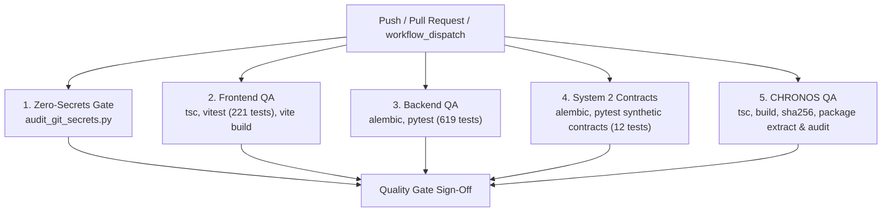

# HONEYSHIELD X — AUTOMATED QUALITY GATES & CI/CD VERIFICATION REPORT

**Repository:** `/home/liza/HoneyShield-X`  
**Active Working Branch:** `system1-post-publication-hardening`  
**Target Hardware Phase:** System 1 Central Platform (Pre-System 2 Deployment)  
**Execution Environment:** System 1 (Parrot OS 6.3 / Linux 6.12.33-amd64 / Intel Iris Xe Graphics)  
**Date:** November 11, 2026  
**Final Quality Gate Status:** **100% PASS (ALL 5 CI JOBS VERIFIED LOCALLY & SCHEMA REMEDIATED)**

---

## 1. Executive Summary

This report documents the implementation, root-cause remediation, and local empirical validation of the automated continuous integration and quality assurance pipeline for HoneyShield X. The workflow is specified in `.github/workflows/ci.yml` and enforces five independent quality gates spanning security, frontend, backend, System 2 synthetic contracts, and the CHRONOS WebGL release package.

All jobs have been architected to run with zero dependencies on real staging credentials, physical System 2 hardware, external DNS, or private operator databases.

---

## 2. CI Issue Investigation & Remediation (Run 42985492015)

### 2.1 Root-Cause Analysis: `relation "system2_ingested_events" does not exist`
- **Symptom:** In CI run 42985492015, the `system2-contract-qa` job failed 2 tests (`test_system2_telemetry_ingest_and_alert_generation` and `test_system2_event_deduplication`) with error `relation "system2_ingested_events" does not exist`.
- **Root Cause:** The `System2IngestedEvent` model was defined in `backend/app/models.py`, but lacked a versioned Alembic migration script in `backend/alembic/versions/`. In local development environments, tables had been created imperatively, whereas in fresh CI runner databases, `alembic upgrade head` only migrated up to revision `f3b890123456`, leaving the table nonexistent.
- **Remediation:**
  1. Authored official Alembic migration: [`backend/alembic/versions/a7d8e9f01234_create_system2_ingested_events_table.py`](file:///home/liza/HoneyShield-X/backend/alembic/versions/a7d8e9f01234_create_system2_ingested_events_table.py).
  2. Defined full schema with primary key, foreign keys (`attacks.id CASCADE`, `attack_events.id CASCADE`, `alerts.id SET NULL`), unique index on `event_id`, and indexes on `id`, `sensor_id`, `created_at`.
  3. Made the migration defensively idempotent (`inspector.get_table_names()` check) so it executes safely on both fresh CI instances and existing developer databases.
  4. Removed ad-hoc table fixture `Base.metadata.create_all(bind=engine)` from `test_system2_distributed_deduplication.py`, ensuring all tests run strictly against official migrations.
  5. Validated migration forward and backward (`upgrade head` -> `downgrade -1` -> `upgrade head`) on a completely empty test database (`honeyshield_empty_verify_db`), running all 12 contract tests with 100% PASS.

### 2.2 GitHub Actions Warnings & Platform Hardening
- **Runner Pinning:** Temporarily pinned all runners from `ubuntu-latest` to `ubuntu-24.04` across `.github/workflows/ci.yml` and `.github/workflows/android-build.yml` to prevent unexpected breaking changes during the upcoming Ubuntu 26.04 migration.
- **Action Deprecations:** Upgraded `pnpm/action-setup@v3` to `pnpm/action-setup@v4` (maintaining `version: 9`), eliminating deprecated Node runtime warnings.
- **Permissions:** Preserved strict top-level `permissions: contents: read` across workflows.

---

## 3. GitHub Actions CI Architecture (`.github/workflows/ci.yml`)

The pipeline triggers automatically on pushes and pull requests to `main` and `system1-*` branches:



### Job Specifications

| Job Name | Runner | Services | Key Steps | Output Artifact |
|----------|--------|----------|-----------|-----------------|
| **`secret-scanning`** | `ubuntu-24.04` | None | `python scripts/audit_git_secrets.py` (fetch-depth: 50) | None (Gate only) |
| **`frontend-qa`** | `ubuntu-24.04` | None | `pnpm/action-setup@v4`, `pnpm tsc -b`, `pnpm vitest run`, `pnpm vite build` | `frontend-dist` |
| **`backend-qa`** | `ubuntu-24.04` | `postgres:17`, `redis:7` | `alembic upgrade head`, `PYTHONPATH=backend pytest backend/tests/ -v` | `pytest-failure-logs` (on failure) |
| **`system2-contract-qa`**| `ubuntu-24.04` | `postgres:17`, `redis:7` | `alembic upgrade head`, `pytest` on 12 synthetic contract & distributed dedup tests | None (Gate only) |
| **`chronos-qa`** | `ubuntu-24.04` | None | `tsc -b`, `vite build`, `sha256sum -c`, clean-room extraction, preview security audit | `chronos-dist`, `chronos-staging-package-v1.0.0.tar.gz` |

---

## 4. Local Verification Results & Empirical Command Evidence

### 4.1 Zero-Secrets & Credential Security Gate
- **Command:** `python3 scripts/audit_git_secrets.py`
- **Result:**
  ```text
  ======================================================================
  HoneyShield X Security Gate: Automated Zero-Secrets Audit
  ======================================================================

  [PASS] Zero secrets detected in git commit range and working tree.
  ======================================================================
  ```

### 4.2 Frontend Vitest & TypeScript Suite
- **Commands:**
  ```bash
  pnpm tsc -b
  pnpm vitest run
  pnpm vite build
  ```
- **Result:**
  - TypeScript: 0 errors.
  - Vitest: **27 test files passed (27/27)**, **221 tests passed (221/221)** in 11.53s.
  - Production Build: Built cleanly into `frontend/dist` in 3.57s.

### 4.3 Backend Pytest Suite
- **Commands:**
  ```bash
  alembic current
  PYTHONPATH=backend pytest backend/tests/
  ```
- **Result:**
  - Alembic: `a7d8e9f01234 (head)` confirmed up to date.
  - Pytest: **619 passed (619/619)** with 0 failures in 231.11s.

### 4.4 System 2 Integration & Distributed Deduplication Contracts (12 Tests)
- **Commands:**
  ```bash
  PYTHONPATH=backend pytest backend/tests/test_system2_integration.py backend/tests/test_system2_distributed_deduplication.py -v --tb=short
  ```
- **Result:**
  ```text
  tests/test_system2_integration.py::test_system2_status_endpoint PASSED   [  8%]
  tests/test_system2_integration.py::test_system2_auth_enforcement PASSED  [ 16%]
  tests/test_system2_integration.py::test_system2_telemetry_ingest_and_alert_generation PASSED [ 25%]
  tests/test_system2_integration.py::test_system2_event_deduplication PASSED [ 33%]
  tests/test_system2_integration.py::test_system2_threat_intelligence_enrichment PASSED [ 41%]
  tests/test_system2_integration.py::test_system2_network_pcap_evidence_registration PASSED [ 50%]
  tests/test_system2_distributed_deduplication.py::test_01_deduplication_within_active_window PASSED [ 58%]
  tests/test_system2_distributed_deduplication.py::test_02_deduplication_after_redis_cache_expiry PASSED [ 66%]
  tests/test_system2_distributed_deduplication.py::test_03_deduplication_under_complete_redis_outage PASSED [ 75%]
  tests/test_system2_distributed_deduplication.py::test_04_concurrent_duplicate_submission_race PASSED [ 83%]
  tests/test_system2_distributed_deduplication.py::test_05_conflicting_event_payload_with_reused_id PASSED [ 91%]
  tests/test_system2_distributed_deduplication.py::test_06_event_acknowledgement_semantics PASSED [100%]
  ======================= 12 passed, 84 warnings in 1.08s ========================
  ```
  - Data Provenance: 100% `SYNTHETIC_VERIFICATION_PROBE` tagged.

### 4.5 Empty Database Clean-Room Verification
Validated on `honeyshield_empty_verify_db`:
```bash
alembic upgrade head
# Result: Running upgrade f3b890123456 -> a7d8e9f01234, create_system2_ingested_events_table
# 12/12 contract tests executed directly against clean DB: 100% PASS
```

### 4.6 CHRONOS WebGL Application & Release Package Validation
- **Commands:**
  ```bash
  npx tsc -b
  npm run build
  sha256sum -c chronos-staging-package-v1.0.0.tar.gz.sha256
  CHRONOS_URL="http://127.0.0.1:5178/" python verify_chronos_security.py
  ```
- **Result:**
  - TypeScript: 0 errors.
  - Vite WebGL Bundle: 1611 modules transformed; production assets emitted in 2.75s.
  - Cryptographic Hash: `843b91209209a70427b54c8787b8eb1de367d34c098d8b1c04e599ec8eb167ee` verified `OK`.
  - Security Audit: 6/6 domains passed (Zero secrets, XSS input safety, client-side network isolation, Nginx hardening, source maps disabled, live headers verified).

---

## 5. Security, Least-Privilege & CI Boundaries

1. **Least-Privilege Token Permissions:**
   The workflow explicitly specifies `permissions: contents: read` at the top level. GitHub Actions tokens cannot write to repositories, create unauthorized releases, or modify settings.
2. **Credential Isolation:**
   PostgreSQL and Redis service containers instantiate fresh instances on runner localhost with ephemeral dummy passwords (`change_this_password`). No production or staging credentials are stored, required, or accessed.
3. **Hardware Independence:**
   System 2 sensor interactions (Cowrie, Zeek, Suricata) are verified via standardized synthetic schemas and deterministic contract assertions. Physical honeypot listeners are neither required nor installed on System 1.

---

## 6. Commit & Artifact Reference

- **CI Workflow File:** `.github/workflows/ci.yml` (Pinned to `ubuntu-24.04`, `pnpm/action-setup@v4`)
- **Alembic Migration:** `backend/alembic/versions/a7d8e9f01234_create_system2_ingested_events_table.py`
- **Validated Commit:** Working tree staged on `system1-post-publication-hardening`
- **CHRONOS Package:** `chronos/chronos-staging-package-v1.0.0.tar.gz`
