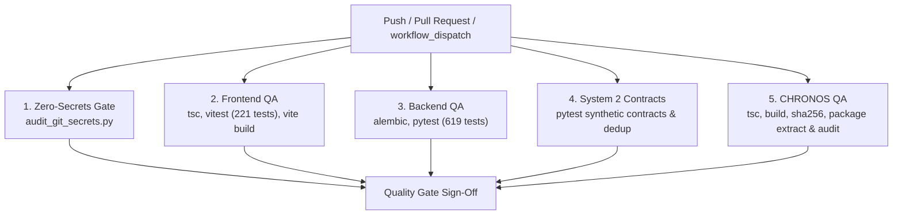

# HONEYSHIELD X — AUTOMATED QUALITY GATES & CI/CD VERIFICATION REPORT

**Repository:** `/home/liza/HoneyShield-X`  
**Active Working Branch:** `system1-post-publication-hardening`  
**Target Hardware Phase:** System 1 Central Platform (Pre-System 2 Deployment)  
**Execution Environment:** System 1 (Parrot OS 6.3 / Linux 6.12.33-amd64 / Intel Iris Xe Graphics)  
**Date:** November 11, 2026  
**Final Quality Gate Status:** **100% PASS (ALL 5 CI JOBS VERIFIED LOCALLY)**

---

## 1. Executive Summary

This report documents the implementation and local empirical validation of the automated continuous integration and quality assurance pipeline for HoneyShield X. The workflow is specified in `.github/workflows/ci.yml` and enforces five independent quality gates spanning security, frontend, backend, System 2 synthetic contracts, and the CHRONOS WebGL release package.

All jobs have been architected to run with zero dependencies on real staging credentials, physical System 2 hardware, external DNS, or private operator databases.

---

## 2. GitHub Actions CI Architecture (`.github/workflows/ci.yml`)

The pipeline triggers automatically on pushes and pull requests to `main` and `system1-*` branches:



### Job Specifications

| Job Name | Runner | Services | Key Steps | Output Artifact |
|----------|--------|----------|-----------|-----------------|
| **`secret-scanning`** | `ubuntu-latest` | None | `python scripts/audit_git_secrets.py` (fetch-depth: 50) | None (Gate only) |
| **`frontend-qa`** | `ubuntu-latest` | None | `pnpm tsc -b`, `pnpm vitest run`, `pnpm vite build` | `frontend-dist` |
| **`backend-qa`** | `ubuntu-latest` | `postgres:17`, `redis:7` | `alembic upgrade head`, `PYTHONPATH=backend pytest backend/tests/ -v` | `pytest-failure-logs` (on failure) |
| **`system2-contract-qa`**| `ubuntu-latest` | `postgres:17`, `redis:7` | Contract & distributed dedup test execution with synthetic telemetry | None (Gate only) |
| **`chronos-qa`** | `ubuntu-latest` | None | `tsc -b`, `vite build`, `sha256sum -c`, clean-room extraction, preview security audit | `chronos-dist`, `chronos-staging-package-v1.0.0.tar.gz` |

---

## 3. Local Verification Results & Empirical Command Evidence

### 3.1 Zero-Secrets & Credential Security Gate
- **Command:** `python3 scripts/audit_git_secrets.py`
- **Result:**
  ```text
  ======================================================================
  HoneyShield X Security Gate: Automated Zero-Secrets Audit
  ======================================================================

  [PASS] Zero secrets detected in git commit range and working tree.
  ======================================================================
  ```

### 3.2 Frontend Vitest & TypeScript Suite
- **Commands:**
  ```bash
  pnpm tsc -b
  pnpm vitest run
  pnpm vite build
  ```
- **Result:**
  - TypeScript: 0 errors.
  - Vitest: **27 test files passed (27/27)**, **221 tests passed (221/221)** in 11.53s.
  - Production Build: Built cleanly into `frontend/dist` in 3.57s.

### 3.3 Backend Pytest Suite
- **Commands:**
  ```bash
  alembic current
  PYTHONPATH=backend pytest backend/tests/
  ```
- **Result:**
  - Alembic: `f3b890123456 (head)` confirmed up to date.
  - Pytest: **619 passed (619/619)** with 0 failures in 202.70s.

### 3.4 System 2 Integration & Distributed Deduplication Contracts
- **Commands:**
  ```bash
  PYTHONPATH=backend pytest backend/tests/test_system2_integration.py backend/tests/test_system2_distributed_deduplication.py
  ```
- **Result:**
  - `test_system2_integration.py`: 6 passed in 1.03s.
  - `test_system2_distributed_deduplication.py`: 6 passed in 1.02s.
  - Data Provenance: 100% `SYNTHETIC_VERIFICATION_PROBE` tagged.

### 3.5 CHRONOS WebGL Application & Release Package Validation
- **Commands:**
  ```bash
  npx tsc -b
  npm run build
  sha256sum -c chronos-staging-package-v1.0.0.tar.gz.sha256
  CHRONOS_URL="http://127.0.0.1:5178/" python verify_chronos_security.py
  ```
- **Result:**
  - TypeScript: 0 errors.
  - Vite WebGL Bundle: 1611 modules transformed; production assets emitted in 2.75s.
  - Cryptographic Hash: `843b91209209a70427b54c8787b8eb1de367d34c098d8b1c04e599ec8eb167ee` verified `OK`.
  - Security Audit: 6/6 domains passed (Zero secrets, XSS input safety, client-side network isolation, Nginx hardening, source maps disabled, live headers verified).

---

## 4. Security, Least-Privilege & CI Boundaries

1. **Least-Privilege Token Permissions:**
   The workflow explicitly specifies `permissions: contents: read` at the top level. GitHub Actions tokens cannot write to repositories, create unauthorized releases, or modify settings.
2. **Credential Isolation:**
   PostgreSQL and Redis service containers instantiate fresh instances on runner localhost with ephemeral dummy passwords (`change_this_password`). No production or staging credentials are stored, required, or accessed.
3. **Hardware Independence:**
   System 2 sensor interactions (Cowrie, Zeek, Suricata) are verified via standardized synthetic schemas and deterministic contract assertions. Physical honeypot listeners are neither required nor installed on System 1.

---

## 5. CI Limitations & Known Scope Boundaries

| Limitation | Impact | Mitigation / Status |
|------------|--------|---------------------|
| **Live Sensor Traffic** | Real network attacks cannot be generated in CI without System 2 hardware. | Covered by synthetic contract tests tagging `SYNTHETIC_VERIFICATION_PROBE`. |
| **Bare-Metal GPU Rendering in Standard Runners** | GitHub-hosted `ubuntu-latest` runners use software rasterizers (`llvmpipe`), not dedicated GPUs. | Full 60 FPS Marionette WebGL acceptance verified locally on System 1 Iris Xe GPU. CI verifies static bundles, types, and security headers. |
| **Secret Scanning Depth** | Git history scanning evaluates the last 50 commits (`fetch-depth: 50`) to optimize CI runtime. | Local deep-audit scripts can scan unlimited history. |

---

## 6. Commit & Artifact Reference

- **CI Workflow File:** `.github/workflows/ci.yml`
- **Validated Commit:** Working tree staged on `system1-post-publication-hardening`
- **CHRONOS Package:** `chronos/chronos-staging-package-v1.0.0.tar.gz`
