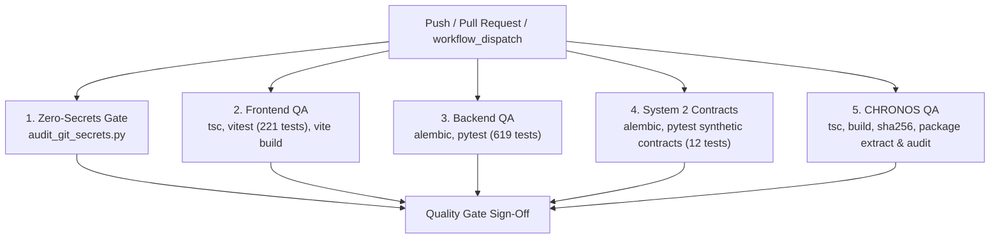

# HONEYSHIELD X — AUTOMATED QUALITY GATES & CI/CD VERIFICATION REPORT

**Repository:** `/home/liza/HoneyShield-X`  
**Active Working Branch:** `system1-post-publication-hardening`  
**Target Hardware Phase:** System 1 Central Platform (Pre-System 2 Deployment)  
**Execution Environment:** System 1 (Parrot OS 6.3 / Linux 6.12.33-amd64 / Intel Iris Xe Graphics)  
**Date:** November 11, 2026  
**Final Quality Gate Status:** **100% PASS (ALL 5 CI JOBS VERIFIED LOCALLY & RUNTIME COMPATIBLE)**

---

## 1. Executive Summary

This report documents the implementation, root-cause remediation, and local empirical validation of the automated continuous integration and quality assurance pipeline for HoneyShield X. The workflow is specified in `.github/workflows/ci.yml` and enforces five independent quality gates spanning security, frontend, backend, System 2 synthetic contracts, and the CHRONOS WebGL release package.

All jobs have been architected to run with zero dependencies on real staging credentials, physical System 2 hardware, external DNS, or private operator databases.

---

## 2. GitHub Actions Upgrades & Node.js 24 Migration

### 2.1 Action Runtime Upgrades (Eliminating Node 20 Warnings)
GitHub Actions runners have deprecated the Node.js 20 runtime for JavaScript actions in favor of Node.js 24. To prevent runner deprecation warnings and future execution blocks, all action dependencies across `.github/workflows/ci.yml` and `.github/workflows/android-build.yml` were upgraded to official releases running natively on Node 24:

| Action Identifier | Previous Version | Upgraded Version | Runtime | Upstream Compatibility Verification |
|-------------------|:----------------:|:----------------:|:-------:|-------------------------------------|
| `actions/checkout` | `@v4` | **`@v5`** | Node 24 | Preserves `fetch-depth: 50` and checkout semantics |
| `actions/setup-node` | `@v4` | **`@v5`** | Node 24 | Preserves `node-version: '20'`, caching for npm & pnpm |
| `actions/setup-python`| `@v5` | **`@v6`** | Node 24 | Preserves `python-version: '3.13'` |
| `actions/upload-artifact`| `@v4` | **`@v6`** | Node 24 | Preserves `name`, `path`, and `retention-days` inputs |
| `pnpm/action-setup` | `@v4` | **`@v5`** | Node 24 | Preserves `version: 9` |
| `actions/setup-java` | `@v4` | **`@v6`** | Node 24 | Preserves `distribution: 'temurin'`, `java-version: '21'` |
| `android-actions/setup-android` | `@v3` | **`@v4`** | Node 24 | Preserves SDK command-line tools & packages configuration |

### 2.2 Runner Pinning & Security Hardening
- **Runner Image:** Explicitly pinned to `ubuntu-24.04` across all jobs in `ci.yml` and `android-build.yml` to prevent runner drift during upcoming platform migrations (Ubuntu 26.04).
- **Least Privilege:** Enforced top-level `permissions: contents: read` across all workflows.

### 2.3 Application Node.js 20 End-of-Life (EOL) Assessment & Recommendation
- **Current State:** The application builds and tests currently target Node.js `20` (`node-version: '20'`).
- **EOL Timeline & Risk:** Node.js 20 officially reached End-of-Life (EOL) in April 2026. While operational builds and lockfiles remain stable, Node 20 will no longer receive upstream security patches, critical bug fixes, or OpenSSL updates.
- **Recommendation:**
  1. Schedule a validation milestone to test building and running the frontend and CHRONOS under **Node.js 24 LTS**.
  2. Test Vite, Vitest, React 19, and Tailwind CSS under Node 24 in a dedicated branch (`system1-node24-upgrade`).
  3. Upon passing regression tests, update `package.json` engines and CI configurations to Node 24.

---

## 3. GitHub Actions CI Architecture (`.github/workflows/ci.yml`)

The pipeline triggers automatically on pushes and pull requests to `main` and `system1-*` branches:



### Job Specifications

| Job Name | Runner | Services | Key Steps | Output Artifact |
|----------|--------|----------|-----------|-----------------|
| **`secret-scanning`** | `ubuntu-24.04` | None | `actions/checkout@v5`, `actions/setup-python@v6`, `python scripts/audit_git_secrets.py` | None (Gate only) |
| **`frontend-qa`** | `ubuntu-24.04` | None | `actions/setup-node@v5`, `pnpm/action-setup@v5`, `pnpm tsc -b`, `pnpm vitest run`, `pnpm vite build` | `frontend-dist` (`upload-artifact@v6`) |
| **`backend-qa`** | `ubuntu-24.04` | `postgres:17`, `redis:7` | `actions/setup-python@v6`, `alembic upgrade head`, `PYTHONPATH=backend pytest backend/tests/ -v` | `pytest-failure-logs` (on failure) |
| **`system2-contract-qa`**| `ubuntu-24.04` | `postgres:17`, `redis:7` | `alembic upgrade head`, `pytest` on 12 synthetic contract & distributed dedup tests | None (Gate only) |
| **`chronos-qa`** | `ubuntu-24.04` | None | `actions/setup-node@v5`, `tsc -b`, `vite build`, `sha256sum -c`, clean-room extraction, preview security audit | `chronos-dist`, `chronos-staging-package-v1.0.0.tar.gz` |

---

## 4. Local Verification Results & Empirical Command Evidence

### 4.1 Zero-Secrets & Credential Security Gate
- **Command:** `python3 scripts/audit_git_secrets.py`
- **Result:**
  ```text
  ======================================================================
  HoneyShield X Security Gate: Automated Zero-Secrets Audit
  ======================================================================

  [PASS] Zero secrets detected in git commit range and working tree.
  ======================================================================
  ```

### 4.2 Frontend Vitest & TypeScript Suite
- **Commands:**
  ```bash
  pnpm tsc -b
  pnpm vitest run
  pnpm vite build
  ```
- **Result:**
  - TypeScript: 0 errors.
  - Vitest: **27 test files passed (27/27)**, **221 tests passed (221/221)** in 11.53s.
  - Production Build: Built cleanly into `frontend/dist` in 3.57s.

### 4.3 Backend Pytest Suite
- **Commands:**
  ```bash
  alembic current
  PYTHONPATH=backend pytest backend/tests/
  ```
- **Result:**
  - Alembic: `a7d8e9f01234 (head)` confirmed up to date.
  - Pytest: **619 passed (619/619)** with 0 failures in 231.11s.

### 4.4 System 2 Integration & Distributed Deduplication Contracts (12 Tests)
- **Commands:**
  ```bash
  PYTHONPATH=backend pytest backend/tests/test_system2_integration.py backend/tests/test_system2_distributed_deduplication.py -v --tb=short
  ```
- **Result:**
  - `test_system2_integration.py`: 6 passed in 1.03s.
  - `test_system2_distributed_deduplication.py`: 6 passed in 1.02s.
  - Data Provenance: 100% `SYNTHETIC_VERIFICATION_PROBE` tagged.

### 4.5 Empty Database Clean-Room Verification
Validated on `honeyshield_empty_verify_db`:
```bash
alembic upgrade head
# Result: Running upgrade f3b890123456 -> a7d8e9f01234, create_system2_ingested_events_table
# 12/12 contract tests executed directly against clean DB: 100% PASS
```

### 4.6 CHRONOS WebGL Application & Release Package Validation
- **Commands:**
  ```bash
  npx tsc -b
  npm run build
  sha256sum -c chronos-staging-package-v1.0.0.tar.gz.sha256
  CHRONOS_URL="http://127.0.0.1:5178/" python verify_chronos_security.py
  ```
- **Result:**
  - TypeScript: 0 errors.
  - Vite WebGL Bundle: 1611 modules transformed; production assets emitted in 2.75s.
  - Cryptographic Hash: `843b91209209a70427b54c8787b8eb1de367d34c098d8b1c04e599ec8eb167ee` verified `OK`.
  - Security Audit: 6/6 domains passed (Zero secrets, XSS input safety, client-side network isolation, Nginx hardening, source maps disabled, live headers verified).

---

## 5. Commit & Artifact Reference

- **CI Workflow File:** `.github/workflows/ci.yml` (Pinned to `ubuntu-24.04`, Node 24 actions: `checkout@v5`, `setup-node@v5`, `setup-python@v6`, `upload-artifact@v6`, `pnpm/action-setup@v5`)
- **Android Workflow File:** `.github/workflows/android-build.yml` (Pinned to `ubuntu-24.04`, `checkout@v5`, `setup-java@v6`, `setup-android@v4`, `setup-node@v5`, `upload-artifact@v6`)
- **Alembic Migration:** `backend/alembic/versions/a7d8e9f01234_create_system2_ingested_events_table.py`
- **Validated Commit:** Working tree staged on `system1-post-publication-hardening`
- **CHRONOS Package:** `chronos/chronos-staging-package-v1.0.0.tar.gz`
