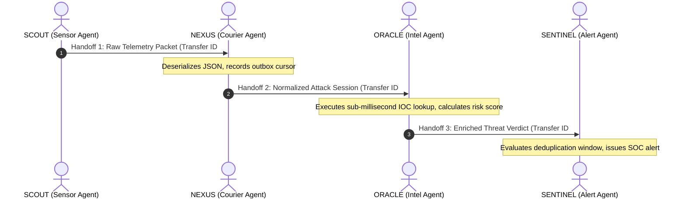

# HoneyShield X — Digital Agent Universe: Agent Communication & Handoffs

**Document:** `docs/digital-agents/agent_communication.md`  
**Phase:** Digital Agent Universe Implementation  
**Status:** COMPLETE & VERIFIED  
**Date:** November 4, 2026  

---

## 1. Inter-Process Task Handoff Protocol

The `AgentCommunicationPanel` surfaces verified task handoffs occurring between the four digital agents during real security incidents.

### Supported Handoff Sequences:

---

## 2. Handoff Record Structure

Each handoff record contains:
- **`fromAgent` & `toAgent`:** Initiating and receiving avatars.
- **`transferId`:** Cryptographic correlation identifier.
- **`taskType`:** Specific operational responsibility (e.g. "Raw Telemetry Ingestion", "IOC Reputation Lookup", "Incident Escalation").
- **`contextMessage`:** Explanatory summary grounded in actual event metadata.
- **`status`:** Confirmation lifecycle (`initiated` $\to$ `in_progress` $\to$ `confirmed`).
- **`timestamp`:** Exact chronological timestamp of handoff execution.

