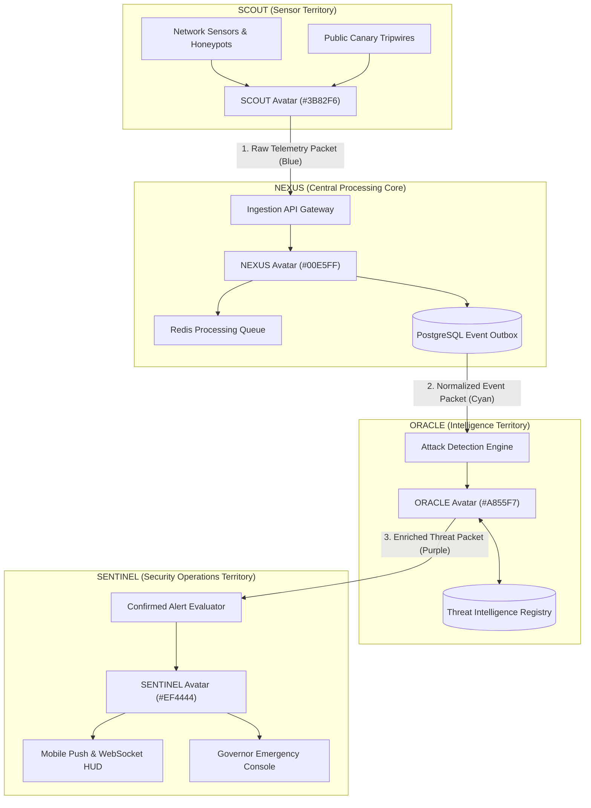

# HoneyShield X — Digital Agent Universe Architecture

**Document:** `docs/digital-agents/architecture.md`  
**Phase:** Digital Agent Universe Implementation  
**Status:** COMPLETE & VERIFIED  
**Date:** November 4, 2026  

---

## 1. Architectural Mission & Concept

The HoneyShield X Digital Agent Universe transforms the Unified Security Operations Platform into an interactive, living cybersecurity environment. Rather than viewing flat tables and static alerts in isolation, four autonomous digital robotic avatars embody and visualize the real-time operational journey of security information across the platform:

---

## 2. Core Subsystem Architecture

### 2.1 The Four Specialized Robotic Agents
1. **SCOUT (Sensor & Collection Agent, `#3B82F6`):**
   - **System:** System 1 / System 2
   - **Role:** Observes edge traps, detects port scans and brute force attempts, packages raw telemetry.
2. **NEXUS (Event Processor & Data Courier, `#00E5FF`):**
   - **System:** System 1 Core
   - **Role:** Central queueing, normalization, schema deserialization, monotonic cursor outbox persistence.
3. **ORACLE (Threat Intelligence & Analysis Agent, `#A855F7`):**
   - **System:** System 3
   - **Role:** Fast indexed IOC correlation, confidence decay scoring, attack session threat enrichment.
4. **SENTINEL (Alert & Emergency Response Agent, `#EF4444`):**
   - **System:** System 1 SOC Response
   - **Role:** Alert generation, deduplication, push notification dispatch, Governor Level-3 emergency containment.

### 2.2 Dual Operating Modes
- **OPERATIONS MODE:** The classic, dense SOC dashboard with 8 NEXUS command panels, MITRE ATT&CK progression matrix, alert triage tables, and forensic deep dives, augmented by the compact `CompactAgentRibbon` displaying live agent statuses.
- **UNIVERSE MODE:** An immersive full-screen experience with four territories, live SVG data bus, animated carrier mechanics, interactive packet inspectors, agent-to-agent communication feeds, and event journey replays.

### 2.3 Event Bus & Processing Flow
Security data travels across confirmed backend stages:
$$\text{Sensor Detonation} \longrightarrow \text{Ingestion Gateway} \longrightarrow \text{Outbox Commit} \longrightarrow \text{Detection Engine} \longrightarrow \text{Threat Intel Match} \longrightarrow \text{SOC Alert Dispatch}$$

No animation is permitted to display a completed stage before receiving verified confirmation from the underlying backend event stream.

