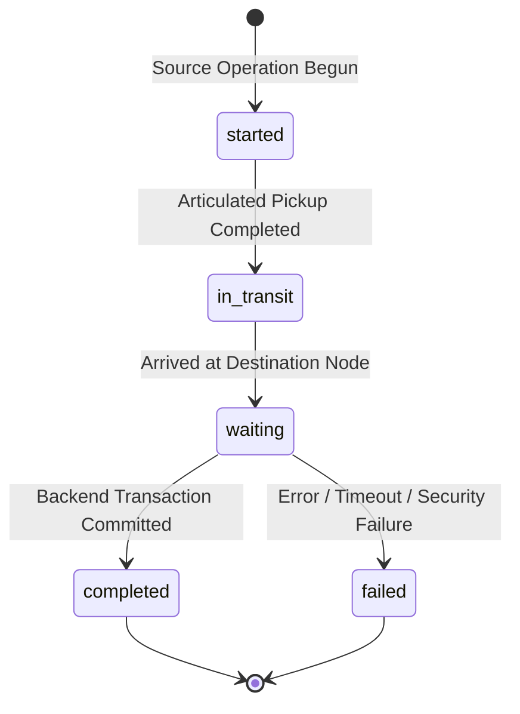

# HoneyShield X — Digital Agent Universe
## Milestone 2: Backend Event Contract & Transfer Lifecycle Specification

**Document:** `docs/digital-agents/milestone2_backend_event_contract.md`  
**Milestone:** 2 — Live Backend Integration, Real-Time Movement & Verified Agent Handoffs  
**Version:** 1.0  
**Status:** APPROVED & TESTED  

---

### 1. Overview & Architecture

The Milestone 2 Event Contract standardizes the transfer of security information across the platform, binding genuine backend events to the four autonomous digital agents:
- **SCOUT (`#3B82F6`):** Sensor Collection & Perimeter Ingestion.
- **NEXUS (`#00E5FF`):** Central Processing, Outbox Queueing & Persistence.
- **ORACLE (`#A855F7`):** Threat Intelligence, IOC Matching & Risk Correlation.
- **SENTINEL (`#EF4444`):** Confirmed Alerts, Mobile Push Dispatch & Governor Containment.

All events are strictly serialized into a typed, versioned lifecycle envelope and recorded transactionally in the PostgreSQL `security_event_outbox` table with monotonically increasing cursors.

---

### 2. Typed Schema Definition

#### Python / Pydantic (`backend/app/events/schemas.py`):

```python
class TransferLifecycleEvent(BaseModel):
    """Typed Digital Agent Universe transfer lifecycle schema (Milestone 2 Contract)."""

    event_id: str = Field(default_factory=lambda: str(uuid.uuid4()))
    transfer_id: str = Field(..., description="Unique transfer identifier e.g. tr_scout_101")
    workflow_id: str = Field(..., description="Associated workflow or attack container e.g. wf_attack_101")
    source: str = Field(..., description="Origin node identifier")
    destination: str = Field(..., description="Destination node identifier")
    agent: Literal["SCOUT", "NEXUS", "ORACLE", "SENTINEL"] = Field(..., description="Assigned digital agent")
    stage: str = Field(..., description="Processing stage e.g. ingestion, persistence, intelligence, alert")
    status: Literal["started", "in_transit", "waiting", "completed", "failed"] = Field(...)
    severity: SecurityEventSeverity = "info"
    timestamp: str = Field(default_factory=lambda: datetime.now(timezone.utc).isoformat())
    resource_id: str = Field(..., description="Primary resource ID e.g. attack container ID")
    schema_version: int = 1
    failure_reason: str | None = None
    payload: dict[str, Any] = Field(default_factory=dict, description="Sanitized operational metadata")
```

#### TypeScript Interface (`frontend/src/digital-agents/types.ts`):

```typescript
export interface TransferLifecycleContract {
  event_id: string;
  transfer_id: string;
  workflow_id: string;
  source: string;
  destination: string;
  agent: 'SCOUT' | 'NEXUS' | 'ORACLE' | 'SENTINEL';
  stage:
    | 'collection'
    | 'ingestion'
    | 'normalization'
    | 'persistence'
    | 'intelligence'
    | 'alert'
    | 'notification'
    | 'containment'
    | 'handoff';
  status: 'started' | 'in_transit' | 'waiting' | 'completed' | 'failed';
  severity: PacketSeverity;
  timestamp: string;
  resource_id: string;
  schema_version: number | string;
  failure_reason?: string;
  payload?: Record<string, any>;
  cursor?: number;
}
```

---

### 3. Canonical Node Mapping

| System Node Identifier | Human-Readable Node Label | System Subsystem | Owning Agent |
| :--- | :--- | :--- | :--- |
| `sensor:*` / `cowrie` / `trap` | Network Sensors & Honeypots | SYS 2 (Deception) | SCOUT |
| `ingestion_api` | Ingestion API Gateway | SYS 1 (SOC Core) | NEXUS |
| `queue` | Redis Processing Queue | SYS 1 (SOC Core) | NEXUS |
| `outbox_db` / `persistence` | PostgreSQL Event Outbox | SYS 1 (Database) | NEXUS |
| `detection_engine` / `detection`| Attack Detection Core | SYS 1 (Detection) | ORACLE |
| `threat_intel_store` / `intel` | Threat Intelligence Store | SYS 3 (Intelligence) | ORACLE |
| `alert_manager` / `alerts` | Confirmed Alert Evaluator | SYS 1 (Alerts) | SENTINEL |
| `soc_console` / `notifications`| SOC Push & Governor Console | SYS 1 (Operations) | SENTINEL |

---

### 4. Lifecycle Stages & Status Transitions



1. **`started` (progress 15%):** The event has been received by the source service. Character approaches the data packet.
2. **`in_transit` (progress 45%):** Data packet is locked in the character's hands as they physically translate along the curved SVG path.
3. **`waiting` (progress 85%):** Character arrives at destination landmark and pauses. In-flight confirmation is pending.
4. **`completed` (progress 100%):** Backend operation (e.g. outbox commit, IOC index, alert delivery) confirms success. Character triggers emerald delivery pulse.
5. **`failed` (progress 90%):** Backend operation fails (e.g. gateway timeout, DB error). Character enters warning pose, displays failure reason in red.

---

### 5. Sensitive Data Sanitization Policy

To uphold cybersecurity compliance and zero-trust logging principles:
- **No Credentials:** Plaintext passwords, authentication hashes, and session cookies are strictly stripped.
- **No Raw Payloads:** Heavy shell scripts or exploit binaries are omitted from visualization streams; only metadata (e.g. `source_ip`, `rule_name`, `alert_title`, `severity`) is distributed.
- **Role Enforcement:** Administrative containment commands require `command:stage_containment` permission to be viewed in real-time streams.

