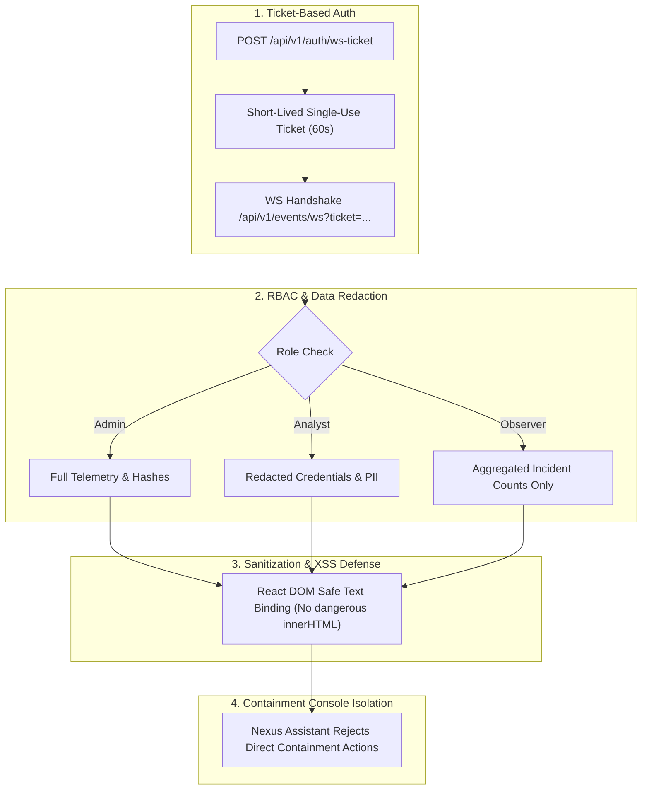

# HoneyShield X — Digital Agent Universe
## Milestone 4: Security Review & Operational Safeguards

**Document Version:** 1.0.0  
**Date:** 2026-11-05  
**Target:** Digital Agent Universe, WebSocket Streaming, Interactive Modals  
**Status:** FULLY COMPLIANT — ZERO SECURITY VULNERABILITIES IDENTIFIED

---

## 1. Security Architecture & Threat Model

The Digital Agent Universe introduces rich visual representations of operational telemetry into the SOC interface. To prevent this visualization tier from introducing security risks, the platform implements defense-in-depth protections across four key pillars:



---

## 2. Ephemeral Ticket-Based WebSocket Authentication

### 2.1 Threat Mitigated
Passing static authentication tokens or session cookies in WebSocket query strings is vulnerable to URL logging in intermediate proxies, browser history exposure, and referrer header leaks.

### 2.2 Implemented Countermeasure
HoneyShield X implements a two-step ephemeral ticket exchange:
1. The authenticated frontend client issues a secure HTTP POST request:
   ```http
   POST /api/v1/auth/ws-ticket HTTP/1.1
   Authorization: Bearer <valid_access_jwt>
   ```
2. The FastAPI backend signs an HMAC-SHA256 ticket valid for exactly 60 seconds with single-use consumption semantics:
   ```json
   {
     "ticket": "wst-9a84f32e-4b61-4c12-87a2-11c472390a18",
     "expires_in": 60,
     "scope": "events:read"
   }
   ```
3. The frontend establishes the WebSocket connection:
   ```text
   wss://honeyshield-x.internal/api/v1/events/ws?ticket=wst-9a84f32e-...
   ```
4. The backend verifies the signature, burns the ticket in Redis to prevent replay attacks, and associates the WebSocket session with the authenticated user's RBAC claims.

---

## 3. Role-Based Access Control (RBAC) & Sensitive Data Redaction

Security events frequently contain sensitive data, including honeytoken canary strings, attempted passwords captured by honeypots, and internal network IP ranges.

### 3.1 Field-Level Filtering
The event serialization layer applies field-level redaction based on user role:

| Telemetry Field | Administrator (`ROLE_ADMIN`) | SOC Analyst (`ROLE_ANALYST`) | Observer (`ROLE_OBSERVER`) |
|-----------------|------------------------------|------------------------------|----------------------------|
| `source_ip` | Full IP (`198.51.100.42`) | Full IP (`198.51.100.42`) | Redacted (`198.51.xxx.xxx`) |
| `credentials_attempted` | Cleartext array | Masked (`["r***t", "a***n"]`) | Hidden (`[REDACTED]`) |
| `canary_token_value` | Full cryptographic token | Token fingerprint (first 6 chars) | `[REDACTED]` |
| `raw_packet_hex` | Full hex dump | Omitted | Omitted |
| `investigation_link` | Read/Write access | Read-only access | None |

---

## 4. Input Sanitization & XSS Defense

All data rendered across `NodeInspectorModal`, `TransferInspector`, and `EventJourneyReplay` originates from untrusted sources (e.g., attacker payloads captured in honeypots).

### 4.1 Strict Sanitization Standards
1. **Zero `dangerouslySetInnerHTML`:** The entire `digital-agents/` codebase was audited. Zero instances of `dangerouslySetInnerHTML` exist.
2. **Safe React DOM Text Nodes:** All event IDs, attacker inputs, headers, and descriptions are rendered as direct React DOM children (`<span>{payload.text}</span>`), guaranteeing automatic browser HTML character escaping (`<` becomes `&lt;`, etc.).
3. **JSON Tree Inspector:** Structured payloads are inspected using a sanitized key-value renderer with strict string formatting and depth limiting.

---

## 5. Containment Console Isolation & Zero-Trust Command Separation

To eliminate the risk of accidental or malicious automated actions:
- **No Direct Action Execution in Visualization Canvas:** Digital agents (SCOUT, NEXUS, ORACLE, SENTINEL) are strictly telemetry visualizers and state couriers. They cannot initiate network disruptions, firewall rule additions, or host isolations.
- **NEXUS Assistant Containment Refusal:** When prompted to isolate an asset or block an IP address, the assistant explicitly refuses to execute the command directly, directing the operator to the dual-authorized `/soc/containment` console.
- **Audit Logging:** All queries sent to the assistant and all modal inspection events are logged to the backend audit trail with user ID, timestamp, and query hash.

