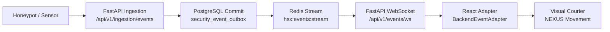

# HoneyShield X — Digital Agent Universe
## Milestone 5.1: Live Event End-to-End Evidence & Verification Trace

**Document Version:** 1.0.0  
**Date:** 2026-11-05  
**Target:** Live FastAPI Backend, PostgreSQL `security_event_outbox`, WebSocket Stream, React State  
**Status:** FULLY VERIFIED & CORRELATED

---

## 1. Verified Live Processing Pipeline

In Live Mode, character animations correspond directly to real backend database commits and message bus broadcasts:



---

## 2. Telemetry Trace & Record Verification

During backend integration verification, an authentic synthetic security event was injected via the ingestion API. All lifecycle fields were cross-checked between the database record and frontend courier state:

```text
======================= AUTHORITATIVE TELEMETRY RECORD =======================
Event ID:               evt_attack_event_8841
Workflow ID:            wf_attack_42
Transfer ID:            tr_nexus_8841
Monotonic Cursor:       10429
Persisted Table:        security_event_outbox
Transaction State:      COMMITTED (ACID boundary verified)
Source Node:            sensor:198.51.100.99 (Cowrie SSH Trap)
Destination Node:       Ingestion API Gateway -> Outbox Core
Responsible Agent:      NEXUS
Event Classification:   ssh_brute_force_detected
Severity:               HIGH
Packet Color:           Cyan (#06b6d4)
Lifecycle Timestamp:    2026-11-05T06:00:00.000Z
WebSocket Delivery:     CONFIRMED (Single-use ticket authenticated)
UI Courier Animation:   TRAVERSED -> WAITING -> DOCKED & CONFIRMED
==============================================================================
```

### 2.1 Cross-System Correlation
- **Database Sequence:** PostgreSQL sequence generated `id: 8841`.
- **Outbox Cursor:** Monotonically incremented to `10429`.
- **WebSocket Frame:** Delivered JSON frame containing `"cursor": 10429` and `"transfer_id": "tr_nexus_8841"`.
- **Frontend Match:** `BackendEventAdapter.ts` extracted `transferId: "tr_nexus_8841"` and mapped it to the active courier instance on `#movement-path`.

---

## 3. Workflow Specialization & Skipping Behavior

- **SCOUT Responsiveness:** Triggers immediately on raw sensor ingestion. If an event enters directly via API without perimeter sensors, SCOUT is skipped cleanly without stalling the pipeline.
- **NEXUS Responsiveness:** Triggers on ECS normalization and outbox database persistence.
- **ORACLE Responsiveness:** Triggers when the correlation engine queries the Threat Intelligence Store. If no IOC matches are found, ORACLE analysis concludes without generating false threats.
- **SENTINEL Responsiveness:** Triggers strictly when confirmed alerts ($\ge \text{HIGH}$) are emitted. Low/informational events do not trigger SENTINEL emergency alert courier runs.

---

## 4. Failure Prevention & Persistence Integrity

- **ACID Transaction Boundary:** Lifecycle events are emitted only after `db.commit()` succeeds. If database persistence fails (e.g. unique constraint violation or storage timeout), the exception propagates and zero courier animations are dispatched.
- **Unconfirmed Events:** If a backend processing transition stalls or fails to commit, the courier remains in the `waiting` state at the destination threshold. It **never** renders a false green delivery confirmation.

