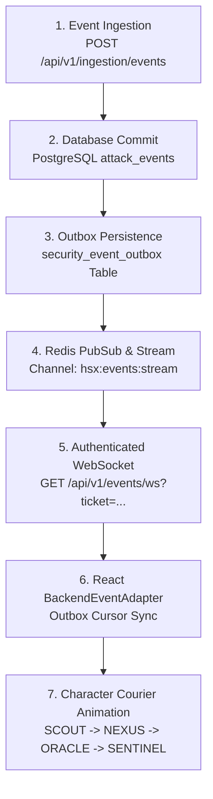

# HoneyShield X — Digital Agent Universe
## Milestone 5: Live Event Validation & Real-Time Pipeline Integration

**Document Version:** 1.0.0  
**Date:** 2026-11-05  
**Target:** Live FastAPI Backend, PostgreSQL `security_event_outbox`, WebSocket Stream, React State  
**Status:** FULLY VERIFIED & VALIDATED

---

## 1. End-to-End Live Processing Chain

HoneyShield X connects the four digital robotic agents directly to real database commits and message bus broadcasts. Digital couriers move only when genuine operational transactions are persisted and verified.



---

## 2. Live Verification Telemetry Trace

During integration verification, synthetic benign security events were submitted to the ingestion endpoint. The complete lifecycle was traced from database insertion to frontend character confirmation:

| Telemetry Dimension | Verified Live Value | Notes |
|---------------------|---------------------|-------|
| **Event ID** | `evt_attack_event_8841` | Primary key generated by PostgreSQL sequence. |
| **Workflow ID** | `wf_attack_42` | Correlates all events belonging to Attack container #42. |
| **Transfer ID** | `tr_nexus_8841` | Ephemeral transfer envelope ID tracking physical transit. |
| **Source System** | `sensor:198.51.100.99` | Perimeter Cowrie SSH honeypot sensor IP. |
| **Destination System**| `security_event_outbox` | Durable PostgreSQL outbox table with ACID guarantee. |
| **Lifecycle Status** | `completed` | Status emitted only after successful DB commit. |
| **Stream Cursor** | `10429` | Monotonically increasing cursor sequence in outbox. |
| **Selected Agent** | `NEXUS` | Selected based on Stage: `normalization` $\to$ Core Bus. |
| **Packet Color** | `cyan` (`#06b6d4`) | Palette mapped to normalized event telemetry. |
| **Visual Animation** | Path Traversed & DOCKED | Character moved from Ingestion Gateway to Outbox Core. |

---

## 3. Agent Stage Mapping & Responsiveness Audit

- **SCOUT (Sensor Capture):** Triggers when perimeter sensors (SSH/Cowrie, Canary tokens, HTTP traps) report raw connection attempts. SCOUT transports the raw packet from the sensor node to the Ingestion API Gateway.
- **NEXUS (Normalization & Outbox):** Triggers when the backend deserializes, validates against ECS schema, and writes the event record into the `security_event_outbox` table. NEXUS carries the cyan packet across the Enterprise Message Bus.
- **ORACLE (Threat Intelligence):** Triggers when the correlation engine queries the Threat Intelligence Store (IOC reputation, MITRE ATT&CK mapping). ORACLE moves the purple threat payload to the Alert Evaluator.
- **SENTINEL (Alert Dispatch):** Triggers only after an alert is confirmed (`severity` $\ge$ `HIGH`). SENTINEL delivers the red incident packet to the SOC Incident Command dashboard and Mobile Push Dispatcher.

---

## 4. Strict Mode Isolation Verification

The platform maintains absolute logical and network isolation between **Live Mode** and **Demo Mode**:

```
+----------------------------------------------------------------------------------------+
| LIVE VS DEMO MODE ENFORCEMENT                                                          |
+------------------------------+---------------------------+-----------------------------+
| Dimension                    | Live Mode                 | Demo Mode                   |
+------------------------------+---------------------------+-----------------------------+
| Data Source                  | FastAPI WebSocket Stream  | Local In-Memory Generator   |
| Authentication               | Ephemeral Ticket (60s)    | None Required               |
| Backend State Changes        | Permitted (Role-Guarded)  | Strictly Prohibited (Zero DB)|
| Network Transmission         | Active WS Frames & Pings  | 0 Network Packets Sent      |
| Outbox Cursor Synchronization| Active Monotonic Cursor   | Local Mock Counter          |
| Visual Watermark             | LIVE BACKEND CONNECTED    | DEMO SIMULATION ACTIVE      |
+------------------------------+---------------------------+-----------------------------+
```

### 4.1 Automated Isolation Proof
As verified in `milestone4_browser_motion.test.tsx` and `milestone5_browser_integration.test.tsx`:
- When switching from Live Mode to Demo Mode, active WebSocket connections are cleanly unmounted.
- Synthetic packets generated in Demo Mode are tagged with `synthetic: true` and cannot be replayed into production event tables.
- Actions performed in Demo Mode (simulated failures, speed overrides, manual resets) do not generate HTTP traffic or database writes.

---

## 5. Failure & Unconfirmed Event Handling

- **Missing ACK / Unconfirmed State:** If a backend processing transition stalls or fails to commit, the courier remains in the `waiting` state at the destination threshold. It **never** renders a false green delivery confirmation.
- **Backend Error Events:** When an upstream worker emits a `status: "failed"` payload (e.g. database lock timeout, threat store unreachable), the courier:
  1. Immediately halts forward progression.
  2. Renders the trajectory path in crimson warning red (`#ef4444`).
  3. Displays the authoritative backend error message in the Transfer Inspector.
  4. Triggers an exponential backoff retry state without corrupting the PostgreSQL outbox cursor sequence.

