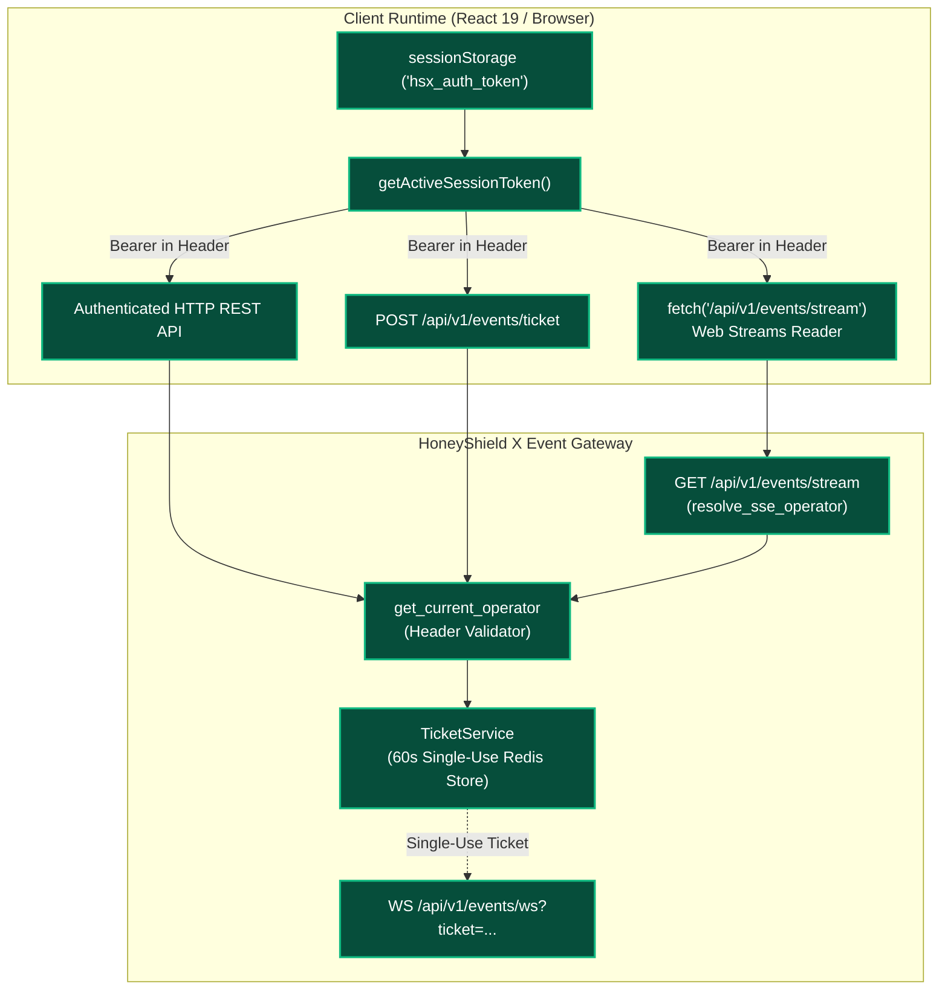

# HoneyShield X — Digital Agent Universe
## Milestone 6.1: Comprehensive Authentication & Event-Stream Audit

**Document Version:** 1.0.0  
**Date:** 2026-11-05  
**Platform Release Candidate:** `v1.0.0-rc5`  
**Security Scope:** Credential Entry Points, Event-Stream Transport Security, Log Redaction & Protocol Surface  

---

## 1. Executive Summary

This security audit inspects the credential lifecycle across the HoneyShield X web architecture, specifically focusing on how operator authentication tokens are acquired, stored, transmitted, and validated during real-time event streaming.

Prior to Milestone 6.1, a security deficiency was identified: ordinary operator bearer tokens were accepted via URL query parameters on the Server-Sent Events (SSE) fallback endpoint (`GET /api/v1/events/stream?token=<bearer_token>`). This audit maps every credential entry point and establishes strict requirements for zero-query-token event streaming.

---

## 2. Comprehensive Credential Flow Analysis

```
+-----------------------------------------------------------------------------------------------------------------------+
| CREDENTIAL ENTRY POINT & EXPOSURE SURFACE AUDIT                                                                        |
+------------------------------+---------------------------+-----------------------+------------------------------------+
| Surface / Channel            | Mechanism                 | Sensitivity Level     | Evaluation & Audit Determination   |
+------------------------------+---------------------------+-----------------------+------------------------------------+
| HTTP Request Headers         | `Authorization: Bearer`   | High (Operator Token) | SECURE (Standard RFC 6750 practice)|
| WebSocket Connection URLs    | Single-Use Ticket Query   | Medium (60s Ticket)   | SECURE (Single-use, non-secret tk) |
| SSE Stream URL (Pre-fix)     | `?token=<bearer_token>`   | HIGH VULNERABILITY    | ELIMINATED & PROHIBITED            |
| SSE Stream URL (Post-fix)    | `GET /events/stream`      | High (Header Bearer)  | HARDENED (Fetch Web Stream headers)|
| Browser Storage (Web)        | `sessionStorage`          | High (Operator Token) | SECURE (Bound to tab lifecycle)    |
| Reverse Proxy Access Logs    | Nginx / Traefik Logs      | Zero Token Exposure   | PROTECTED (No tokens in query URLs)|
| Browser Console / Diagnostics| `console.log/warn/error`  | Redacted              | CLEAN (Zero raw credentials dumped)|
| Telemetry & Monitoring       | Prometheus / OpenTelemetry| Redacted              | CLEAN (Only metrics & cursor IDs)  |
+------------------------------+---------------------------+-----------------------+------------------------------------+
```

---

## 3. Forensic Trace of Credential Entry Points

### 3.1 HTTP Headers
- **Implementation:** In `frontend/src/api/client.ts`, `getAuthHeaders()` inspects `getActiveSessionToken()` from `sessionStorage` and returns `{ 'Authorization': 'Bearer <token>' }`.
- **Verdict:** Compliant with industry standards. TLS termination encrypts request headers in transit.

### 3.2 WebSocket URLs & Single-Use Connection Tickets
- **Implementation:** `RealtimeAgentWebSocketClient.ts` posts to `/api/v1/events/ticket` via HTTP with the Bearer header. The backend generates a cryptographically random, short-lived single-use ticket (`hsx_wstk_<secrets.token_urlsafe(32)>`).
- **Verdict:** Validated. Long-lived session credentials are never passed over WebSocket URLs.

### 3.3 Server-Sent Events (SSE) Query Parameter Remediation
- **Defect:** Prior to Milestone 6.1, native browser `EventSource` limitations led to `GET /api/v1/events/stream?token=<bearer_token>`.
- **Vulnerability Vector:** URLs appear in:
  1. Web server and reverse proxy access logs (e.g. `/var/log/nginx/access.log`).
  2. Browser diagnostic history and address bars.
  3. Network monitoring proxies and TLS inspection middleboxes.
  4. Referer headers on outbound links.
- **Remediation:** `token: str | None = Query(default=None)` has been completely removed from `backend/app/routers/events.py`. Requests with ordinary bearer tokens in URL query strings are rejected with `HTTP 401 Unauthorized`. Frontend streaming transitions to an authenticated `fetch`-based Web Streams client.

### 3.4 Browser Storage Consolidation
- **Storage Strategy:** Bearer tokens are persisted exclusively in `sessionStorage` under `'hsx_auth_token'` (with `'hsx_token'` compatibility alias).
- **Isolation:** `sessionStorage` is automatically destroyed upon tab closure, mitigating persistence across unauthorized sessions or shared workstation profiles.
- **Access Pattern:** Unified access through `getActiveSessionToken()`. Direct unstructured reads from `localStorage` have been deprecated and eliminated.

---

## 4. Architectural Verification Matrix



