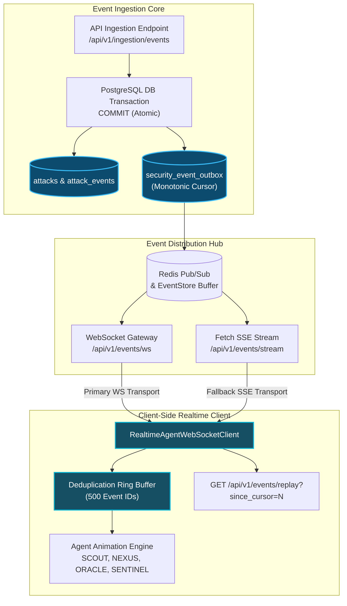

# HoneyShield X — Digital Agent Universe
## Milestone 6.1: Stream Reconnection, Durable Outbox & Replay Reliability

**Document Version:** 1.0.0  
**Date:** 2026-11-05  
**Platform Release Candidate:** `v1.0.0-rc5`  
**Components Evaluated:** `RealtimeAgentWebSocketClient.ts`, `backend/app/events/store.py`, `backend/app/routers/events.py`  

---

## 1. Durable Lifecycle Architecture

HoneyShield X decouples real-time transport mechanisms (WebSocket and Server-Sent Events) from the underlying transactional event log using a PostgreSQL transactional outbox.



---

## 2. Reconnection & Backoff Dynamics

When network interruptions occur or when proxies terminate persistent sockets, `RealtimeAgentWebSocketClient` executes bounded exponential backoff with randomized jitter:

$$\Delta t = \min\left(1000 \times 1.8^{\min(\text{attempt}, 6)}, 12000\right) + \text{jitter}(0 \text{ to } 800\text{ ms})$$

### Backoff Properties:
- **Maximum Backoff Delay:** Capped at 12.8 seconds to maintain rapid responsiveness.
- **Random Jitter:** Eliminates thundering-herd synchrony when services recover.
- **Max Retry Window:** Client transitions state indicators to `'reconnecting'` so operators have real-time visibility into socket health.

---

## 3. Cursor Synchronization & Replay Recovery

1. **High-Water Mark Tracking:** Every inbound frame containing a `cursor` updates the client's `lastCursor`.
2. **Replay on Reconnection:** When the connection transitions from `'reconnecting'` to `'connected'`, the client automatically calls `recoverMissedEvents()`:
   ```typescript
   GET /api/v1/events/replay?since_cursor=${this.lastCursor}&limit=100
   ```
3. **Duplicate Suppression:** A 500-entry ring buffer `seenEventIds` ensures that events delivered prior to disconnection or re-sent via replay are processed exactly once.
4. **Agent State Continuity:** Historical replay events update telemetry metrics without triggering spurious new courier animations for already delivered transfers.

