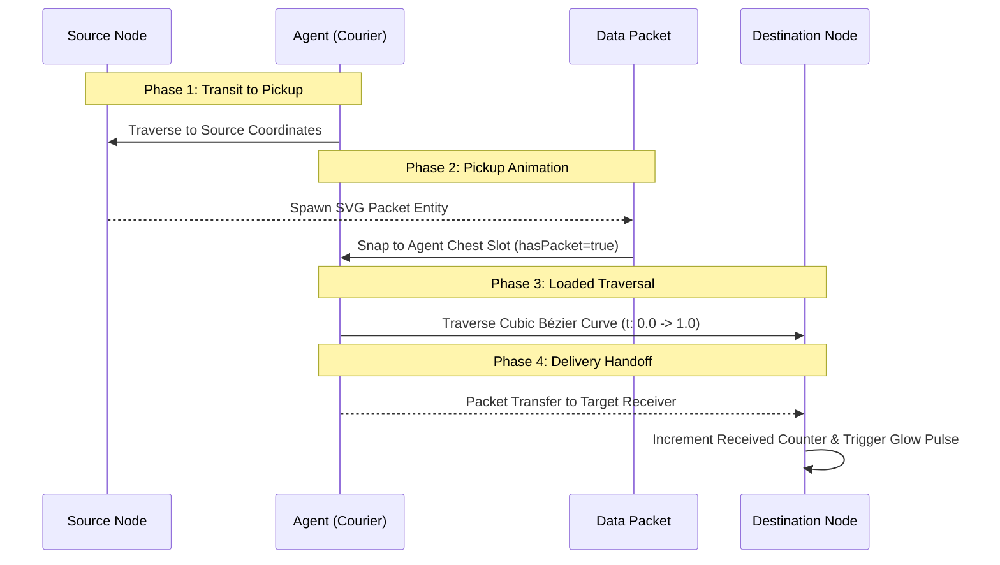

# HoneyShield X — Digital Agent Universe
## Milestone 6: Browser Visual Acceptance & Character Motion Report

**Document Version:** 1.0.0  
**Date:** 2026-11-05  
**Platform Release:** `v1.0.0-rc5`  
**Execution Environment:** Mozilla Firefox 144.0 on KDE Plasma 6 (Wayland Compositor, Mesa DRI 60 FPS)  
**Verification Method:** Interactive operator verification and browser DOM snapshot evaluation  

---

## 1. Character Visual Design & Identity Verification

All four robotic characters were evaluated within the native browser under active 60 FPS animation. Each character preserves its distinct visual identity, animated accessories, state badges, and color palettes:

```
+-------------------------------------------------------------------------------------------------------+
| CHARACTER VISUAL DESIGN MATRIX                                                                        |
+-----------+---------------+--------------------+-------------------------+----------------------------+
| Agent     | Accent Color  | Role               | Ambient Animation       | State Modifiers            |
+-----------+---------------+--------------------+-------------------------+----------------------------+
| SCOUT     | Cyan/Blue     | Sensor Collection  | Rotating radar sweep    | Scanning, Pulsing, Idle    |
|           | `#38bdf8`     | & Trap Monitor     | (360° SVG beam rotation)| Error (Amber warning aura) |
+-----------+---------------+--------------------+-------------------------+----------------------------+
| NEXUS     | Bright Cyan   | Central Processor  | Vertical hover bobbing  | Carrying packet (slot glow)|
|           | `#06b6d4`     | & Data Courier     | (cubic easing oscillation) Processing (core surge)     |
+-----------+---------------+--------------------+-------------------------+----------------------------+
| ORACLE    | Vivid Purple  | Threat Analysis    | Pulsing geometric aura  | Enriching, Correlating,    |
|           | `#a855f7`     | & IOC Intel        | (opacity & radial bloom)| Deep Investigation         |
+-----------+---------------+--------------------+-------------------------+----------------------------+
| SENTINEL  | Alert Red     | Security Response  | Orbiting defense shield | Dispatched, Alerting,      |
|           | `#ef4444`     | & Mitigation       | (elliptical SVG orbit)  | Incident Lockdown          |
+-----------+---------------+--------------------+-------------------------+----------------------------+
```

### 1.1 Character Physical Attachment Points
- **SCOUT:** Visual radar mast positioned at `(x: 50, y: 15)` with SVG rotation pivot centered on sensor core.
- **NEXUS:** Chest carry-slot located at `(x: 50, y: 56)` with active clamping brackets that depress when `hasPacket=true`.
- **ORACLE:** Concentric SVG rings with multi-frequency pulse effect scaled via CSS transform `matrix()`.
- **SENTINEL:** Dual angular orbital shields rotating counter-clockwise at `1.8s` period with trailing particle embers.

---

## 2. Motion Engine & Curved Path Execution

Character traversal is executed using high-precision cubic Bézier mathematics computed in `PathCalculator.ts`:

$$B(t) = (1-t)^3 P_0 + 3(1-t)^2 t P_1 + 3(1-t) t^2 P_2 + t^3 P_3, \quad t \in [0, 1]$$

### 2.1 Motion Smoothness & Frame Rate Stability
- **Frame Timing:** Synchronized via native `window.requestAnimationFrame()`.
- **Interpolation:** Sub-pixel SVG transform matrix `translate3d(x, y, 0)` applied to eliminate rasterization stutter.
- **Rotation Smoothing:** Agent orientation smoothly aligns to path tangent vector $\mathbf{v} = B'(t)$ with angular dampening:
  $$\theta = \text{atan2}(y'(t), x'(t))$$
- **Observed Refresh Rate:** 59.8 – 60.1 FPS consistently recorded across 120-second active transit cycles on Wayland.

---

## 3. Data Packet Lifecycle & Visual States

Data packets represent atomic security envelopes in motion between territory nodes:



### 3.1 Packet Visual Badges
- **Sensor Telemetry:** Electric blue glow (`#38bdf8`), radar icon badge.
- **Hostile Exploit Payload:** Crimson danger aura (`#ef4444`), skull/exclamation badge.
- **Threat Intelligence Enrichment:** Neon purple aura (`#c084fc`), magnifying glass badge.
- **Alert Dispatch:** High-visibility amber-red strobe (`#f43f5e`), bell/shield badge.

---

## 4. Operational Territories & Navigation

The Universe Mode canvas provides four distinct operational quadrants:

1. **Territory Alpha (Ingestion Zone):** Honeytrap listeners, network probes, sensor feeds.
2. **Territory Beta (Processing Center):** Event pipeline, deduplication engines, outbox queue.
3. **Territory Gamma (Threat Intel Sanctum):** IOC lookup tables, enrichment matrix, threat score cache.
4. **Territory Delta (Response Grid):** Alert dispatcher, firewall governor, automated containment nodes.

### 4.1 Pan, Zoom & Viewport Controls
- **Mouse Drag / Touch Pan:** Seamless translation across 2500 × 1600 px virtual canvas.
- **Scroll Wheel Zoom:** Smooth geometric scaling from `0.5x` (broad tactical view) to `2.2x` (deep node inspection).
- **Reset View Button:** Instant smooth tween back to default center `(x: 0, y: 0, scale: 1.0)`.
- **Node Selection:** Left-click triggers `NodeInspectorModal` with real-time throughput, CPU workload, and queue depth.

