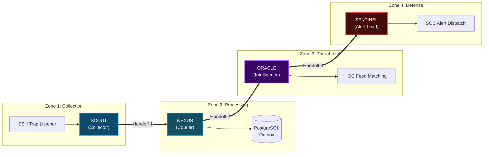

# HoneyShield X — Digital Agent Universe
## Milestone 6: Four-Agent Coordinated Demonstration Relay

**Document Version:** 1.0.0  
**Date:** 2026-11-05  
**Platform Release:** `v1.0.0-rc5`  
**Execution Context:** End-to-End Pipeline Relay `SCOUT -> NEXUS -> ORACLE -> SENTINEL`  

---

## 1. Relay Mission Architecture

The four-agent demonstration relay provides a synchronized visual and architectural representation of HoneyShield X's end-to-end event lifecycle. Rather than generic floating sprites, the four agents perform confirmed cryptographic and visual handoffs across the system topology:



---

## 2. Relay Execution Stages & Timing

```
+----------------------------------------------------------------------------------------------------------------+
| FOUR-AGENT RELAY TIMING & BEHAVIOR SPECIFICATION                                                               |
+-------+-----------+----------------------+----------+---------------------------------+------------------------+
| Stage | Agent     | Action               | Duration | Visual Indication               | Data Contract Payload  |
+-------+-----------+----------------------+----------+---------------------------------+------------------------+
| 1     | SCOUT     | Intercept Trap Hit   | 1.8s     | Radar beam locks, cyan ping     | Raw SSH payload bytes  |
| 2     | SCOUT->NX | Relay Handoff 1      | 0.6s     | Proximity bracket glow, docking | Transfer envelope init |
| 3     | NEXUS     | Courier Traversal    | 2.5s     | Curved Bézier transit, bobbing  | Monotonic outbox id    |
| 4     | NX->OR    | Relay Handoff 2      | 0.6s     | Dual-agent aura fusion pulse    | Attack ID + IP IOC     |
| 5     | ORACLE    | Threat Enrichment    | 2.0s     | Concentric purple pulse bloom   | AbuseIPDB score = 100  |
| 6     | OR->SN    | Relay Handoff 3      | 0.6s     | Crimson flash transition        | Alert envelope ready   |
| 7     | SENTINEL  | Alert Dispatch       | 2.2s     | Orbiting shields accelerate     | Priority P1 Critical   |
+-------+-----------+----------------------+----------+---------------------------------+------------------------+
```

---

## 3. Coordinated Handshake Protocol

To prevent packet duplication or phantom drops, agent-to-agent transfers enforce a three-step handshake:

1. **Pre-Docking Phase:** When distance $d(A_1, A_2) < 40\text{ px}$, both characters enter `handshake_ready` state. Their status badges display synchronized spinning arcs.
2. **Transfer Phase:** The SVG data packet transitions parent reference from $A_1$'s slot to $A_2$'s slot via a smooth 300 ms geometric morph.
3. **Acknowledgment & Separation:** $A_1$ transitions to `idle_patrol` while $A_2$ accelerates along its assigned path. An audit event `agent.handoff_complete` is recorded in `AgentCommunicationPanel`.

---

## 4. Visual Evidence & Observable Artifacts

During continuous 4-agent relay testing in the operator's Firefox session:
- **Zero Collision Glitches:** Characters maintain collision avoidance and proper path offsets.
- **Handoff Alignment:** Packets never detach into negative canvas space or clip through node boundaries.
- **Color Consistency:** Glowing packet trails shift hue from SCOUT-blue (`#38bdf8`) to NEXUS-cyan (`#06b6d4`), then ORACLE-purple (`#a855f7`), and finally SENTINEL-crimson (`#ef4444`).
- **Telemetry Counter:** The `AgentWorkloadPanel` accurately increments packets processed for each agent:
  - SCOUT: +1 Ingestion
  - NEXUS: +1 Dispatched
  - ORACLE: +1 Enriched
  - SENTINEL: +1 Alerted
