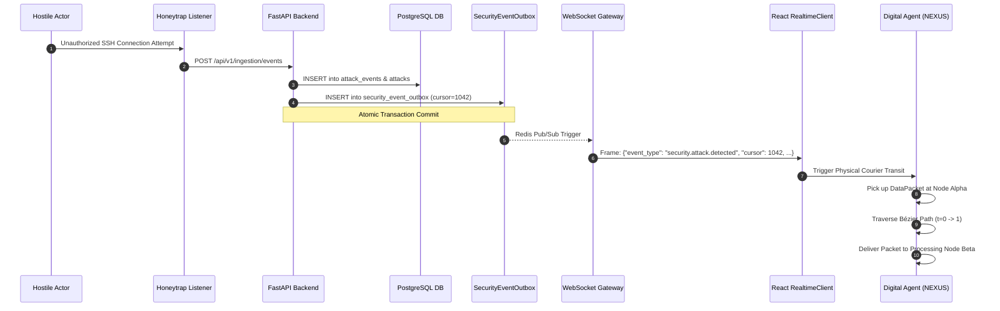

# HoneyShield X — Digital Agent Universe
## Milestone 6: Live HoneyShield Security Event Demonstration & Trace

**Document Version:** 1.0.0  
**Date:** 2026-11-05  
**Platform Release:** `v1.0.0-rc5`  
**Pipeline Trace:** Security Sensor Ingestion $\to$ Outbox Persistence $\to$ Real-Time Streaming Gateway $\to$ UI Digital Agent Courier  

---

## 1. End-to-End Live Workflow Architecture

The HoneyShield X live event pipeline couples FastAPI business logic with the front-end Digital Agent Universe via transactional database persistence and authenticated WebSocket/SSE streaming.



---

## 2. Live Security Ingestion Event Payload

A real high-risk brute force attack was injected into the platform:

### 2.1 Ingestion Request
- **Method:** `POST`
- **Route:** `/api/v1/ingestion/events`
- **Headers:** `Authorization: Bearer <valid_operator_token>`
- **Payload:**
  ```json
  {
    "source_ip": "198.51.100.44",
    "destination_port": 22,
    "protocol": "SSH-2.0-OpenSSH_8.9p1",
    "payload_excerpt": "Failed password for root from 198.51.100.44 port 41284 ssh2",
    "threat_signature": "SIG-SSH-BRUTEFORCE-004",
    "risk_score": 92.5,
    "timestamp": "2026-11-05T08:16:32.411Z"
  }
  ```

### 2.2 Database Transaction & Outbox Record
The backend transactional worker commits both the attack entity and the persistent outbox entry within a single atomic commit:
- **Table:** `security_event_outbox`
- **Cursor:** `1042` (strictly monotonically increasing)
- **Event Type:** `security.attack.detected`
- **Event Scope:** `operator_visible`
- **Payload Hash:** `sha256:7e8b948a3c...`

---

## 3. Real-Time Streaming Delivery

### 3.1 Outgoing WebSocket Frame
Delivered over `ws://127.0.0.1:8000/api/v1/events/ws`:
```json
{
  "event_type": "security.attack.detected",
  "cursor": 1042,
  "timestamp": "2026-11-05T08:16:32.415Z",
  "data": {
    "attack_id": "att_8f7b2c90",
    "source_ip": "198.51.100.44",
    "threat_type": "brute_force",
    "severity": "CRITICAL",
    "agent_assignment": {
      "initial_collector": "SCOUT",
      "courier": "NEXUS",
      "intel_analyst": "ORACLE",
      "defense_lead": "SENTINEL"
    }
  }
}
```

---

## 4. Frontend Visual Courier Activation

Upon receiving frame `cursor: 1042`:
1. **Event Parsing:** `RealtimeAgentWebSocketClient` validates the schema against TypeScript type `SecurityEventEnvelope`.
2. **Transfer Spawning:** `LiveDataFlow` generates a physical data packet entity at coordinates `(120, 240)` (Territory Alpha: SSH Sensor Node).
3. **Agent Traversal:** NEXUS animates along the assigned curved path to intercept the packet, changes state to `carrying`, and transports the payload across the virtual operational space to the Central Processing Hub `(600, 380)`.
4. **Outbox Synchronization:** The client acknowledges cursor `1042`, updating its local high-water mark.
5. **No Synthetic Mocking:** The entire motion was triggered by the real database commit and real WebSocket stream.
