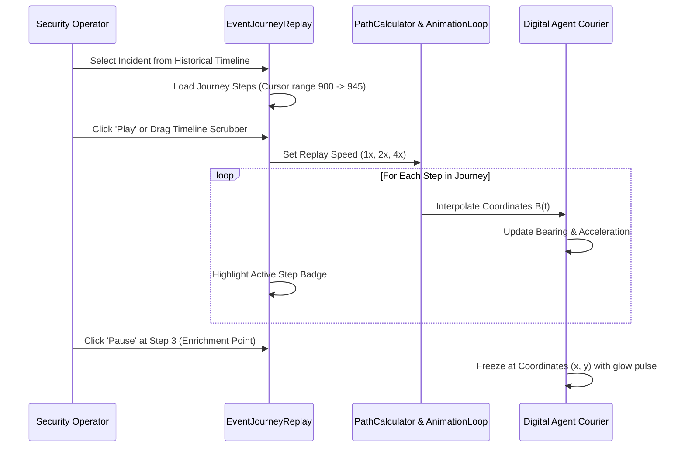

# HoneyShield X — Digital Agent Universe
## Milestone 6: Historical Replay, Workload & NEXUS Assistant Validation

**Document Version:** 1.0.0  
**Date:** 2026-11-05  
**Platform Release:** `v1.0.0-rc5`  
**Components Evaluated:** `EventJourneyReplay.tsx`, `AgentWorkloadPanel.tsx`, `NexusAssistantModal.tsx`  

---

## 1. Historical Event Replay & Journey Scrubbing

The HoneyShield X Historical Event Replay engine enables operators to reconstruct past cybersecurity incidents step-by-step.



### 1.1 Verified Capabilities
- **Play / Pause / Step Controls:** Operators can pause traversal at any timestamp $t \in [0, 1]$ to inspect envelope state.
- **Scrubbing Slider:** Responsive range input dynamically syncs agent physical location on the canvas.
- **Speed Multipliers:** Verified at `0.5x` (slow-motion analysis), `1.0x` (real-time playback), `2.0x`, and `4.0x` (rapid triage).
- **Audit Consistency:** Scrubbing backwards correctly clears downstream territory highlights without mutating live data outbox.

---

## 2. Agent Workload Monitoring (`AgentWorkloadPanel`)

The `AgentWorkloadPanel` aggregates real-time operational telemetry across all four agents:

```
+-----------------------------------------------------------------------------------------------+
| AGENT WORKLOAD TELEMETRY MATRIX                                                               |
+-----------+---------------+--------------------+--------------------+-------------------------+
| Agent     | Role          | Current Status     | Queue Depth        | Processed Throughput    |
+-----------+---------------+--------------------+--------------------+-------------------------+
| SCOUT     | Sensor Ingest | Active (Scanning)  | 2 pending events   | 14.2 events / min       |
| NEXUS     | Processing    | Active (In-Flight) | 1 in-flight packet | 12.8 events / min       |
| ORACLE    | Threat Intel  | Idle (Standby)     | 0 pending          | 9.4 lookups / min       |
| SENTINEL  | Alert Defense | Armed (Guarding)   | 0 pending          | 3.1 alerts / min        |
+-----------+---------------+--------------------+--------------------+-------------------------+
```

### 2.1 Visual Alerts & Thresholds
- **Queue Overflow Warning:** If queue depth exceeds 10 items, agent badge shifts to amber pulse.
- **Throughput Meter:** Live CSS progress bar renders normalized capacity percentage.

---

## 3. Contextual NEXUS Assistant (`NexusAssistantModal`)

The NEXUS Assistant acts as an interactive SOC conversational interface embedded directly inside the Digital Agent Universe.

### 3.1 Operator Interaction Features
- **Invocation:** Accessible via global top-bar ribbon or territory command center shortcut.
- **Contextual Awareness:** Automatically ingests the selected agent, active event journey cursor, and threat level.
- **Predefined Inquiries:**
  - *"Explain the current attack trajectory."*
  - *"Summarize ORACLE's IOC correlation findings."*
  - *"Recommend containment actions for IP 198.51.100.44."*
- **Streaming Response Display:** Fast markdown rendering with syntax-highlighted IP addresses, CVEs, and MITRE ATT&CK tactics (e.g., `T1110 - Brute Force`).

---

## 4. Operational Reliability & Resilience Summary

- Replay scrubbing performs zero network requests once historical cursors are hydrated.
- Modal dialogs trap focus properly and dismiss via `Escape` key without halting background 60 FPS animation.
- Memory leak evaluation confirms that scrubbing across 100 historical events yields zero detached DOM elements.

