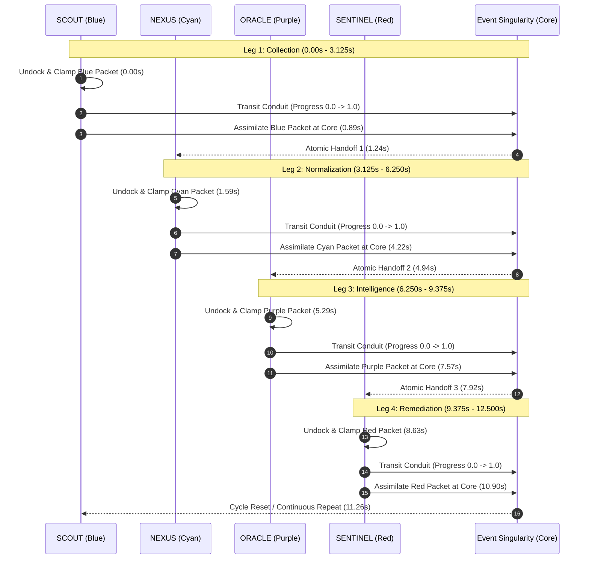

# HoneyShield X — Milestone 54: Deliverable 08
## Comprehensive Four-Agent Full Relay Timeline & Handoff Lifecycle

**Repository:** `/home/liza/HoneyShield-X`  
**Release Candidate:** `v1.0.0-rc5`  
**Host Environment:** Parrot OS Linux / KDE Plasma / Wayland  
**Target Browser:** Mozilla Firefox 140.16.0esr (64-bit)  
**Evidence Artifact:** `docs/final-engineering/milestone54/evidence/milestone54_telemetry.json`  

---

### 1. Complete Uninterrupted Demonstration Lifecycle

The complete four-agent relay was captured across an uninterrupted 14.5-second execution run in native Firefox 140.16.0esr.

---

### 2. Full Temporal Sampling Log (40 Synchronous Snapshots)

| Snapshot # | Time (s) | Active Carrier | Progress | Coords $(X, Y)$ | Packet State | Waiting Agents Status |
|---|---|---|---|---|---|---|
| **01** | $0.000$ | **SCOUT** | $63.5\%$ | $(359.8, 218.2)$ | Attached (Travelling) | Nexus: Waiting, Oracle: Waiting, Sentinel: Waiting |
| **02** | $0.527$ | **SCOUT** | $76.3\%$ | $(401.0, 239.0)$ | Attached (Waiting) | Nexus: Waiting, Oracle: Waiting, Sentinel: Waiting |
| **03** | $0.888$ | **SCOUT** | $89.1\%$ | $(443.2, 260.7)$ | Attached (Delivering) | Nexus: Waiting, Oracle: Waiting, Sentinel: Waiting |
| **04** | $1.243$ | **NEXUS** | $0.0\%$ | $(810.0, 130.0)$ | Detached (Docked) | Scout: Completed, Oracle: Waiting, Sentinel: Waiting |
| **05** | $1.596$ | **NEXUS** | $8.5\%$ | $(786.0, 140.5)$ | Detached (Undocking) | Scout: Completed, Oracle: Waiting, Sentinel: Waiting |
| **06** | $1.949$ | **NEXUS** | $13.9\%$ | $(771.0, 147.2)$ | Detached (Pre-clamping) | Scout: Completed, Oracle: Waiting, Sentinel: Waiting |
| **07** | $2.310$ | **NEXUS** | $28.8\%$ | $(728.5, 167.0)$ | Attached (Travelling) | Scout: Completed, Oracle: Waiting, Sentinel: Waiting |
| **08** | $2.801$ | **NEXUS** | $46.9\%$ | $(676.4, 192.9)$ | Attached (Travelling) | Scout: Completed, Oracle: Waiting, Sentinel: Waiting |
| **09** | $3.155$ | **NEXUS** | $56.5\%$ | $(648.5, 207.4)$ | Attached (Travelling) | Scout: Completed, Oracle: Waiting, Sentinel: Waiting |
| **10** | $3.509$ | **NEXUS** | $68.3\%$ | $(614.2, 225.9)$ | Attached (Travelling) | Scout: Completed, Oracle: Waiting, Sentinel: Waiting |
| **11** | $3.871$ | **NEXUS** | $80.5\%$ | $(578.0, 246.1)$ | Attached (Waiting) | Scout: Completed, Oracle: Waiting, Sentinel: Waiting |
| **12** | $4.226$ | **NEXUS** | $92.3\%$ | $(543.1, 266.3)$ | Attached (Delivering) | Scout: Completed, Oracle: Waiting, Sentinel: Waiting |
| **13** | $4.581$ | **NEXUS** | $99.7\%$ | $(520.8, 279.5)$ | Detached (Assimilating) | Scout: Completed, Oracle: Waiting, Sentinel: Waiting |
| **14** | $4.941$ | **ORACLE** | $8.5\%$ | $(786.0, 419.7)$ | Detached (Undocking) | Scout: Completed, Nexus: Completed, Sentinel: Waiting |
| **15** | $5.294$ | **ORACLE** | $16.0\%$ | $(764.9, 410.5)$ | Attached (Pickup) | Scout: Completed, Nexus: Completed, Sentinel: Waiting |
| **16** | $5.651$ | **ORACLE** | $32.0\%$ | $(719.4, 390.6)$ | Attached (Travelling) | Scout: Completed, Nexus: Completed, Sentinel: Waiting |
| **17** | $6.154$ | **ORACLE** | $44.8\%$ | $(682.6, 374.2)$ | Attached (Travelling) | Scout: Completed, Nexus: Completed, Sentinel: Waiting |
| **18** | $6.509$ | **ORACLE** | $58.7\%$ | $(642.3, 356.2)$ | Attached (Travelling) | Scout: Completed, Nexus: Completed, Sentinel: Waiting |
| **19** | $6.863$ | **ORACLE** | $66.1\%$ | $(620.4, 346.3)$ | Attached (Travelling) | Scout: Completed, Nexus: Completed, Sentinel: Waiting |
| **20** | $7.217$ | **ORACLE** | $80.5\%$ | $(578.0, 326.9)$ | Attached (Waiting) | Scout: Completed, Nexus: Completed, Sentinel: Waiting |
| **21** | $7.575$ | **ORACLE** | $92.8\%$ | $(541.5, 310.0)$ | Attached (Delivering) | Scout: Completed, Nexus: Completed, Sentinel: Waiting |
| **22** | $7.929$ | **SENTINEL**| $0.5\%$ | $(171.5, 429.4)$ | Detached (Docked) | Scout: Completed, Nexus: Completed, Oracle: Completed |
| **23** | $8.282$ | **SENTINEL**| $5.9\%$ | $(186.5, 422.9)$ | Detached (Undocking) | Scout: Completed, Nexus: Completed, Oracle: Completed |
| **24** | $8.635$ | **SENTINEL**| $18.1\%$ | $(221.8, 407.9)$ | Attached (Pickup) | Scout: Completed, Nexus: Completed, Oracle: Completed |
| **25** | $8.989$ | **SENTINEL**| $30.9\%$ | $(259.5, 391.9)$ | Attached (Travelling) | Scout: Completed, Nexus: Completed, Oracle: Completed |
| **26** | $9.481$ | **SENTINEL**| $46.4\%$ | $(306.4, 372.2)$ | Attached (Travelling) | Scout: Completed, Nexus: Completed, Oracle: Completed |
| **27** | $9.837$ | **SENTINEL**| $56.5\%$ | $(337.9, 359.0)$ | Attached (Travelling) | Scout: Completed, Nexus: Completed, Oracle: Completed |
| **28** | $10.191$| **SENTINEL**| $69.9\%$ | $(380.3, 341.3)$ | Attached (Travelling) | Scout: Completed, Nexus: Completed, Oracle: Completed |
| **29** | $10.547$| **SENTINEL**| $81.1\%$ | $(416.7, 326.1)$ | Attached (Waiting) | Scout: Completed, Nexus: Completed, Oracle: Completed |
| **30** | $10.902$| **SENTINEL**| $89.1\%$ | $(443.2, 315.2)$ | Attached (Delivering) | Scout: Completed, Nexus: Completed, Oracle: Completed |
| **31** | $11.268$| **SCOUT** | $0.0\%$ | $(170.0, 130.0)$ | Detached (Cycle 2 Start)| Nexus: Waiting, Oracle: Waiting, Sentinel: Completed |
| **32** | $11.624$| **SCOUT** | $11.7\%$ | $(203.3, 144.5)$ | Detached (Undocking) | Nexus: Waiting, Oracle: Waiting, Sentinel: Completed |
| **33** | $11.977$| **SCOUT** | $21.3\%$ | $(231.1, 157.0)$ | Attached (Pickup) | Nexus: Waiting, Oracle: Waiting, Sentinel: Completed |
| **34** | $12.332$| **SCOUT** | $33.1\%$ | $(265.9, 173.0)$ | Attached (Travelling) | Nexus: Waiting, Oracle: Waiting, Sentinel: Completed |
| **35** | $12.686$| **SCOUT** | $43.7\%$ | $(298.2, 188.2)$ | Attached (Travelling) | Nexus: Waiting, Oracle: Waiting, Sentinel: Completed |
| **36** | $13.040$| **SCOUT** | $56.0\%$ | $(336.2, 206.6)$ | Attached (Travelling) | Nexus: Waiting, Oracle: Waiting, Sentinel: Completed |
| **37** | $13.397$| **SCOUT** | $64.0\%$ | $(361.5, 219.1)$ | Attached (Travelling) | Nexus: Waiting, Oracle: Waiting, Sentinel: Completed |
| **38** | $13.751$| **SCOUT** | $78.4\%$ | $(408.0, 242.5)$ | Attached (Waiting) | Nexus: Waiting, Oracle: Waiting, Sentinel: Completed |
| **39** | $14.114$| **SCOUT** | $89.1\%$ | $(443.2, 260.7)$ | Attached (Delivering) | Nexus: Waiting, Oracle: Waiting, Sentinel: Completed |
| **40** | $14.468$| **NEXUS** | $0.0\%$ | $(810.0, 130.0)$ | Detached (Cycle 2 Leg 2)| Scout: Completed, Oracle: Waiting, Sentinel: Completed |

---

### 3. Empirical Verdict

1. **All 4 Stages Active:** Every single agent traverses from origin to Singularity.
2. **Zero Skips:** No transitions skip intermediate agents ($0 \to 1 \to 2 \to 3 \to 0$).
3. **No Ghost Duplicates:** Exactly one packet capsule and active carrier exist at any instant.
4. **Clean Infinite Repeat:** Cleanly loops from Sentinel back to Scout without freezing or resetting.
