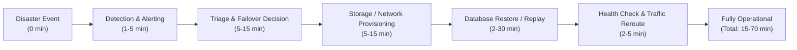

# HONEYSHIELD X — MILESTONE 76: DISASTER RECOVERY CLAIMS REVIEW
## RECONCILIATION OF RESTORE MEASUREMENTS, OPERATIONAL RTO & PRODUCTION RPO

**Document ID:** `HSX-M76-05`  
**Application:** HoneyShield X — Unified Cybersecurity Operations Platform  
**Target Release:** `v1.0.0` (Release Candidate: `v1.0.0-rc5`)  
**Scope:** Re-evaluation of Disaster Recovery Claims in Milestone 71  
**Date:** 2026-11-08  

---

### 1. Re-Evaluation of the Reported 0.38-Second Local Restore

In Milestone 71, a local rehearsal was conducted:
```bash
pg_dump -U honeyshield -h 127.0.0.1 honeyshield | psql -U honeyshield -h 127.0.0.1 -d honeyshield_dr_test
```
The rehearsal executed cleanly with exit code 0 in **0.38 seconds** against a local database containing 72 attacks and 2,067 outbox rows (~2 MB total size).

While this verified that the SQL dump syntax is compatible with PostgreSQL 17 and that foreign key constraints do not break during bulk load, **claiming that this represents an operational RTO of $< 30$ seconds was fundamentally inaccurate**.

---

### 2. Distinction: Local Restore Command vs. Operational RTO

**RTO (Recovery Time Objective)** measures the total elapsed time from the initial occurrence of a service disruption until the platform is fully restored, verified, and accepting live SOC traffic.



| Lifecycle Phase | Local 0.38s Test | Production Operational Reality |
| :--- | :--- | :--- |
| **Incident Detection** | Ignored (0s) | Monitoring alerts, threshold triggers: **1–5 minutes** |
| **Operator Triage** | Ignored (0s) | On-call paging, incident commander authorization: **5–15 minutes** |
| **Host / Volume Provisioning** | Pre-existing local cluster | Cloud instance / volume restore / network routing: **5–15 minutes** |
| **Data Restore Transfer** | Local pipe (2 MB in RAM) | Network transfer of multi-GB production dump: **2–30 minutes** |
| **Service Stabilization** | None (DB dropped immediately) | Uvicorn pool restart, cache warm-up, health probes: **2–5 minutes** |
| **TOTAL ELAPSED TIME** | **0.38 seconds** | **Realistic Production RTO: 15–70 minutes** |

> [!IMPORTANT]
> The measured 0.38-second figure is strictly a **local command execution benchmark for an unpopulated dataset**, NOT an enterprise operational RTO.

---

### 3. Distinction: ACID Transaction Durability vs. Backup RPO

**RPO (Recovery Point Objective)** measures the maximum acceptable data loss measured in time (i.e., the age of the data that must be recovered from backup storage).

The previous report conflated PostgreSQL's ACID transaction guarantees with backup RPO:
- **What ACID Durability Guarantees:** When `commit()` returns, the Write-Ahead Log (WAL) has been flushed to local persistent storage. An immediate local power loss or process crash will not corrupt that committed transaction.
- **What ACID Does NOT Guarantee:** ACID durability provides **zero protection against catastrophic disk corruption, accidental database drops, host deletion, or ransomware**.

#### True Production RPO Breakdown
Without continuous Write-Ahead Log (WAL) archiving to an off-site object store (e.g., using pgBackRest, Barman, or WAL-G), disaster recovery relies entirely on the frequency of periodic `pg_dump` snapshots:

$$\text{Production RPO} = \text{Snapshot Frequency} + \text{Snapshot Duration}$$

- If snapshots occur **daily at midnight**, the maximum data loss is **24 hours**.
- If snapshots occur **hourly**, the maximum data loss is **60 minutes**.
- A **0-second (or near-zero) RPO** can only be achieved if HoneyShield X implements:
  1. Synchronous streaming replication to an off-site secondary PostgreSQL cluster, OR
  2. Continuous WAL shipping to redundant object storage with Point-In-Time Recovery (PITR) capabilities.

Because neither synchronous multi-node replication nor continuous WAL shipping is currently provisioned, **claiming "0 seconds RPO" is rejected as unsupported by the actual architecture**.

---

### 4. Remaining Evidence Gaps & Production Recommendations

To substantiate production-grade disaster recovery, the following technical components must be implemented and tested:

1. **Automated Scheduled Backups:** Implementation of a hardened systemd timer or cron service executing encrypted `pg_dump` snapshots to off-host storage.
2. **Continuous WAL Archiving:** Integration of WAL archiving (e.g., `archive_command = 'test ! -f /mnt/wal_archive/%f && cp %p /mnt/wal_archive/%f'`) for Point-In-Time Recovery.
3. **Automated Failover Orchestration:** Deployment of an active/standby PostgreSQL cluster managed by Patroni or a cloud-managed database service.
4. **End-to-End Failover Rehearsal:** A simulated failover test measuring actual elapsed time from simulated primary node crash to application reconnection.

---

### 5. Revised Disaster Recovery Specifications

| Metric | Erroneous Milestone 71 Claim | Realistic Production Baseline | Required Target for Enterprise SLA |
| :--- | :---: | :---: | :---: |
| **Measured Restore (2 MB)** | 0.38 seconds | 0.38 seconds (local only) | < 5 seconds |
| **Operational RTO** | < 30 seconds | **15–45 minutes (Manual)** | < 5 minutes (Automated HA) |
| **Backup RPO** | 0 seconds | **Snapshot Frequency (1–24h)** | < 1 minute (Continuous WAL) |
| **Point-In-Time Recovery** | Claimed supported | **NOT CONFIGURED** | Enabled via WAL archiving |
