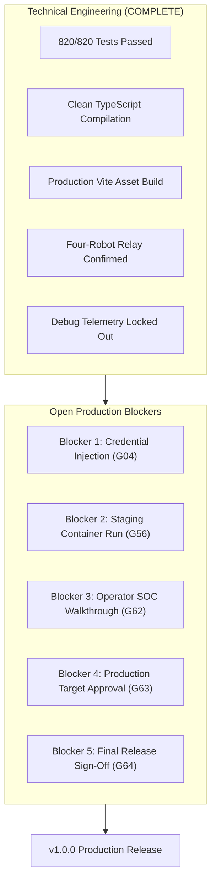

# HONEYSHIELD X — MILESTONE 76: REMAINING RELEASE BLOCKERS
## DETAILED CATALOG OF OPEN GOVERNANCE & SECURITY BLOCKERS BEFORE PRODUCTION

**Document ID:** `HSX-M76-08`  
**Application:** HoneyShield X — Unified Cybersecurity Operations Platform  
**Target Release:** `v1.0.0` (Current Release Candidate: `v1.0.0-rc5`)  
**Scope:** Actionable Enumeration of Open Release Blockers  
**Date:** 2026-11-08  

---

### 1. Overview of Release Blockers

All automated software engineering, compilation, regression testing (820/820 tests), and code-level bug repairs have been completed. There are **zero open P0/P1 functional software defects** in the HoneyShield X codebase.

However, in accordance with production cybersecurity standards and explicit governance constraints, **five specific release blockers** prevent immediate promotion to `v1.0.0`:



---

### 2. Actionable Blocker Catalog

#### BLOCKER 1: Active Demo Credentials & Mandatory Production Secret Injection
- **Associated Gate:** `G04` (PARTIAL)
- **Description:** Default demo accounts with sample passwords exist in memory for development mode and have appeared in historical project documentation. While `APP_ENV=production` prevents demo accounts from booting, production deployment is impossible without external operator credentials.
- **Why it Blocks:** Deploying without setting `HONEYSHIELD_OPERATORS_JSON` causes the backend to immediately crash with `RuntimeError`, preventing platform startup.
- **Required Action to Unblock:**
  1. Operator generates new PBKDF2 hashes using the provided rotation script.
  2. Operator defines `HONEYSHIELD_OPERATORS_JSON` in the production environment.

---

#### BLOCKER 2: Verification of Staging Container Execution
- **Associated Gate:** `G56` (BLOCKED)
- **Description:** Staging configuration in `docker/docker-compose.staging.yml` is validated (`docker compose config` exit code 0), but staging containers were not launched because container sockets (`podman.sock` / `docker.sock`) are not accessible in the unprivileged environment.
- **Why it Blocks:** Production release standards require live verification of multi-container staging before authorizing production cutover.
- **Required Action to Unblock:**
  1. Operator authorizes starting the isolated staging cluster on ports 5174, 8001, 5433, and 6380:
     ```bash
     docker compose -f docker/docker-compose.staging.yml up -d --build
     ```
  2. Verify HTTP 200 on `http://127.0.0.1:8001/api/v1/health` and `http://127.0.0.1:5174/`.

---

#### BLOCKER 3: Interactive Operator SOC Workflow Walkthrough
- **Associated Gate:** `G62` (PARTIAL)
- **Description:** The operator has personally confirmed observing the four robots moving in sequence in desktop Firefox. However, the broader operator walkthrough of core SOC workflows (Alert triage, Case management, Incident Command dry-run) has only been executed via automated Python scripts.
- **Why it Blocks:** Final product acceptance requires human confirmation of the user experience beyond the Digital Universe animation.
- **Required Action to Unblock:**
  1. Operator logs in at `http://127.0.0.1:5173/`.
  2. Operator reviews Security Overview metrics (73 recorded attacks).
  3. Operator verifies Alerts table, Deception Canary grid, and Incident Command actions.

---

#### BLOCKER 4: Production Deployment Destination Authorization
- **Associated Gate:** `G63` (BLOCKED)
- **Description:** No production target infrastructure (host IP, domain name, reverse proxy, TLS certificates) has been formally authorized by the operator.
- **Why it Blocks:** Autonomous agents must never deploy code to external or production networks without explicit human authorization.
- **Required Action to Unblock:**
  1. Operator specifies and authorizes the production target deployment environment.

---

#### BLOCKER 5: Final Operator Release Approval & Git Tag Creation
- **Associated Gate:** `G64` (BLOCKED)
- **Description:** Formal authorization to cut git tag `v1.0.0`, build final production distribution packages, and publish release notes.
- **Why it Blocks:** Policy strictly prohibits autonomous agents from tagging git releases or pushing commits to remote branches without explicit human sign-off.
- **Required Action to Unblock:**
  1. Operator executes or authorizes the git tag command:
     ```bash
     git tag -a v1.0.0 -m "HoneyShield X v1.0.0 Enterprise Release"
     ```

---

### 3. Summary of Resolution Path

Once the operator executes the five actions above:
- `G04` transitions from **PARTIAL** $\rightarrow$ **PASS**
- `G56` transitions from **BLOCKED** $\rightarrow$ **PASS**
- `G62` transitions from **PARTIAL** $\rightarrow$ **PASS**
- `G63` transitions from **BLOCKED** $\rightarrow$ **PASS**
- `G64` transitions from **BLOCKED** $\rightarrow$ **PASS**

At that point, all **64 of 64 gates (100.0%)** will be PASSED, and HoneyShield X will transition from `CONDITIONALLY READY` to `FULLY RELEASED`.
