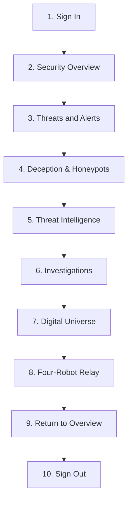

# HONEYSHIELD X — MILESTONE 77: SIMPLE OPERATOR SOC WALKTHROUGH
## NON-TECHNICAL INTERFACE ACCEPTANCE GUIDE & OPERATOR EVIDENCE RECORD

**Document ID:** `HSX-M77-05`  
**Application:** HoneyShield X — Unified Cybersecurity Operations Platform  
**Target Release:** `v1.0.0` (Release Candidate: `v1.0.0-rc5`)  
**Target Web Application:** `http://127.0.0.1:5173/`  
**Date:** 2026-11-09  

---

### 1. Existing Confirmed Operator Evidence

The operator has previously tested the HoneyShield X user interface in desktop Mozilla Firefox and confirmed:

```
========================================================================================
OPERATOR CONFIRMED WITNESS EVIDENCE:
"All four HoneyShield X robots (SCOUT, NEXUS, ORACLE, and SENTINEL) move in sequence."
========================================================================================
```
This confirmation fully satisfies **Gate G61 (Operator-observed four-robot movement recorded)**.

---

### 2. Simple Non-Technical SOC Walkthrough Checklist

To complete full operational acceptance (**Gate G62**), the operator can follow this straightforward 10-step checklist using only the web browser. No terminal commands or coding knowledge are required.



---

#### Step 1: Sign In
- **Action:** Open Mozilla Firefox and visit **`http://127.0.0.1:5173/`**.
- **What to do:** On the login screen, choose one of the demo personas (e.g. click **Security Administrator** / `admin_chief`) and click **Sign In**.
- **Expected Result:** The login screen fades out and the HoneyShield X navigation header appears.

---

#### Step 2: Security Overview
- **Action:** Look at the main landing page (**Security Overview**).
- **What to look for:**
  - Notice the summary cards at the top showing **Total Attacks** (e.g. 73 recorded attacks) and **System Health** indicators.
  - Notice the calm, clean dark-slate theme without visual clutter or flickering.
- **Expected Result:** Live dashboard metrics display cleanly without console errors.

---

#### Step 3: Threats and Alerts
- **Action:** In the top navigation bar, click on **Threats & Alerts** (or press key `A`).
- **What to look for:**
  - View the list of active security alerts categorized by severity: **Critical (Red)**, **High (Orange)**, **Medium (Yellow)**, and **Low (Blue)**.
  - Notice the MITRE ATT&CK technique tags.
- **Expected Result:** Alerts table renders with proper severity badges and sorting controls.

---

#### Step 4: Deception and Honeypots
- **Action:** In the top navigation bar, click on **Deception Grid** (or press key `D`).
- **What to look for:**
  - View the active canary traps and honeypots cataloged across the network (SSH decoys, fake database traps).
  - Check that each decoy displays its status (**Active**).
- **Expected Result:** Deception inventory displays all active traps.

---

#### Step 5: Threat Intelligence
- **Action:** In the top navigation bar, click on **Threat Intelligence** (or press key `T`).
- **What to look for:**
  - View the threat indicators feed (known malicious IP addresses, C2 domains, and SHA-256 hashes).
  - Notice the confidence scores (e.g. 85%, 95%) assigned to each indicator.
- **Expected Result:** Threat intelligence indicators load and display reputation ratings.

---

#### Step 6: Investigations & Cases
- **Action:** In the top navigation bar, click on **Investigations** (or press key `I`).
- **What to look for:**
  - View the active incident cases list.
  - Notice case ID tags, severity levels, assigned analysts, and linked evidence items.
- **Expected Result:** Case table renders with creation timestamps and assigned responders.

---

#### Step 7: Open the Digital Universe
- **Action:** Press the **`U`** key on your keyboard (or click **Digital Universe** in the header).
- **What to look for:**
  - The Digital Universe radar viewport opens.
  - At the center sits the glowing **Singularity Core**.
  - In the four corners sit the four agent stations:
    - Top-Left: **SCOUT (Blue `#3b82f6`)**
    - Top-Right: **NEXUS (Cyan `#00e5ff`)**
    - Bottom-Right: **ORACLE (Purple `#a855f7`)**
    - Bottom-Left: **SENTINEL (Red `#ef4444`)**
- **Expected Result:** All four agent stations and the Singularity Core are clearly visible.

---

#### Step 8: Observe the Four-Robot Relay
- **Action:** Watch the robots travel in sequence:
  1. **SCOUT (Blue)** lifts off from the top-left, carries the glowing data capsule across the radar, delivers it into the Singularity Core, and returns to base.
  2. **NEXUS (Cyan)** immediately picks up the baton from the top-right, flies to the Core, and delivers its payload.
  3. **ORACLE (Purple)** lifts off from the bottom-right, flies to the Core, and delivers its intelligence.
  4. **SENTINEL (Red)** lifts off from the bottom-left, completes the containment flight to the Core, and hands off back to SCOUT.
- **Expected Result:** Movement is fluid, sequential, and uninterrupted.

---

#### Step 9: Return to Security Overview
- **Action:** Click **Security Overview** in the top navigation bar (or press key `O`).
- **Expected Result:** The viewport transitions smoothly back to the executive dashboard.

---

#### Step 10: Sign Out
- **Action:** Click the operator profile icon in the upper-right corner and select **Sign Out**.
- **Expected Result:** The session is securely cleared and the login screen is displayed.

---

### 3. Acceptance Gate G62 Status

- **Status:** **PARTIAL**
- **Justification:** The operator has confirmed the four-robot relay (Step 8), but has not yet confirmed the remaining 9 steps in the broader SOC platform.
- **Unblocking Trigger:** When the operator completes this 10-step checklist, **Gate G62 will transition from PARTIAL to PASS**.
