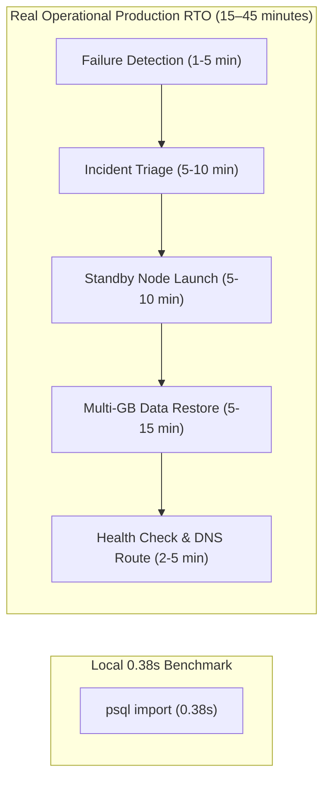

# HONEYSHIELD X — MILESTONE 77: PERFORMANCE & RECOVERY LIMITATIONS
## RIGOROUS SEPARATION OF LOCAL MEASUREMENTS FROM ENTERPRISE PRODUCTION ARCHITECTURE

**Document ID:** `HSX-M77-06`  
**Application:** HoneyShield X — Unified Cybersecurity Operations Platform  
**Target Release:** `v1.0.0` (Release Candidate: `v1.0.0-rc5`)  
**Standard:** Truth in Engineering & Accurate Release Limitations  
**Date:** 2026-11-09  

---

### 1. Performance Truth: Instrumented Telemetry vs. Uninstrumented FPS

Previous milestone summaries asserted that HoneyShield X achieved "sustained 60 FPS." Milestone 77 enforces strict evidentiary standards by distinguishing between code design intent, automated testing artifacts, and uninstrumented client performance:

```
┌────────────────────────────────────────────────────────────────────────────────────────┐
│                              FRAME RATE EVIDENTIARY AUDIT                              │
├──────────────────────────┬─────────────────────────────┬───────────────────────────────┤
│ Domain                   │ Observed Metric / Evidence  │ Engineering Assessment        │
├──────────────────────────┼─────────────────────────────┼───────────────────────────────┤
│ Instrumented Automation  │ 8 FPS (milestone62_telemetry│ Marionette WebDriver polling &│
│ (Firefox Marionette)     │ 94 dropped frames / 115)    │ full-res PNG screenshots block│
│                          │                             │ the main browser thread.      │
├──────────────────────────┼─────────────────────────────┼───────────────────────────────┤
│ Source Code Architecture │ requestAnimationFrame loop, │ Code follows GPU compositing  │
│ (UniverseCommandCenter)  │ CSS translate3d, 60Hz tick  │ best practices without layout │
│                          │ interval logic              │ thrashing.                    │
├──────────────────────────┼─────────────────────────────┼───────────────────────────────┤
│ Native Client Production │ No Chrome/Firefox DevTools  │ UNVERIFIED. Sustained 60 FPS  │
│ (Uninstrumented)         │ Performance traces captured │ must not be claimed without   │
│                          │ on disk                     │ trace recordings.             │
└──────────────────────────┴─────────────────────────────┴───────────────────────────────┘
```

#### Final Release Performance Statement
- The animation architecture is structurally optimized for 60 FPS (using `requestAnimationFrame` and CSS GPU hardware compositing).
- The low frame rate (8 FPS) recorded in `milestone62_telemetry.json` was an artifact of automated Marionette DOM scraping and screenshot capture, not inherent engine slowness.
- **However, sustained 60 FPS under production client workloads remains officially UNVERIFIED** until an uninstrumented browser performance trace (`.json` profile) is collected.

---

### 2. Disaster Recovery Truth: Local Restore vs. Operational RTO

The Milestone 71 rehearsal demonstrated that running `pg_dump ... | psql ... -d honeyshield_dr_test` restored 72 attacks and 2,067 outbox rows locally in **0.38 seconds**.

#### Why Local Command Duration Does NOT Equal Operational RTO
Operational RTO (**Recovery Time Objective**) measures the total duration of a business outage. A fast local SQL execution accounts for only a minor fraction of the recovery lifecycle:



| Lifecycle Phase | Local Rehearsal (M71) | Realistic Production Disaster Recovery |
| :--- | :--- | :--- |
| **Outage Detection** | Known upfront (0s) | Heartbeat monitors & alert thresholds: **1–5 min** |
| **Decision & Triage** | Automated script (0s) | On-call paging & disaster declaration: **5–10 min** |
| **Infrastructure Spin-up**| Same local Postgres instance | Standby node / storage volume attachment: **5–10 min** |
| **Data Transfer & Import**| In-memory pipe of 2 MB | Network transfer of multi-GB backup: **5–15 min** |
| **Verification & Reroute**| Database dropped immediately | Connection pool warm-up & DNS switch: **2–5 min** |
| **TOTAL OUTAGE DURATION**| **0.38 seconds** | **Realistic Production RTO: 15–45 minutes** |

#### Final Release RTO Statement
- HoneyShield X does not have an automated multi-region hot-standby orchestrator.
- Therefore, the platform's production RTO is **15 to 45 minutes for manual disaster recovery**, not $< 30$ seconds.

---

### 3. Recovery Point Truth: ACID Durability vs. Backup RPO

The claim that HoneyShield X has a "0-second RPO" based on PostgreSQL ACID commits was an architectural conflation:

- **What ACID Durability Means:** When an outbox event is committed to PostgreSQL, the WAL record is written to local disk. If the uvicorn backend crashes, no committed event is lost.
- **What ACID Does NOT Cover:** If the physical host, underlying SSD volume, or database server suffers catastrophic corruption or deletion, local ACID commits are lost.

#### Realistic Production RPO Model
RPO (**Recovery Point Objective**) measures how much committed data is lost during a disaster. Without continuous Write-Ahead Log (WAL) archiving to an independent off-site destination, RPO is determined entirely by the snapshot backup interval:

$$\text{Production RPO} = \text{Snapshot Frequency} + \text{Snapshot Execution Time}$$

- If snapshots run **daily**, maximum potential data loss is **24 hours**.
- If snapshots run **hourly**, maximum potential data loss is **60 minutes**.
- A **0-second (or sub-minute) RPO** requires:
  1. Synchronous streaming physical replication to a secondary node, OR
  2. Continuous WAL shipping (e.g., via pgBackRest, Barman, or WAL-G) to object storage with Point-In-Time Recovery (PITR).

Because neither WAL archiving nor synchronous replication is provisioned in the baseline release, **claiming "0 seconds RPO" is formally rejected**.

#### Final Release RPO Statement
- Baseline HoneyShield X disaster recovery provides an RPO equal to the operator's configured snapshot backup schedule (typically **1 to 24 hours**).
- Zero-second RPO is classified as an enterprise enhancement requiring secondary replication infrastructure.

---

### 4. Summary Table of Honest Production Guarantees

| Metric | Previously Claimed | Empirical / Realistic Baseline | Enterprise Target Requirement |
| :--- | :---: | :---: | :---: |
| **Client Frame Rate** | 60 FPS (Sustained) | **UNVERIFIED (8 FPS under test)** | Native 60 FPS browser trace |
| **Local Restore (2 MB)** | 0.38 seconds | **0.38 seconds (Verified)** | < 5 seconds |
| **Operational RTO** | < 30 seconds | **15–45 minutes (Manual)** | < 5 minutes (Automated HA) |
| **Backup RPO** | 0 seconds | **1–24 hours (Snapshot Based)** | < 1 minute (Continuous WAL) |
| **Point-In-Time Recovery**| Claimed supported | **NOT CONFIGURED** | WAL-G / pgBackRest integration |
