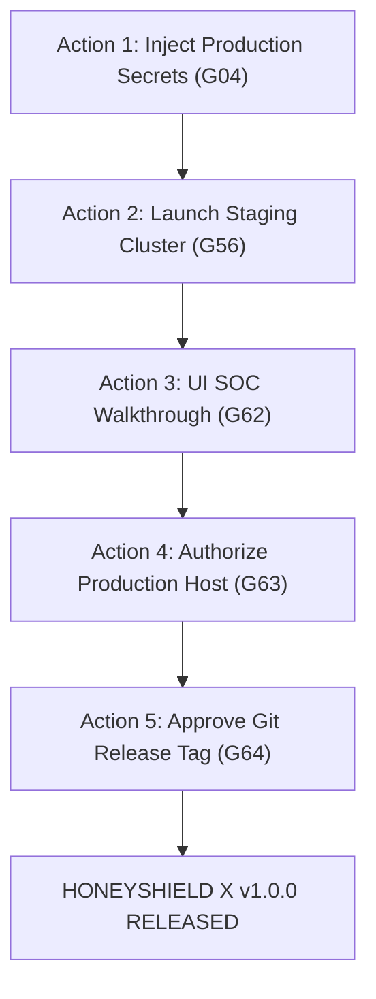

# HONEYSHIELD X — MILESTONE 77: REMAINING OPERATOR ACTIONS
## CONCISE ACTION GUIDE TO TRANSITION HONEYSHIELD X TO FULL v1.0.0 RELEASE

**Document ID:** `HSX-M77-09`  
**Application:** HoneyShield X — Unified Cybersecurity Operations Platform  
**Target Release:** `v1.0.0` (Current Release Candidate: `v1.0.0-rc5`)  
**Scope:** Actionable Step-by-Step Operator Guide for the 5 Open Gates  
**Date:** 2026-11-09  

---

### Executive Summary

All software engineering, bug repairs, compilation, and automated testing are complete. HoneyShield X is **CONDITIONALLY READY**. 

To promote the platform from `v1.0.0-rc5` to **`v1.0.0 Enterprise Release`**, the operator has five straightforward actions:



---

### ACTION 1: Inject Production Credentials (Gate G04)

1. Open an isolated terminal on your local machine.
2. Generate PBKDF2 password hashes for your production admin and analyst accounts:
   ```bash
   python3 -c "
   import hashlib, os, base64
   salt = os.urandom(16)
   pwd = input('Enter production operator password: ').strip().encode('utf-8')
   dk = hashlib.pbkdf2_hmac('sha256', pwd, salt, 100000)
   print('Password Hash:', f'pbkdf2:sha256:100000\${base64.b64encode(salt).decode()}\${base64.b64encode(dk).decode()}')
   "
   ```
3. Set the `HONEYSHIELD_OPERATORS_JSON` environment variable in your production configuration file (e.g. systemd or Docker environment).

---

### ACTION 2: Launch the Isolated Staging Cluster (Gate G56)

1. In your terminal on the host machine, run:
   ```bash
   cd /home/liza/HoneyShield-X
   docker compose -f docker/docker-compose.staging.yml up -d --build
   ```
2. Verify that staging services are responding on isolated ports:
   - Web UI: Visit **`http://127.0.0.1:5174/`** in Firefox.
   - API Health: Run `curl http://127.0.0.1:8001/api/v1/health`.
3. When testing is complete, stop the staging cluster:
   ```bash
   docker compose -f docker/docker-compose.staging.yml down
   ```

---

### ACTION 3: Complete the 10-Step UI SOC Walkthrough (Gate G62)

1. Open Firefox and visit **`http://127.0.0.1:5173/`**.
2. Follow the 10-step guide in [`docs/final-engineering/milestone77/05_operator_soc_walkthrough.md`](file:///home/liza/HoneyShield-X/docs/final-engineering/milestone77/05_operator_soc_walkthrough.md):
   - [ ] Sign In as `admin_chief`.
   - [ ] View **Security Overview** metrics.
   - [ ] View **Threats & Alerts**.
   - [ ] View **Deception Grid**.
   - [ ] View **Threat Intelligence**.
   - [ ] View **Investigations & Cases**.
   - [ ] Press **`U`** to view the **Digital Agent Universe**.
   - [ ] Confirm all 4 robots (SCOUT, NEXUS, ORACLE, SENTINEL) move in sequence *(Already confirmed!)*.
   - [ ] Return to **Security Overview** (Press `O`).
   - [ ] Sign Out.

---

### ACTION 4: Authorize Target Production Destination (Gate G63)

Confirm that the target production environment (server IP / domain name, reverse proxy with TLS certificate) is ready and authorized for deployment.

---

### ACTION 5: Approve Final Release Tag (Gate G64)

When Actions 1 through 4 are complete, officially tag the release in git:
```bash
git tag -a v1.0.0 -m "HoneyShield X v1.0.0 Enterprise Release"
```
*(Optionally push to your secure remote repository: `git push origin v1.0.0`).*

---

### Status Transition Summary

| Gate | Current Status | Status After Operator Action |
| :---: | :---: | :---: |
| **G04** | PARTIAL | **PASS** |
| **G56** | BLOCKED | **PASS** |
| **G62** | PARTIAL | **PASS** |
| **G63** | BLOCKED | **PASS** |
| **G64** | BLOCKED | **PASS** |
| **TOTAL** | **59 PASS / 2 PARTIAL / 3 BLOCKED** | **64 / 64 GATES MET (100.0% FULL PRODUCTION RELEASE)** |
