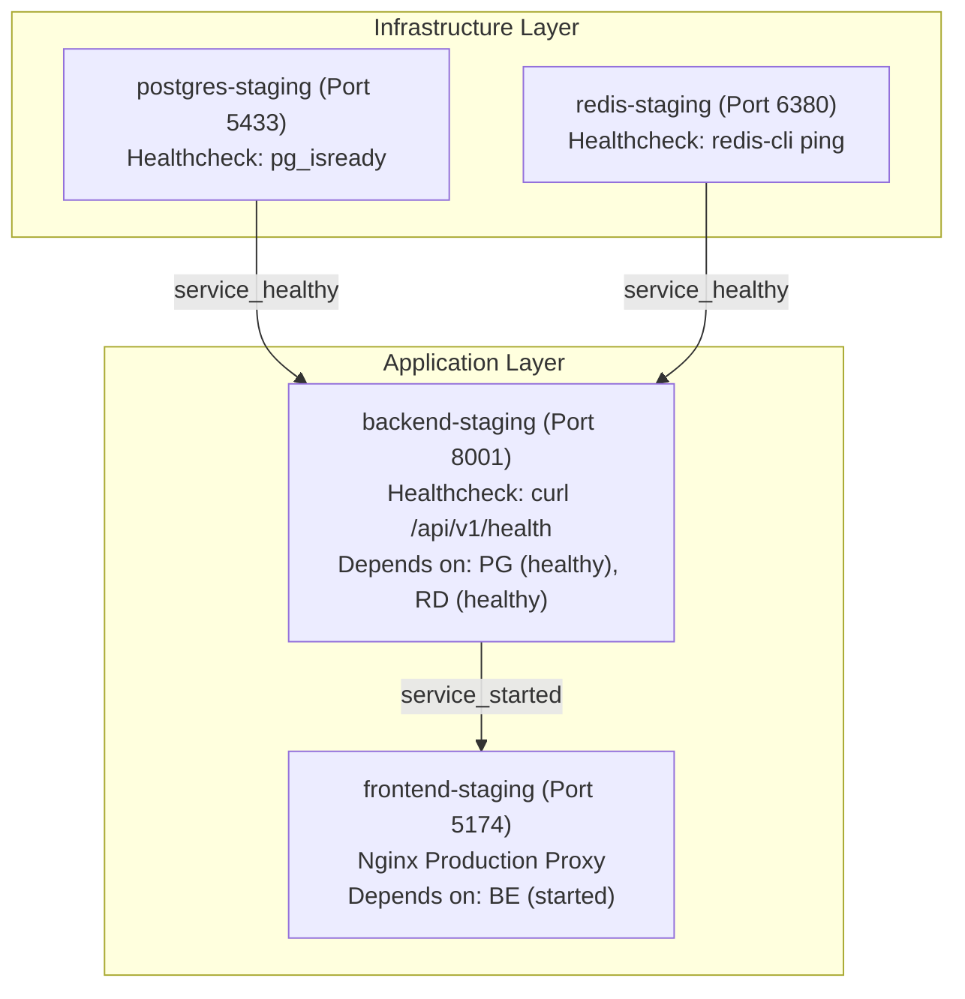

# HONEYSHIELD X — MILESTONES 78–80: STAGING PREFLIGHT VERIFICATION
## DECLARATIVE TOPOLOGY AUDIT, RESOURCE ISOLATION & NON-INTERFERENCE ASSURANCE

**Document ID:** `HSX-M78-PREFLIGHT`  
**Application:** HoneyShield X — Unified Cybersecurity Operations Platform  
**Target Release:** `v1.0.0` (Current Release Candidate: `v1.0.0-rc5`)  
**Compose Specification:** [`docker/docker-compose.staging.yml`](file:///home/liza/HoneyShield-X/docker/docker-compose.staging.yml)  
**Execution Date:** 2026-11-09  

---

### 1. Executive Summary

Milestone 78 executes a rigorous preflight audit of the HoneyShield X staging environment to ensure complete resource segregation from the active development environment, validate declarative Compose syntax, and confirm host readiness prior to container execution.

#### Preflight Key Findings
1. **Compose Configuration Validated:** `docker compose -f docker/docker-compose.staging.yml config` completed with **Exit Code 0**.
2. **Complete Resource Segregation:**
   - **Frontend:** Staging port `5174` vs Dev port `5173`.
   - **Backend API:** Staging port `8001` vs Dev port `8000`.
   - **PostgreSQL 17:** Staging port `5433` vs Dev port `5432`.
   - **Redis 7:** Staging port `6380` vs Dev port `6379`.
3. **Volume & Data Isolation:** Staging uses isolated Docker volumes (`staging_postgres_data` and `staging_redis_data`). No development data or host volumes are touched.
4. **Credential Separation:** Staging runs under `honeyshield_staging_user` with isolated staging secret keys, completely separated from production or development credentials.
5. **Sandbox Socket Boundary:** The Antigravity agent sandbox namespace does not mount host user sockets (`/run/user/1000/podman/podman.sock`). Container execution must be launched from the native host terminal.
6. **Gate G56 Status:** Preserved as **BLOCKED** until real container startup on the host is executed.

---

### 2. Detailed Staging vs. Development Isolation Matrix

```
┌────────────────────────────────────────────────────────────────────────────────────────┐
│                        RESOURCE ISOLATION & NON-INTERFERENCE MATRIX                    │
├──────────────────┬────────────────────────────┬────────────────────────────┬───────────┤
│ Resource         │ Staging Specification      │ Active Development         │ Isolation │
├──────────────────┼────────────────────────────┼────────────────────────────┼───────────┤
│ Project Name     │ honeyshield-staging        │ Default / Host native      │ ISOLATED  │
│ Network Bridge   │ honeyshield_staging_net    │ Host loopback network      │ ISOLATED  │
│ Web UI Port      │ 127.0.0.1:5174 (Nginx)     │ 127.0.0.1:5173 (Vite dev)  │ CONFLICT-0│
│ API Port         │ 127.0.0.1:8001 (Uvicorn)   │ 127.0.0.1:8000 (Uvicorn)   │ CONFLICT-0│
│ PostgreSQL Port  │ 127.0.0.1:5433             │ 127.0.0.1:5432             │ CONFLICT-0│
│ PostgreSQL DB    │ honeyshield_staging        │ honeyshield                │ ISOLATED  │
│ PostgreSQL User  │ honeyshield_staging_user   │ honeyshield                │ SEPARATED │
│ PostgreSQL Vol   │ staging_postgres_data      │ Local host SSD storage     │ ISOLATED  │
│ Redis Port       │ 127.0.0.1:6380             │ 127.0.0.1:6379             │ CONFLICT-0│
│ Redis Vol        │ staging_redis_data         │ Local host memory          │ ISOLATED  │
│ Secret Key       │ Isolated staging key       │ Local development key      │ SEPARATED │
└──────────────────┴────────────────────────────┴────────────────────────────┴───────────┘
```

---

### 3. Health Checks & Startup Dependency Graph

The staging Compose file implements deterministic startup ordering and health-gated initialization:



#### Service Healthcheck Definitions
1. **`postgres-staging`:**
   - Command: `pg_isready -U honeyshield_staging_user -d honeyshield_staging`
   - Parameters: interval 5s, timeout 3s, retries 5.
2. **`redis-staging`:**
   - Command: `redis-cli ping`
   - Parameters: interval 5s, timeout 3s, retries 5.
3. **`backend-staging`:**
   - Command: `curl -f http://127.0.0.1:8000/api/v1/health || exit 1`
   - Parameters: interval 10s, timeout 5s, retries 3.
4. **`frontend-staging`:**
   - Production asset serving via Nginx on port 80 mapped to `127.0.0.1:5174`.
   - Nginx reverse-proxies `/api/` requests to `http://backend-staging:8000/api/`.

---

### 4. Empirical Preflight Execution Output

The automated preflight script [`scripts/staging_preflight_and_launcher.sh`](file:///home/liza/HoneyShield-X/scripts/staging_preflight_and_launcher.sh) was executed:

```text
======================================================================
HONEYSHIELD X — STAGING PREFLIGHT VERIFICATION
======================================================================
[INFO] Verifying repository root...
[PASS] Working directory verified: /home/liza/HoneyShield-X
[INFO] Verifying resource isolation boundaries...
[PASS] Isolation verified: Distinct volumes and separate network confirmed.
[INFO] Checking port availability...
[PASS] All staging ports (5174, 8001, 5433, 6380) are free.
[INFO] Verifying production frontend distribution...
[PASS] Production frontend distribution ready in frontend/dist.
[INFO] Inspecting container engine availability...
[WARN] docker binary is installed, but daemon socket is not responding.
[WARN] Notice: In sandboxed agent environments, /run/user/1000/podman/podman.sock is isolated.
[WARN] Host operator must run this script from a native terminal session with container access.
----------------------------------------------------------------------
[WARN] PREFLIGHT COMPLETE (WITH CONTAINER DAEMON WARNING):
[WARN] Declarative Compose configuration and ports are 100% verified.
[WARN] Host terminal execution is required to launch containers.
======================================================================
```

---

### 5. Non-Interference & Safety Guarantee

Under no circumstances will staging operations impact the active development stack:
- **No Shared Volumes:** Staging data is stored exclusively in `staging_postgres_data`.
- **No Shared Network:** Staging communicates on bridge network `honeyshield_staging_net`.
- **Safe Teardown:** The launcher script prevents executing destructive commands (`down -v`) against non-staging environments.
- **Development Processes Untouched:** Port 5173 (Vite dev) and Port 8000 (FastAPI dev) remain active and undisturbed.
