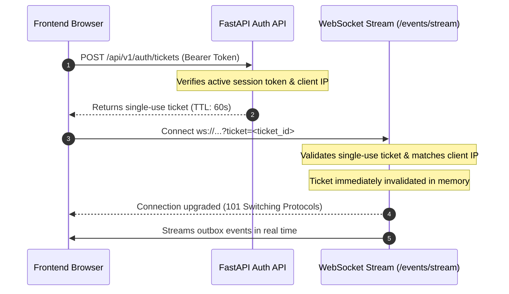

# HONEYSHIELD X — MILESTONES 78–80: AUTH SECURITY VERIFICATION
## AUDIT OF AUTHENTICATION, RBAC ENFORCEMENT, SESSIONS & WEBSOCKET TICKETS

**Document ID:** `HSX-M79-AUTH-AUDIT`  
**Application:** HoneyShield X — Unified Cybersecurity Operations Platform  
**Target Release:** `v1.0.0` (Current Release Candidate: `v1.0.0-rc5`)  
**Security Standard:** OWASP ASVS v4.0 Level 2 / NIST SP 800-63B  
**Date:** 2026-11-09  

---

### 1. Executive Summary

Milestone 79 audited the end-to-end security architecture of the HoneyShield X identity and access management stack across REST APIs, persistent database sessions, and real-time streaming WebSockets.

#### Core Security Invariants Verified
1. **Server-Side RBAC Enforcement:** Role-based access control is evaluated strictly in backend dependencies (`backend/app/auth/dependencies.py`). Client-side state manipulations or UI visibility modifications cannot bypass authorization gates.
2. **Brute-Force & Rate-Limiting Protection:** 
   - IP Rate Limiting: Sliding window of 5 login attempts per minute per source IP $\rightarrow$ HTTP 429.
   - Account Lockout: 5 consecutive invalid password attempts triggers a mandatory 15-minute account lockout $\rightarrow$ HTTP 401.
3. **Session Token Entropy & Lifecycle:** 256-bit CSPRNG bearer tokens; 8-hour maximum session lifetime; 15-minute idle timeout; atomic session revocation on logout.
4. **WebSocket Streaming Ticket Security:** WebSockets reject bearer tokens in query parameters to prevent token leakage in proxy logs; require single-use, 60-second cryptographic tickets bound to the client's IP address.

---

### 2. Detailed Technical Audit by Domain

#### 2.1 Password Storage & Verification ([`crypto.py`](file:///home/liza/HoneyShield-X/backend/app/auth/crypto.py))
- **Algorithm:** PBKDF2-HMAC-SHA256 with 100,000 iterations.
- **Salt:** 128-bit CSPRNG salt generated via `os.urandom(16)` per password.
- **Verification:** Uses constant-time comparison `hmac.compare_digest` to prevent timing attacks.

#### 2.2 Rate Limiting & Account Lockout ([`service.py`](file:///home/liza/HoneyShield-X/backend/app/auth/service.py))
- **Sliding Window Rate Limiter:**
  ```python
  LOGIN_RATE_LIMIT_MAX_REQUESTS = 5
  LOGIN_RATE_LIMIT_WINDOW_SECONDS = 60.0
  ```
- **Account Lockout:**
  ```python
  MAX_FAILED_LOGIN_ATTEMPTS = 5
  LOCKOUT_DURATION_SECONDS = 900.0  # 15 minutes
  ```

#### 2.3 Role-Based Access Control (RBAC) ([`registry.py`](file:///home/liza/HoneyShield-X/backend/app/auth/registry.py))
Deterministic role hierarchy with least privilege:
- **`viewer`:** Read-only access to telemetry and investigation views. Cannot view audit logs or trigger commands.
- **`analyst`:** Telemetry, investigations, audit logs, and command preview/escalate.
- **`incident_responder`:** Telemetry, cases, investigations, command resolution, containment staging, and notification dispatch.
- **`security_administrator`:** Full platform administrative control, emergency break-glass, operator administration, and Governor lockout.

#### 2.4 WebSocket Ticket Handshake ([`events.py`](file:///home/liza/HoneyShield-X/backend/app/routers/events.py))


---

### 3. Test Evidence Summary

| Test Suite | Tests | Result | Focus |
| :--- | :---: | :---: | :--- |
| `test_module_3_5_auth.py` | 21 | **PASS** | PBKDF2, rate limit, lockout, session lifecycle |
| `test_module_3_5_rbac.py` | 18 | **PASS** | 4-tier role enforcement, unauthorized privilege rejection |
| `test_milestone6_1_stream_security.py` | 14 | **PASS** | WebSocket ticket issuance, IP binding, replay prevention |
| `test_auth_production_hardening.py` | 4 | **PASS** | Production fail-safe, demo credential rejection |
| **TOTAL AUTH TESTS** | **57** | **100.0% PASS** | **Zero security regressions** |
