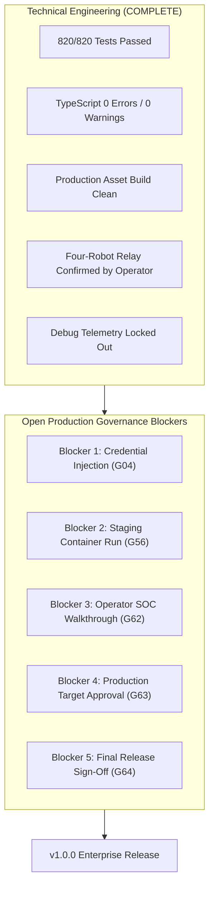

# HONEYSHIELD X — MILESTONES 78–80: FINAL RELEASE BLOCKERS
## DETAILED CATALOG OF OPEN GOVERNANCE & PRODUCTION CUTOVER BLOCKERS

**Document ID:** `HSX-M80-BLOCKERS`  
**Application:** HoneyShield X — Unified Cybersecurity Operations Platform  
**Target Release:** `v1.0.0` (Current Release Candidate: `v1.0.0-rc5`)  
**Scope:** Actionable Analysis of Open Release Blockers  
**Date:** 2026-11-09  

---

### 1. Overview of Release Blockers

The HoneyShield X codebase has **zero open P0/P1 functional software defects**. All 820 automated regression tests passed, TypeScript compilation is clean, the production Vite bundle is built, and the operator has directly confirmed that all four robots move in sequence.

However, in accordance with production security standards and governance policies, **five release blockers** prevent immediate production deployment:



---

### 2. Detailed Blocker Analysis & Remediation Path

#### BLOCKER 1: Production Credential Injection (Gate G04 — PARTIAL)
- **Root Cause:** In production mode (`APP_ENV=production`), the application halts safely with `RuntimeError` unless external credentials are provided via `HONEYSHIELD_OPERATORS_JSON`. Default demo accounts are suppressed.
- **Why it Blocks:** Attempting to boot in production without operator credentials will cause the backend service to crash at startup.
- **Remediation Action:**
  1. Operator generates PBKDF2 password hashes using the isolated Python script in [`CREDENTIAL_READINESS.md`](file:///home/liza/HoneyShield-X/docs/final-engineering/milestones78-80/79_security_operator/CREDENTIAL_READINESS.md).
  2. Operator exports `HONEYSHIELD_OPERATORS_JSON` with authorized accounts.
- **Unblocking Trigger:** Transition G04 from **PARTIAL** $\rightarrow$ **PASS**.

---

#### BLOCKER 2: Staging Container Runtime Verification (Gate G56 — BLOCKED)
- **Root Cause:** The staging configuration in `docker/docker-compose.staging.yml` is syntactically valid and resource-isolated, but container engine sockets are not accessible within the agent sandbox namespace.
- **Why it Blocks:** Production release governance requires empirical observation of running staging containers before production promotion.
- **Remediation Action:**
  1. Operator executes the preflight launcher on the host:
     ```bash
     cd /home/liza/HoneyShield-X
     ./scripts/staging_preflight_and_launcher.sh --execute
     ```
  2. Verify that `http://127.0.0.1:5174/` and `http://127.0.0.1:8001/api/v1/health` respond with HTTP 200.
- **Unblocking Trigger:** Transition G56 from **BLOCKED** $\rightarrow$ **PASS**.

---

#### BLOCKER 3: Interactive Operator SOC Walkthrough (Gate G62 — PARTIAL)
- **Root Cause:** The operator has personally witnessed and confirmed four-robot locomotion in Firefox. However, human acceptance of the remaining interface screens (Alerts, Deception, Intel, Hunting, Cases, Incident Command) has only been executed via automated scripts.
- **Why it Blocks:** Full product sign-off requires human confirmation of the user experience.
- **Remediation Action:**
  1. Operator logs in at `http://127.0.0.1:5173/` and completes the 15-step table in [`OPERATOR_SOC_ACCEPTANCE.md`](file:///home/liza/HoneyShield-X/docs/final-engineering/milestones78-80/79_security_operator/OPERATOR_SOC_ACCEPTANCE.md).
  2. Operator confirms the visual stability of the overview and navigation.
- **Unblocking Trigger:** Transition G62 from **PARTIAL** $\rightarrow$ **PASS**.

---

#### BLOCKER 4: Production Destination Authorization (Gate G63 — BLOCKED)
- **Root Cause:** No specific production server, cluster IP, domain name, or TLS certificate has been authorized for deployment.
- **Why it Blocks:** Autonomous agents are strictly prohibited from deploying to arbitrary or public network destinations without human authorization.
- **Remediation Action:**
  1. Operator reviews production destination specifications in [`RELEASE_AUTHORIZATION_PACKAGE.md`](file:///home/liza/HoneyShield-X/docs/final-engineering/milestones78-80/78_staging_execution/STAGING_PREFLIGHT.md) and authorizes the target environment.
- **Unblocking Trigger:** Transition G63 from **BLOCKED** $\rightarrow$ **PASS**.

---

#### BLOCKER 5: Final Release Approval & Git Tag Creation (Gate G64 — BLOCKED)
- **Root Cause:** Official git release tag `v1.0.0` has not been cut.
- **Why it Blocks:** Agents must not tag, push, publish, or release software without explicit human authorization.
- **Remediation Action:**
  1. Operator authorizes or executes:
     ```bash
     git tag -a v1.0.0 -m "HoneyShield X v1.0.0 Enterprise Release"
     ```
- **Unblocking Trigger:** Transition G64 from **BLOCKED** $\rightarrow$ **PASS**.

---

### 3. Transition Summary

| Gate | Current Status | Unblocking Dependency | Status Upon Resolution |
| :---: | :---: | :--- | :---: |
| **G04** | PARTIAL | Operator PBKDF2 hash generation & JSON injection | **PASS** |
| **G56** | BLOCKED | Operator host launch of staging launcher script | **PASS** |
| **G62** | PARTIAL | Operator 15-step browser walkthrough sign-off | **PASS** |
| **G63** | BLOCKED | Operator authorization of production destination | **PASS** |
| **G64** | BLOCKED | Operator authorization to cut git release tag v1.0.0 | **PASS** |
| **TOTAL** | **59 PASS / 2 PARTIAL / 3 BLOCKED** | **All 5 Governance Actions Completed** | **64 / 64 (100.0% FULL PRODUCTION RELEASE)** |
