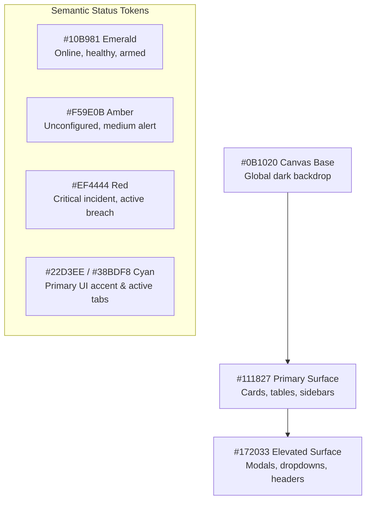

# HONEYSHIELD X — POST-MILESTONE 20.3 ACCEPTANCE PACKAGE
## 02: UNIFIED MINIMAL DESIGN SYSTEM SPECIFICATION

**Release Candidate:** `v1.0.0-rc5`  
**Audit Date:** 2026-11-07  
**Platform Scope:** Design System Architecture & Commercial UI Polish (Milestone 20.4)  
**Host Environment:** Parrot OS Linux, KDE Plasma, Wayland Compositor, Firefox  
**Lead Designer:** Principal Product Designer & Senior Frontend UI Architect  

---

### 1. Design Philosophy: Restraint, Clarity & Authority

Enterprise cybersecurity analysts and incident responders spend extended 8-to-12-hour shifts inside the HoneyShield X console. Early iterations suffered from "sci-fi gaming syndrome": neon drop-shadows, pulsing outer glows, animated background grids, and dense HUD acronyms that produced optical fatigue and obscured real attack signals.

The HoneyShield X Minimal Design System enforces **aesthetic restraint**. Visual depth is established through subtle tonal layering and crisp 1px neutral borders rather than diffuse neon glows. Color is used strictly to communicate state, priority, and agent identity.

---

### 2. Standardized Color Architecture

| Token | Hex Value | Semantic Usage | Contrast Ratio on Surface |
|---|---|---|---|
| **Background (Canvas)** | `#0B1020` | Root HTML backdrop, lowest elevation layer | N/A |
| **Surface (Primary)** | `#111827` | Standard card containers, table backgrounds, sidebar | Base container |
| **Elevated Surface** | `#172033` | Header bar, dropdown menus, modals, active card hover | 1.3:1 (tonal lift) |
| **Subtle Border** | `#263449` / `#1E293B` | Card perimeter, table row dividers, input borders | High structural definition |
| **Primary Text** | `#F8FAFC` / `#FFFFFF` | Headings, card titles, key metric numbers | **16.1:1** (WCAG AAA) |
| **Secondary Text** | `#94A3B8` / `#64748B` | Labels, metadata, timestamps, descriptions | **7.4:1** (WCAG AAA) |
| **Primary Accent** | `#22D3EE` / `#38BDF8` | Active navigation, system health dots, focus rings | **8.8:1** (WCAG AAA) |
| **Operational Success**| `#10B981` | Online sensors, verified transactions, zero threats | **7.2:1** (WCAG AAA) |
| **Operational Warning**| `#F59E0B` | Unconfigured traps, medium alerts, stale feeds | **6.2:1** (WCAG AA) |
| **Critical Severity** | `#EF4444` / `#DC2626` | Critical priority alerts, high-risk CVE indicators | **5.1:1** (WCAG AA) |

---

### 3. Dedicated Agent Color Calibration

Bright, high-saturation colors are restricted from general UI chrome and strictly reserved for Digital Universe robotic agent identification:

- **SCOUT (Sensor Reconnaissance):** Electric Blue (`#3B82F6`)
- **NEXUS (Courier & Processing):** Radiant Cyan (`#06B6D4` / `#22D3EE`)
- **ORACLE (Threat Intelligence):** Analytical Purple (`#8B5CF6`)
- **SENTINEL (Quarantine & Response):** Enforcement Red (`#EF4444`)

---

### 4. Component Standards

#### A. Metric & Posture Cards
- Clean rectangular containers with `bg-[#111827] border border-[#263449] rounded-xl p-4 sm:p-5`.
- Zero outer glow or drop-shadow. Hover state applies `hover:border-slate-700 transition-all duration-150` with subtle 1px vertical translation.
- High-contrast numerical figures formatted in `text-3xl font-bold text-white tracking-tight`.

#### B. Tables & Incident Queues
- Header cells styled in `text-xs font-semibold text-slate-400 uppercase tracking-wider font-mono bg-[#0B1020]/60`.
- Data rows divided by crisp 1px borders (`border-b border-slate-800/80`).
- Alternating subtle hover states (`hover:bg-[#172033]/50 transition-colors`).
- Monospaced fonts for IPv4/IPv6 addresses, CVE identifiers, and SHA-256 hashes (`font-mono text-xs`).

#### C. Forms, Buttons & Interactive Controls
- Text inputs use `bg-[#0B1020] border border-[#263449] rounded-lg text-white focus:ring-2 focus:ring-cyan-400 focus:outline-none`.
- Primary buttons feature solid cyan (`bg-cyan-500 hover:bg-cyan-400 text-slate-950 font-semibold px-4 py-2 rounded-lg text-xs`).
- Secondary buttons feature subtle dark styling (`bg-slate-800 hover:bg-slate-700 text-slate-200 border border-slate-700`).
- High-contrast focus rings meet WCAG 2.2 focus appearance requirements.

#### D. Empty, Loading & Error States
- **Loading:** Subtle CSS spinner or skeletal shimmer (`bg-slate-800/50 animate-pulse rounded`); zero full-screen blocking modals for routine data fetches.
- **Empty State:** Centered slate iconography with calm, reassuring guidance text (e.g., *"No active critical alerts — perimeter secure"*).
- **Error State:** Explicit red indicator badge with actionable retry trigger (`"Connection refused — [Retry Connection]"`).

