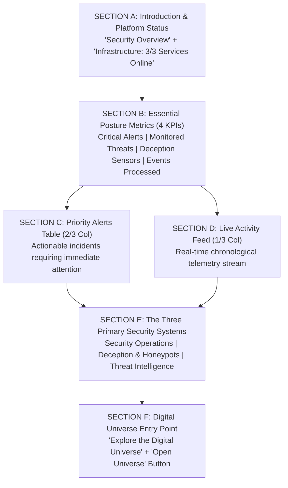

# HONEYSHIELD X — POST-MILESTONE 20.3 ACCEPTANCE PACKAGE
## 03: OVERVIEW DASHBOARD & UNIFIED NAVIGATION SPECIFICATION

**Release Candidate:** `v1.0.0-rc5`  
**Audit Date:** 2026-11-07  
**Platform Scope:** Executive Overview & Global Navigation Architecture (Milestone 20.4)  
**Host Environment:** Parrot OS Linux, KDE Plasma, Wayland Compositor, Firefox  
**Lead Architect:** Principal SOC Architect & Usability Specialist  

---

### 1. Executive Summary

A core objective of the minimal redesign was solving navigational confusion and alert burial. Operators need an unambiguous mental model: six clear primary destinations, a well-organized secondary drawer for advanced forensic tooling, and an incident-first overview dashboard where active attacks can be assessed and triaged immediately.

---

### 2. The Six Primary Navigation Destinations

The primary sidebar ([`Sidebar.tsx`](file:///home/liza/HoneyShield-X/frontend/src/components/Sidebar.tsx)) and mobile drawer ([`MobileNavDrawer.tsx`](file:///home/liza/HoneyShield-X/frontend/src/components/MobileNavDrawer.tsx)) enforce six canonical destinations:

```
+-----------------------------------------------------------------------------------+
| 1. Overview             | Executive posture, 4 KPIs, priority alerts, live events |
| 2. Threats & Alerts     | Incident triage, severity queuing, status updates       |
| 3. Honeypots            | Active deception fleet, canary tokens, trap telemetry    |
| 4. Threat Intelligence  | STIX 2.1 indicators, adversary attribution, IOC fusion   |
| 5. Investigations       | Forensic timelines, IP dossiers, host isolation         |
| 6. Digital Universe     | Spatial 3D/2.5D cyber stage with 4 autonomous robots     |
+-----------------------------------------------------------------------------------+
```

#### Secondary Contextual Navigation (Drawer & Sub-Views):
- **Incident Command (`command`):** Real-time network defense war room and quarantine controls.
- **Detection Rules (`rules` / `catalog`):** Detection catalog, rule replay, and simulation sandboxes.
- **AI Campaigns & Hunting (`campaigns` / `hunts`):** PostgreSQL regex search and adversary campaign mapping.
- **Case Management (`cases`):** Evidence vault chain of custody and escalation notes.
- **System Integrations (`integrations`):** Third-party SIEM forwarders, webhook dispatchers, API credentials.
- **Platform Configuration (`config` / `audit`):** SRE health metrics, Prometheus endpoints, audit logs.

---

### 3. Overview Layout Architecture (Reading Order A through F)



#### Section Breakdown:
1. **Section A (Introduction):**
   - Heading: `Security Overview`
   - Description: `"Monitor threats, investigate activity, and manage your security environment."`
   - Health Badge: `"Infrastructure: 3/3 Services Online"` (PostgreSQL, Redis, FastAPI).
   - Onboarding Toggle: Permanent `"Platform Guide"` button (Compass icon) to access the 4-pillar FTUX guide.
2. **Section B (Essential Posture Metrics):**
   - **Critical Alerts:** Count of unresolved severity-1 incidents (`3 Active`, Red alert badge).
   - **Monitored Threats:** Active adversary campaigns and tracked threat actors (`12 Active`, Amber warning badge).
   - **Sensor Health:** Honest dynamic sensor status (`Canary Active (5 Unconfigured)`, Cyan telemetry badge).
   - **Events Processed:** Sliding 24h persistent aggregate (`2,847 Events (24h)`, Purple badge).
3. **Section C (Priority Alerts Queue — Above Fold):**
   - Positioned on the left 2/3 column. Renders severity pills, source vectors, incident titles, detection timestamps, and direct `"Investigate →"` action.
   - Zero scrolling required on 1080p and 1440p displays to begin triage.
4. **Section D (Recent Activity Feed):**
   - Positioned on the right 1/3 column. Displays timestamped, descending live telemetry stream (port scans, canary triggers, auth attempts).
5. **Section E (Three Primary Security Systems):**
   - **Security Operations:** *"Detect and investigate suspicious activity. Autonomous threat triage and guided incident response workflows."*
   - **Deception & Honeypots:** *"Observe attackers interacting with controlled traps. Active decoys and canary tokens engage adversaries before production exposure."*
   - **Threat Intelligence:** *"Enrich indicators and connect related threats. Multi-feed STIX 2.1 IOC fusion and adversary campaign attribution."*
6. **Section F (Digital Universe Entry Point):**
   - Header: **Explore the Digital Universe**
   - Subtitle: *"Follow security events through HoneyShield X with four digital agents."*
   - Button: **Open Universe**
   - Distinct colored glyphs for SCOUT (Blue), NEXUS (Cyan), ORACLE (Purple), and SENTINEL (Red).

---

### 4. Navigation Verification Status

- [x] All 6 primary sidebar navigation items route to active views with 1 click.
- [x] Responsive sidebar collapse (`w-60` to `w-16`) preserves icon recognition and tooltips.
- [x] Mobile navigation drawer functions smoothly on touch viewports (390px to 768px).
- [x] Zero duplicate navigation links between Header and Sidebar.

