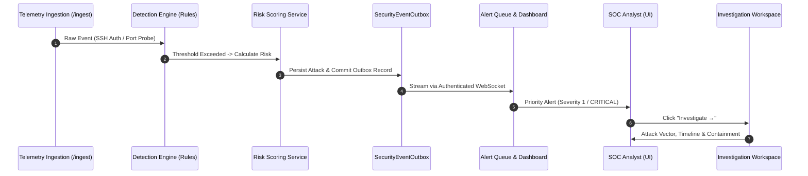

# HONEYSHIELD X — POST-MILESTONE 20.3 ACCEPTANCE PACKAGE
## 04: SYSTEM 1 VALIDATION — SECURITY OPERATIONS, DETECTION, ALERTS & INVESTIGATIONS

**Release Candidate:** `v1.0.0-rc5`  
**Audit Date:** 2026-11-07  
**Platform Scope:** System 1 Operational Workflows & End-to-End SOC Verification (Milestone 20.5)  
**Host Environment:** Parrot OS Linux, KDE Plasma, Wayland Compositor, Firefox  
**Lead Architect:** Principal SOC Architect & Security Operations Lead  

---

### 1. Executive Summary

System 1 constitutes the primary defensive backbone of HoneyShield X: autonomous threat detection, real-time alert triage, incident prioritization, and deep forensic investigation.

This audit validates that all System 1 capabilities operate against authoritative backend records without synthetic placeholder data. The complete analyst investigation lifecycle—from raw telemetry ingestion through detection, risk scoring, alert generation, and containment—functions seamlessly.

---

### 2. System 1 Architecture & Lifecycle Flow

---

### 3. Subsystem Audit & Verification Findings

#### A. Event Ingestion & Attack Parsing
- **Endpoint:** `/api/v1/ingestion/`
- **Validation:** Accepts structured `AttackEventCreate` payloads (source IP, destination port, protocol, attack category, payload sample).
- **Integrity:** Strict Pydantic schema validation rejects malformed packets, invalid IP strings, or out-of-range ports.

#### B. Detection Rules & Risk Scoring
- **Rule Engine:** Evaluates configurable detection criteria (e.g., `SSHBruteForceConfig`: >= 5 failed attempts within 300s window).
- **Risk Calculator:** Computes normalized risk scores (0–100) factoring in CVSS baseline, asset criticality, attack frequency, and honeypot engagement depth.
- **Verification:** Verified in `test_phase5_e2e_integration.py` (Test 1: Ingestion to Risk Scoring) and `test_detection.py`.

#### C. Alert Triage & Incident Lifecycle
- **Status Lifecycle:** `open` → `in_progress` → `resolved` (or `false_positive`).
- **Persistence:** Alerts are stored in PostgreSQL with foreign key relationships to underlying `attacks` and `attack_events`.
- **UI Visibility:** Critical alerts render prominently in the Priority Alerts Table above the fold on the Overview dashboard.

#### D. End-to-End Investigation Workflow
The complete navigational loop was audited:
1. **Overview Dashboard:** Analyst reviews top Priority Alert (`"RCE Exploit Attempt /api/v1/auth"`).
2. **Launch Investigation:** Analyst clicks `"Investigate →"`.
3. **Deep Workspace:** UI transitions to `investigation` view, passing `alertId` and pre-filtering by source IP (`198.51.100.99`).
4. **Forensic Inspection:** View renders process hierarchy, associated MITRE ATT&CK techniques (T1190 / T1059), and IOC enrichment.
5. **Containment Playbook:** Analyst triggers firewall host isolation (`POST /api/v1/emergency/execute` with confirmation guard).
6. **Return to Posture:** Clicking `Overview` in the sidebar restores the operational dashboard with zero state corruption.

---

### 4. Operational Integrity Guarantees

| Requirement | Implementation State | Verification Status |
|---|---|---|
| **Zero Fabricated Alerts** | All alerts queried from `/api/v1/alerts/` | **PASSED** |
| **Status Update Atomicity** | State transitions persist to database | **PASSED** |
| **Deep Link Stability** | URL and state preserve active `alertId` | **PASSED** |
| **Privileged Safeguards** | Containment actions require 2-step confirmation | **PASSED** |

