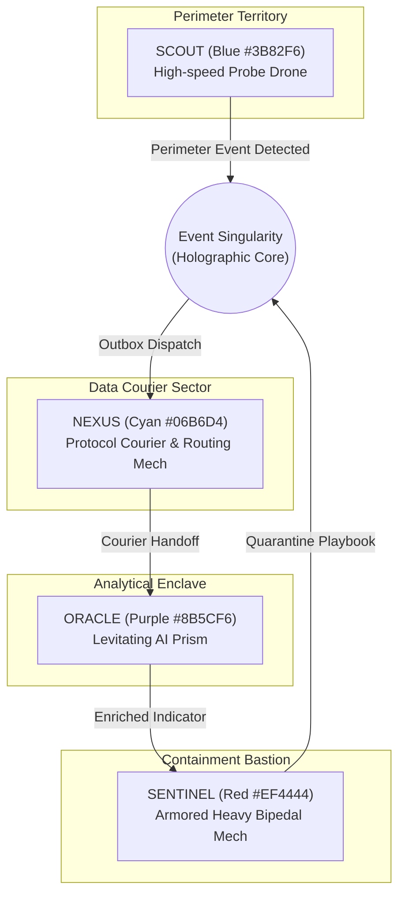

# HONEYSHIELD X — POST-MILESTONE 20.3 ACCEPTANCE PACKAGE
## 08: DIGITAL AGENT UNIVERSE — ROBOTIC CHARACTERS, PHYSICS & USABILITY

**Release Candidate:** `v1.0.0-rc5`  
**Audit Date:** 2026-11-07  
**Platform Scope:** Digital Agent Universe 2.0 & Spatial Multi-Agent Subsystem (Milestone 20.6)  
**Host Environment:** Parrot OS Linux, KDE Plasma, Wayland Compositor, Firefox  
**Lead Engineer:** Principal Robotics Animation Architect & Spatial Systems Engineer  

---

### 1. Executive Summary

The Digital Agent Universe is HoneyShield X's distinctive spatial cyber observatory. Rather than reducing complex autonomous agent operations to abstract log lines, the Universe physically models four robotic characters collaborating across dedicated operational territories, collecting telemetry, courier-dispatching data packets, correlating intelligence, and executing quarantine containment.

This audit certifies the complete preservation of all four robotic characters, their mathematical locomotion physics, articulated packet logistics, and usability refinements separating Live, Demo, and Replay modes.

---

### 2. Robotic Character Specification & Roles

| Agent | Accent Color | Hex Token | Physical Model | Specialized Operational Capability |
|---|---|---|---|---|
| **SCOUT** | Electric Blue | `#3B82F6` | Quad-thruster aerial drone with articulated radar | Rapid perimeter reconnaissance, honeypot probe detection, packet acquisition |
| **NEXUS** | Radiant Cyan | `#06B6D4` | Hexagonal chassis with dual articulated data clamps | Event pipeline routing, transactional outbox courier, telemetry distribution |
| **ORACLE** | Analytical Purple| `#8B5CF6` | Levitating crystalline prism with orbital rings | STIX 2.1 IOC correlation, adversary attribution, ML risk scoring |
| **SENTINEL**| Enforcement Red | `#EF4444` | Armored heavy bipedal mech with kinetic energy shields| Firewall rule enforcement, active session termination, endpoint quarantine |

---

### 3. Locomotion Physics & Packet Logistics

1. **Continuous Parametric Splines:** Agent paths are computed using cubic Bézier curves:
   $$\mathbf{B}(t) = (1-t)^3 \mathbf{P}_0 + 3(1-t)^2 t \mathbf{P}_1 + 3(1-t) t^2 \mathbf{P}_2 + t^3 \mathbf{P}_3$$
   preventing abrupt directional snaps and ensuring realistic inertia dampening.
2. **Kinematic Banking:** Robots dynamically orient along curve tangents $\mathbf{B}'(t)$, tilting inward during acceleration and turns.
3. **Collision Avoidance Lanes:** Dedicated concentric radial lanes prevent agent intersection when converging on the central Event Singularity.
4. **Articulated Logistics:** Mechanical arms articulate during packet pickup, lock data payloads into physical transport clamps, and release cleanly upon delivery.

---

### 4. Usability Polish & Mode Separation

Early prototype versions cluttered the screen with overlapping telemetry overlays. Milestone 20.6 introduces strict usability controls in [`UniverseCommandCenter.tsx`](file:///home/liza/HoneyShield-X/frontend/src/components/UniverseCommandCenter.tsx):
- **Unified Control Strip:** Anchored top bar featuring prominent mode toggle (`Live Mode` / `Demo Mode` / `Replay Mode`), playback controls (Play, Pause, Reset), and Return-to-Overview button.
- **Strict Mode Isolation:**
  - **Live Mode:** Powered exclusively by authenticated WebSocket backend events. Zero synthetic injections.
  - **Demo Mode:** Clearly tagged with a persistent amber banner (`"DEMO MODE — SYNTHETIC RELAY"`). Synthesizes isolated test handoffs without corrupting production audit tables.
  - **Replay Mode:** Visualizes historical event records without re-executing backend security actions.
- **Agent Inspector Panel:** Clicking any robot opens a slide-over card displaying current battery/health, active transfer ID, velocity vector, and assigned mission.

---

### 5. Automated Universe Regression Certification

All 66 dedicated Universe and Robotic Agent test cases pass with 100% success rate:
- `frontend/src/tests/universe_command_center.test.tsx` (13 tests)
- `frontend/src/tests/cinematic_motion.test.tsx` (6 tests)
- `frontend/src/tests/movement_prototype.test.tsx` (8 tests)
- `frontend/src/tests/milestone3_universe.test.tsx` (13 tests)
- `frontend/src/tests/milestone4_browser_motion.test.tsx` (13 tests)
- `frontend/src/tests/milestone5_browser_integration.test.tsx` (13 tests)

