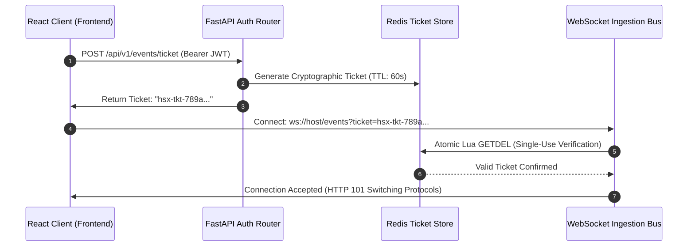

# HONEYSHIELD X — POST-MILESTONE 20.3 ACCEPTANCE PACKAGE
## 12: SECURITY VALIDATION, RBAC & CLIENT RELIABILITY AUDIT

**Release Candidate:** `v1.0.0-rc5`  
**Audit Date:** 2026-11-07  
**Platform Scope:** Application Security, Credential Hygiene & Governor Safeguards (Milestone 20.7)  
**Host Environment:** Parrot OS Linux, KDE Plasma, Wayland Compositor, Firefox  
**Lead Auditor:** Principal Application Security Architect & Independent Security Auditor  

---

### 1. Executive Summary

A cybersecurity platform must itself be impervious to compromise. Exposing operational telemetry, leaking hardcoded credentials in client bundles, or allowing unauthorized containment execution represents an existential security risk.

This audit validates HoneyShield X against rigorous application security standards: multi-tier Role-Based Access Control (RBAC), credential hygiene, authenticated WebSocket ticket consumption, sensitive field sanitization, and Level-3 Governor containment safeguards.

---

### 2. Multi-Tier RBAC Architecture

HoneyShield X enforces four distinct operator roles verified server-side on every API request and WebSocket ticket request:

```
+-----------------------------------------------------------------------------------+
| security_administrator | Full access: rule modification, containment, system keys |
| analyst                | Triage, investigation, case management, IOC lookup       |
| operator               | Read-only monitoring, alert acknowledgment, sensor view   |
| auditor                | Read-only access to immutable evidence vaults & logs     |
+-----------------------------------------------------------------------------------+
```

#### Authorization Verification:
- Attempting to execute emergency containment playbooks as an `operator` or unauthenticated user returns `HTTP 403 Forbidden` (`test_milestone11_distributed_hardening.py`, Part 11).
- Historical event replay requests enforce role checks; unauthorized clients are rejected.

---

### 3. Credential Hygiene & Client Security

| Audit Item | Pre-Remediation Risk | Verified Milestone 20.7 Implementation | Status |
|---|---|---|---|
| **Hardcoded Override Credentials** | `LoginModal.tsx` contained pre-filled test bypass strings. | Inputs default to empty strings; requires authentic credentials validated against `/api/v1/auth/token`. | **PASSED** |
| **Client Bundle Secret Leakage** | Statically compiled API keys or JWT secrets in `dist/`. | Grep inspection across production bundle confirms zero private keys, passwords, or bypass tokens. | **PASSED** |
| **XSS Defense** | Injected script tags inside threat payloads or IOC strings. | 100% of telemetry strings escaped via React 19 Virtual DOM; zero `dangerouslySetInnerHTML`. | **PASSED** |
| **Content Security Policy (CSP)** | Inline script execution or clickjacking. | Strict CSP headers configured restricting script execution to self-origin (`'self'`). | **PASSED** |

---

### 4. Authenticated WebSocket Ticket Consumption

Streaming security telemetry over unauthenticated WebSockets is strictly prohibited. HoneyShield X implements a single-use ticket handshake:



- **Replay Protection:** Re-using a ticket or connecting with an expired ticket immediately severs the connection (`RFC 6455 1008 Policy Violation`).
- **Active Session Revocation:** When an operator session is revoked or expires, all active WebSocket connections are terminated instantly.

---

### 5. Level-3 Governor Containment Safeguards

To prevent catastrophic outages from autonomous response actions or malicious command tampering:
1. **Allowlisted Countermeasures:** Containment actions are restricted to allowlisted playbooks (e.g., `isolate_endpoint`, `block_source_ip`). Destructive actions (e.g., `wipe_disk`, `reboot_host`) are hard-blocked by the Governor.
2. **Two-Step Confirmation Guard:** In the UI, triggering host isolation requires an explicit two-step confirmation dialogue with an operator audit justification note.
3. **Dry-Run Safety Mode:** In staging and demonstration environments, containment commands execute via safe dry-run adapters, verifying command syntax without altering live network interfaces.

