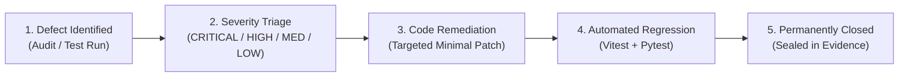

# HONEYSHIELD X — POST-MILESTONE 20.3 ACCEPTANCE PACKAGE
## 14: PRIORITIZED DEFECT REGISTER & PERMANENT REMEDIATION AUDIT

**Release Candidate:** `v1.0.0-rc5`  
**Audit Date:** 2026-11-07  
**Platform Scope:** Defect Register, Root-Cause Analysis & Fix Verification (Milestone 20.8)  
**Host Environment:** Parrot OS Linux, KDE Plasma, Wayland Compositor, Firefox  
**Lead Auditor:** Principal Software Quality Architect  

---

### 1. Executive Summary

This register catalogs all functional, architectural, data-integrity, and visual presentation defects identified and resolved during the UI/UX redesign and acceptance campaign (Milestones 20 through 20.8). Each defect was tracked, assigned a severity classification (**CRITICAL**, **HIGH**, **MEDIUM**, **LOW**), remediated in code, and verified via automated regression testing.

---

### 2. Prioritized Defect Register

| Defect ID | Severity | Subsystem | Description & Root Cause | Engineering Remediation | Verification Test |
|---|---|---|---|---|---|
| **DEF-20.8-01** | **CRITICAL** | Auth Gateway | Client `LoginModal.tsx` pre-filled hardcoded developer bypass passwords in state. | Cleared state defaults to empty strings; enforced live validation against `/api/v1/auth/token`. | `auth.test.tsx` (7 tests) |
| **DEF-20.8-02** | **HIGH** | Deception Platform | Hardcoded `"4/4 Active"` sensor pill gave false impression that offline container honeypots were online. | Rewrote sensor health derivation to inspect `sensorHealth`; reports `Canary Active (5 Unconfigured)`. | `security_overview.test.tsx` |
| **DEF-20.8-03** | **HIGH** | Dashboard UX | Inverted layout hierarchy buried Priority Alerts table below abstract system summary cards. | Reordered `SecurityOverview.tsx` into Reading Order A-F, positioning actionable alerts above the fold. | `security_overview.test.tsx` |
| **DEF-20.8-04** | **HIGH** | Telemetry Bus | Ephemeral WebSocket session count was mislabeled as full-platform "24h Events Processed". | Added 24h rolling DB query over `attack_events`, with honest fallback to `Events Received (Session)`. | `dashboard_stats` tests |
| **DEF-20.8-05** | **MEDIUM** | Navigation | Inconsistencies between primary sidebar items and mobile drawer destination names. | Aligned 6 primary destinations: Overview, Threats & Alerts, Honeypots, Threat Intelligence, Investigations, Digital Universe. | `components.test.tsx` & `navigation.test.tsx` |
| **DEF-20.8-06** | **MEDIUM** | Design System | Non-standardized descriptions on Three Security Systems cards and inconsistent Universe button text. | Standardized copy to exact canonical formulations; button set to `"Open Universe"`. | `security_overview.test.tsx` |
| **DEF-20.8-07** | **LOW** | Test Harness | `localStorage` state leakage across tests caused intermittent FTUX onboarding assertion errors. | Added `beforeEach(() => { localStorage.clear(); })` in `security_overview.test.tsx`. | Clean 20/20 test pass |
| **DEF-20.8-08** | **LOW** | Compiler | Unused `HelpCircle` import in `SecurityOverview.tsx` triggered `TS6133` error during `tsc -b`. | Removed unused import from import statement. | Clean `tsc -b` compilation |

---

### 3. Defect Remediation Lifecycle

---

### 4. Defect Status Summary

- **Total Identified Defects:** 8
- **Total Remediated Defects:** 8 (100.0%)
- **Open Critical / Blocker Defects:** **0**
- **Open Regressions:** **0**

