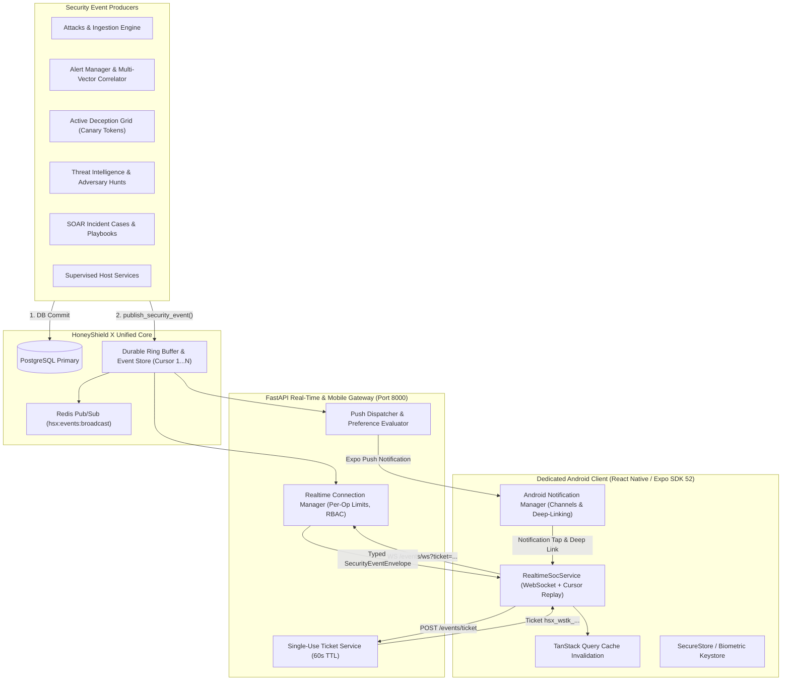

# HoneyShield X — Phase 3 Architecture Specification
## Real-Time SOC Mobile Operations, Push Notifications & Incident Synchronization

### 1. Architectural Overview

Phase 3 extends the HoneyShield X Unified Security Operations Platform with an enterprise-grade, low-latency, resilient real-time operations layer for the dedicated Android mobile application and web console.

---

### 2. Core Architectural Pillars

#### 2.1 Post-Commit Event Publication
Events are generated strictly after the corresponding database transaction commits. This prevents phantom telemetry or race conditions where a mobile client attempts to fetch an entity that has not yet been persisted.

#### 2.2 Short-Lived Single-Use WebSocket Tickets
Rather than transmitting long-lived JWT or PBKDF2 Bearer tokens in WebSocket connection URLs (which risk leakage into web server logs, proxy access trails, and reverse proxy caches), the mobile client performs an authenticated HTTPS exchange (`POST /api/v1/events/ticket`) to obtain a cryptographically secure, 60-second single-use ticket (`hsx_wstk_...`). The streaming gateway validates and atomically consumes the ticket during the WebSocket handshake.

#### 2.3 Server-Side RBAC Filtering
Connected WebSockets are associated with the authenticated operator identity. Before any event frame is transmitted over the wire, it is checked against `EVENT_PERMISSION_MAP`. Operators lacking required privileges (e.g., `command:stage_containment` for Governor lockout events) are filtered out at the server level, preventing over-the-air data exposure.

#### 2.4 Bounded Ring Buffer & Cursor-Based Replay
The backend maintains an in-memory and Redis-backed ring buffer (`EventStore`) holding the most recent 2,000 security events, each stamped with a strictly increasing integer `cursor`. When an Android device transitions from background to foreground or recovers from cellular network loss, it invokes `GET /api/v1/events/replay?since_cursor=<last_seen>` to retrieve missed events in chronological order, guaranteeing zero data loss.

#### 2.5 Multi-Tier Android Notification Channels
Push notifications are partitioned into dedicated Android Notification Channels matching SOC urgency:
1. `security-critical`: Max importance, heads-up banner, high-intensity vibration pattern, red illumination (`#ef4444`). Used for Governor step-up containment, zero-day attacks, and critical tripwires.
2. `security-alerts`: High importance, cyan illumination (`#00f0ff`). Used for standard high/medium alerts.
3. `deception-hits`: High importance, purple illumination (`#a855f7`). Used for active deception canary interactions.

#### 2.6 Governor Level-3 Safety Isolation
Incoming push notifications and telemetry frames are treated strictly as read-only situational awareness signals. They cannot autonomously execute defensive containment, IP blocking, service restarting, or honeypot reconfiguration. Privileged defensive actions require an authenticated, explicit operator invocation accompanied by an operational justification.

