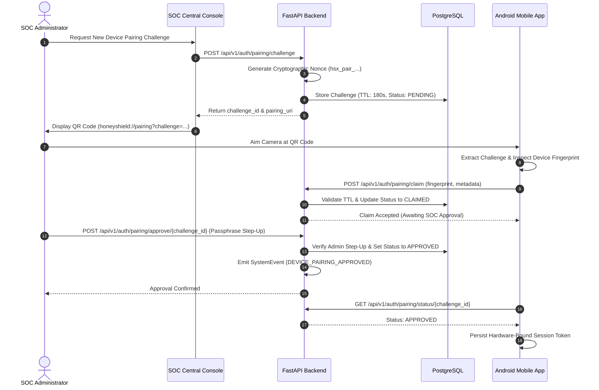

# HoneyShield X — Phase 4 Device Pairing Security Architecture

**Document ID:** `HSX-DOC-P4-003`  
**Phase:** 4 — Secure Device Association  
**Date:** 2026-11-04  
**Author:** Principal Cryptographic Architect & Security Engineer  
**Classification:** Internal Technical Standard  

---

## 1. Threat Model & Association Vulnerabilities

Traditional mobile app pairing protocols frequently suffer from:
1. **Long-Lived Secret Exposure:** Static tokens embedded in QR codes that can be shoulder-surfed or photographed.
2. **Credential Transmission:** Transmitting plaintext passwords or bearer tokens over QR optical channels.
3. **Replay Attacks:** Intercepting a scanned token and reusing it from an unauthorized device.
4. **Lack of Operator Attestation:** Unsupervised device enrollment directly granting administrative access.

---

## 2. HoneyShield X Single-Use Ephemeral QR Protocol

HoneyShield X resolves these vulnerabilities through an ephemeral, multi-stage, out-of-band enrollment handshake:

---

## 3. Protocol Invariants & Controls

### 3.1 Non-Credential QR Payloads
The QR code contains **no bearer tokens, private keys, or passwords**. The payload is an opaque URI:
`honeyshield://pairing?challenge=hsx_pair_49CxroTceq4PFyTe2m9IThHzd2XPQlv1wnj6NUiD3C0&endpoint=https://soc.honeyshield.local/api/v1`

### 3.2 180-Second Strict Expiration
Challenges expire after 180 seconds (`PAIRING_CHALLENGE_TTL_SECONDS = 180`). If not claimed and approved within this window, the backend transitions the record to `expired` and returns `410 Gone`.

### 3.3 Replay Protection
A challenge can be claimed exactly once. Subsequent claim attempts return `409 Conflict`.

### 3.4 Mandatory Administrative Step-Up Approval
Even after an Android device successfully claims a challenge, the device remains in `claimed` state without API access until a SOC Administrator executes the `/approve` endpoint presenting a valid step-up confirmation passphrase (min 8 characters).

### 3.5 Immediate Revocation
Administrators can terminate any pairing session instantly via:
`POST /api/v1/auth/pairing/revoke/{challenge_id}`

### 3.6 Full Audit Trail
All state transitions are logged immutably into `system_events`:
- `DEVICE_PAIRING_REQUESTED`
- `DEVICE_PAIRING_CLAIMED`
- `DEVICE_PAIRING_APPROVED`
- `DEVICE_PAIRING_REVOKED`

