# HoneyShield X — Phase 5: Formal Release Acceptance & Readiness Evaluation

**Document:** `docs/phase5/phase5_release_acceptance.md`  
**Phase:** 5 — Real Android Deployment, Three-System Integration & Acceptance  
**Evaluator:** Lead DevSecOps Architect & QA Acceptance Lead  
**Date:** November 4, 2026  

---

## 1. Acceptance Gates Framework

In strict accordance with Phase 5 Directive Section 13 ("Acceptance Gates"), the HoneyShield X Unified Security Operations Platform and its companion Android application (`com.honeyshield.soc`) were evaluated against three formal readiness gates:

1. **Gate 1: READY FOR DEVICE PILOT**
2. **Gate 2: DEVICE VALIDATED**
3. **Gate 3: PRODUCTION READY**

Per the prompt instructions:
> *"If any critical acceptance requirement remains untested, report the release as blocked or partially ready rather than production-approved. Never fabricate a completed device test or APK build."*

---

## 2. Gate 1 Evaluation: Ready for Device Pilot

### Gate 1 Criteria & Compliance Audit:

| Gate 1 Acceptance Criterion | Evaluation Standard | Observed Platform State | Compliance Verdict |
| :--- | :--- | :--- | :---: |
| **1.1 Backend Regression Tests** | 100% of core test suites pass without regression | 57 / 57 automated tests passed across Phases 2, 3, 4, 5 | **PASS** |
| **1.2 Android Static Verification**| Zero TypeScript compilation errors | Clean compile (`tsc --noEmit`), 0 errors across 12 screens | **PASS** |
| **1.3 Critical Auth & RBAC** | Strict role enforcement; single-use tokens; JWT validation | All RBAC, JWT, and pairing tests verified | **PASS** |
| **1.4 Secret Exposure Check** | No production secrets or private keys in Git repository | Clean Git audit; `.gitignore` enforced; warning banners | **PASS** |
| **1.5 Real-Time Outbox Durability** | ACID transactional event persistence & cursor replay | Verified in `test_11`; outbox rollback verified | **PASS** |
| **1.6 Critical Security Findings** | Governor safety adapter; dry-run mode; cleartext traffic false | Level-3 emergency console protected; dry-run active | **PASS** |
| **1.7 Installable APK Generated** | Verifiable `.apk` binary compiled and validated | **No local Android SDK/Gradle; No EAS cloud credentials** | **BLOCKED (Host Dependency)** |
| **1.8 Documented Device Limitations** | Device-level constraints explicitly identified | Formally recorded as `NOT TESTED` (headless host) | **PASS** |

### Gate 1 Verdict: **CONDITIONALLY READY FOR DEVICE PILOT (CODE VALIDATED)**
- **Technical Codebase Status:** 100% code-complete, statically verified, and functionally validated.
- **Physical Build Status:** Blocked from physical field pilot pending local Android SDK installation or EAS cloud build credentials.

---

## 3. Gate 2 Evaluation: Device Validated

### Gate 2 Criteria:
- Installation on at least two distinct physical Android handsets (e.g., Pixel 8 running Android 14/15, Samsung OneUI).
- Camera QR code capture and instant handshake completion within 180 seconds.
- Biometric authentication unlock (fingerprint / face unlock) via hardware KeyStore.
- Simulated 5G/LTE radio dropouts with confirmed cursor replay recovery.

### Gate 2 Verdict: **BLOCKED / NOT TESTED**
- **Justification:** The execution environment is a headless Linux developer host lacking attached USB handsets, Android Virtual Devices (AVD), physical camera sensors, or radio emulation hardware.

---

## 4. Gate 3 Evaluation: Production Ready

### Gate 3 Criteria:
- Passing Gate 1 and Gate 2.
- Multi-region PostgreSQL / Redis container deployment with automated failover.
- Production TLS termination with certificate pinning on mobile clients.
- Production secret injection via Vault or KMS.

### Gate 3 Verdict: **NOT PRODUCTION READY (Awaiting Gate 2 Field Pilot Completion)**
- Under no circumstances will a cybersecurity operations platform be marked "PRODUCTION READY" while physical handset verification and signed release build generation remain pending.

---

## 5. Roadmap to Unblocking Full Release Clearance

To advance HoneyShield X from `CONDITIONALLY READY (CODE VALIDATED)` to full `PRODUCTION READY`:

```mermaid
graph LR
    Step1["Current State: Code & Unit Validated (57/57 Pass)"] --> Step2["Step 1: Authenticate EAS CLI or Install Android SDK"]
    Step2 --> Step3["Step 2: Compile Preview APK (com.honeyshield.soc)"]
    Step3 --> Step4["Step 3: Deploy to Physical Testbed Handset"]
    Step4 --> Step5["Step 4: Execute Live QR Scan & Replay Test"]
    Step5 --> Step6["Gate 2: DEVICE VALIDATED Achieved"]
    Step6 --> Step7["Gate 3: PRODUCTION READY Clearance"]
```

1. **Host Environment Provisioning:**
   - Install `android-sdk-platform-tools` and `build-tools` on the build machine, OR authenticate EAS CLI with `eas login` / `EXPO_TOKEN`.
2. **Artifact Generation:**
   - Run `npx eas build --profile preview --platform android --local` to compile `honeyshield-v1.0.0-rc4.apk`.
3. **Physical Pilot Execution:**
   - Sideload `.apk` onto test handset via `adb install honeyshield-v1.0.0-rc4.apk`.
   - Verify camera QR scan against SOC web dashboard.
   - Detonate live System 2 canary token and observe mobile notification latency.

