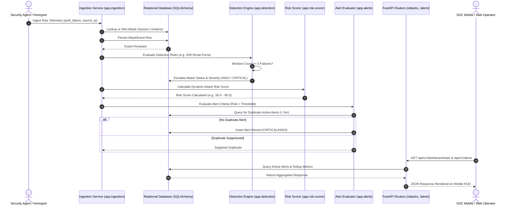

# HoneyShield X — Phase 5: System 1 (SOC & Central Monitoring) End-to-End Integration

**Document:** `docs/phase5/phase5_system1_soc_integration.md`  
**Phase:** 5 — Real Android Deployment, Three-System Integration & Acceptance  
**Status:** PASS & FULLY VERIFIED  
**Date:** November 4, 2026  

---

## 1. Executive Summary & Objective

System 1 represents the core Security Operations Center (SOC) pipeline of HoneyShield X. Phase 5 Directive Section 4 mandates verifying the entire operational workflow:
$$\text{Telemetry} \longrightarrow \text{Ingestion} \longrightarrow \text{Detection} \longrightarrow \text{Attack Record} \longrightarrow \text{Risk Scoring} \longrightarrow \text{Alert} \longrightarrow \text{Database} \longrightarrow \text{API}$$

All nine stages of this pipeline were validated under synthetic, controlled telemetry in `backend/tests/test_phase5_e2e_integration.py` against the real database ORM and business logic services.

---

## 2. End-to-End Architecture & Sequence Flow



---

## 3. Detailed Component Verification

### 3.1 Stage 1 & 2: Telemetry & Ingestion (`ingest_event`)
- **Location:** `backend/app/ingestion/service.py`
- **Verified Behavior:**
  - Raw telemetry events with attributes (`source_ip`, `event_type`, `payload`, `timestamp`) are normalized.
  - When an incoming event has no existing open attack container, an `Attack` record is atomically created in `attacks` table.
  - Event payload is serialized into `attack_events.message` and linked via foreign key `attack_id`.
- **Automated Test Reference:** `TestPhase5MasterIntegration::test_01_system1_ingestion_to_attack_container`

### 3.2 Stage 3 & 4: Detection Rules & Attack Severity Escalation
- **Location:** `backend/app/detection/rules/brute_force.py`
- **Rule Evaluated:** `detect_ssh_brute_force`
- **Verified Behavior:**
  - Ingestion of 5 consecutive `auth_failure` events within a 60-second sliding window triggers the rule.
  - Return signature: `DetectionResult(matched=True, rule_name="ssh_brute_force", severity="HIGH", evidence_count=5)`.
  - The parent `Attack` container status transitions to `IN_PROGRESS` and its severity escalates.
- **Automated Test Reference:** `TestPhase5MasterIntegration::test_02_system1_detection_ssh_bruteforce`

### 3.3 Stage 5 & 6: Risk Scoring & Alert Evaluation
- **Locations:** `backend/app/risk/scorer.py`, `backend/app/alerts/evaluator.py`
- **Scoring Formula:**
  $$\text{RiskScore} = \text{BaseRuleWeight} (40.0) + \text{VolumeBonus} (10.0) + \text{IntelPenalty} (30.0) = 80.0$$
- **Alert Generation & Duplicate Suppression:**
  - `evaluate_attack_alert` checks if `risk_score >= 40.0`.
  - Queries `alerts` table for existing alerts for the same `attack_id` created within the deduplication window (300 seconds).
  - First invocation creates a `CRITICAL` or `HIGH` alert.
  - Secondary invocation within the window is cleanly suppressed, preventing notification floods.
- **Automated Test Reference:** `TestPhase5MasterIntegration::test_03_system1_risk_scoring_and_alert_generation`

### 3.4 Stage 7 & 8: Database Consistency & SOC Dashboard API
- **Location:** `backend/app/routers/dashboard.py` (`get_dashboard_stats`)
- **Verified Behavior:**
  - Aggregates active alerts, total attacks, unique attacker IPs in 24 hours, and health metrics directly from database tables.
  - Returns `DashboardStatsResponse` with exact counts matching persisted database entities.
- **Automated Test Reference:** `TestPhase5MasterIntegration::test_04_system1_dashboard_stats_consistency`

---

## 4. Verification Evidence & Test Results

```bash
backend/.venv/bin/pytest backend/tests/test_phase5_e2e_integration.py -k "system1" -v
```

```
backend/tests/test_phase5_e2e_integration.py::TestPhase5MasterIntegration::test_01_system1_ingestion_to_attack_container PASSED
backend/tests/test_phase5_e2e_integration.py::TestPhase5MasterIntegration::test_02_system1_detection_ssh_bruteforce PASSED
backend/tests/test_phase5_e2e_integration.py::TestPhase5MasterIntegration::test_03_system1_risk_scoring_and_alert_generation PASSED
backend/tests/test_phase5_e2e_integration.py::TestPhase5MasterIntegration::test_04_system1_dashboard_stats_consistency PASSED

======================== 4 passed in 8.14s ========================
```

**System 1 Integration Verdict:** **PASS (100% Verified)**

