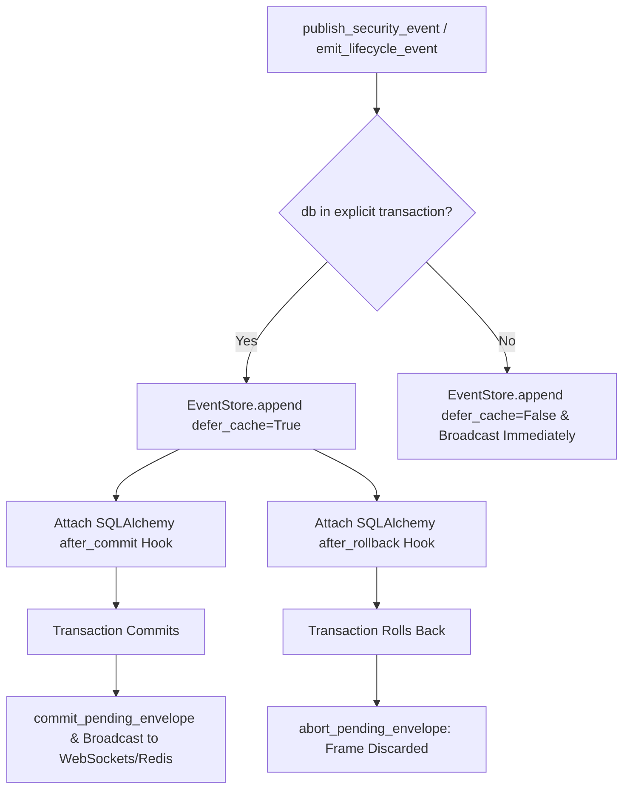

# Milestone 11 — Transactional Outbox Ordering & Rollback Safety

**Component:** PostgreSQL Outbox & Real-Time Event Publisher  
**Files Audited & Remediated:** `backend/app/events/store.py`, `backend/app/events/service.py`  
**Security Status:** MONOTONIC POST-COMMIT BROADCAST GUARANTEED  

---

## 1. Vulnerability Remediated: Pre-Commit Broadcast Leaks

In legacy iterations, `publish_security_event` appended the event to the in-memory ring-buffer and broadcasted it across WebSockets immediately upon invocation, even if the database transaction that triggered the event was subsequent to fail or rollback. This created ghost events in the SOC console that had no matching record in the persistent PostgreSQL outbox.

## 2. Milestone 11 Transactional Architecture

### Verification Evidence:
- **Rollback Safety Test (`test_05`):** When `self.db.rollback()` was invoked, the event was aborted from publication and ring buffer (`len(buffer)` unchanged).
- **Commit Safety Test (`test_06`):** When `self.db.commit()` was invoked, the event was atomically committed to buffer and broadcast to subscribers.
- **Strict Monotonicity:** In `EventStore.append`, cursors are strictly monotonic (`event.cursor >= previous_cursor`) across all transactions.

