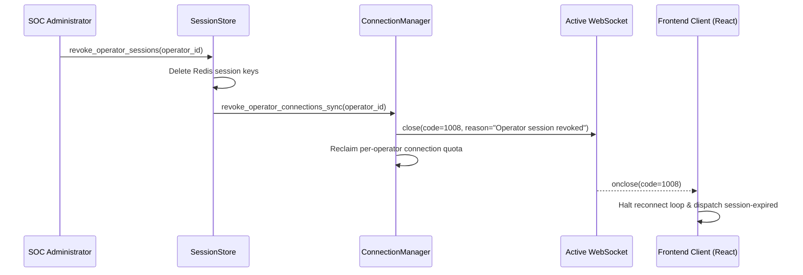

# Milestone 11 — Active Session Revocation & Immediate Stream Termination

**Component:** Zero-Trust Stream Lifecycle & Session Revocation  
**Files Audited & Remediated:** `backend/app/auth/session.py`, `backend/app/events/manager.py`, `frontend/src/digital-agents/engine/RealtimeAgentWebSocketClient.ts`  
**Security Status:** ACTIVE STREAM SEVERING (RFC 6455 Close Code 1008)  

---

## 1. Vulnerability Remediated: Zombie WebSockets

Previously, when an administrator revoked an operator's session (`revoke_session` or `revoke_operator_sessions`), the session record was deleted from `SessionStore`, but active WebSocket connections in `RealtimeConnectionManager` remained established. The revoked operator continued receiving sensitive security events in real time.

## 2. Milestone 11 Remediated Real-Time Revocation Pipeline

1. **RFC 6455 Close Code 1008:** Active WebSockets are closed immediately with code 1008 (Policy Violation) and reason `"Operator session revoked"`.
2. **Per-Broadcast Zero-Trust Verification:** In `broadcast_event()`, before sending any envelope, the manager verifies `default_operator_registry.get_operator(username)`. If deactivated (`is_active == False`) or revoked, the frame is dropped and the socket severed.
3. **Frontend Reconnect Termination:** `RealtimeAgentWebSocketClient.ts` halts automatic reconnection when code 1008, 4001, or 4003 is received and broadcasts `session-expired` to the UI.

