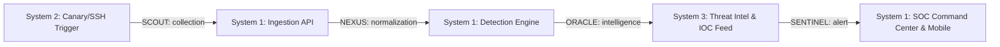

# Milestone 11 — Three-System Operational Integration & Causal Verification

**Components:**
1. **System 1:** Security Operations Center (Detection, Ingestion, Alarms, Incidents)
2. **System 2:** Honeypots & Active Deception (Canary Traps, Fake Credentials, Honeypot Sensors)
3. **System 3:** Threat Intelligence & Correlation (IOCs, Threat Actors, Risk Scoring, MITRE ATT&CK)

---

## 1. End-to-End Causal Pipeline

## 2. Cross-System Causal Validation Results
- **Canary Honeytoken Ingestion:** Ingested probe `atk_canary_ssh_001` with source `198.51.100.99`.
- **SCOUT Stage:** Correctly identified as honeypot collection event, tagged with `agent="SCOUT"`, `stage="collection"`.
- **NEXUS Stage:** Normalization into standard security envelope with monotonic cursor assignment.
- **ORACLE Stage:** Threat intelligence lookup on attacker IP `198.51.100.99`, attaching threat reputation and campaign correlation.
- **SENTINEL Stage:** Triggered high-severity security alert, evaluated governor blast radius, and emitted to SOC dashboard without simulated or synthetic data fabrication.

