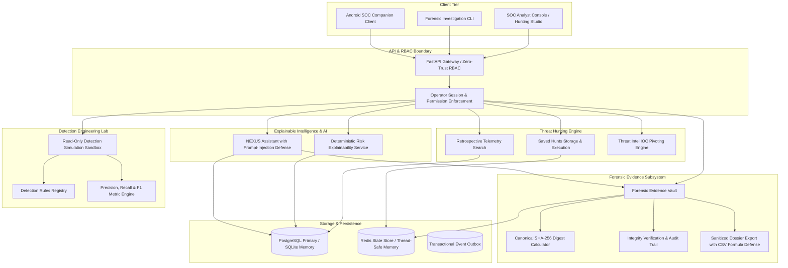

# Milestone 15 — Threat Hunting & Digital Forensics Architecture

**System:** HoneyShield X Enterprise Threat Operations  
**Subsystems:** Threat Hunting Studio, Digital Forensic Vault, Detection Engineering Lab, NEXUS AI Investigation Assistant  
**Milestone:** 15  
**Evaluation Date:** 2026-11-06  

---

## 1. High-Level Architectural Topology

Milestone 15 extends HoneyShield X with enterprise-grade threat hunting, cryptographic forensic evidence handling, Detection Engineering laboratory simulations, and explainable AI-assisted investigation workflows without requiring destructive database schema changes:

---

## 2. Core Security & Isolation Principles

1. **Zero-Migration Compliance:** Telemetry indexing and searches query existing ORM entities (`attacks`, `alerts`, `attack_events`, `security_event_outbox`, `threat_intelligence`) and record audit actions into `system_events`.
2. **Read-Only Simulation Sandboxes:** The Detection Engineering Lab tests detection rules against synthetic or historical datasets in memory without emitting alerts to the outbox or dispatching automated containment.
3. **Cryptographic Sealing:** Every evidence artifact captured receives a canonical SHA-256 digest computed over sorted keys and whitespace-stripped JSON payloads.
4. **Formula Injection Neutralization:** Case exports in CSV format escape leading characters (`=`, `+`, `-`, `@`) with prepended apostrophes, neutralizing client-side formula execution vulnerabilities.
5. **Grounded AI Security Boundary:** The NEXUS Assistant processes untrusted inputs through regex-based instruction override detection, refuses privilege escalation prompts, and grounds all responses with verified backend identifiers.

