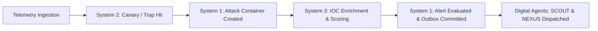

# Milestone 7 — Three-System Integration Verification

**Project:** HoneyShield X Unified Cybersecurity Operations Platform  
**Target Release Candidate:** `v1.0.0-rc5`  
**Evaluation Date:** 2026-11-05  

---

## 1. Overview of the Three Systems

The HoneyShield X platform unites three primary operational systems:
1. **System 1: SOC Monitoring, Detection & Incident Command**
   - Telemetry ingestion, attack session tracking, rule execution, dynamic risk scoring, alert deduplication, case management.
2. **System 2: Deception Infrastructure & Canary Tokens**
   - Honeytokens, trap listeners, canary tripwire dispatch, deception decoy generation.
3. **System 3: Threat Intelligence & Correlation**
   - IOC extraction/normalization, threat intelligence feed lookup, source IP enrichment, risk multiplier propagation.

---

## 2. Cross-System Workflow Verification

The end-to-end operational pipeline was validated through automated tests and controlled integration flows:

### Detailed Component Verification Results

| Workstream | Verifying Test Suite | Status | Key Verifications |
| :--- | :--- | :--- | :--- |
| **System 1 (SOC)** | `test_phase5_e2e_integration.py` (Tests 1–4) | **PASS** | Ingestion pipeline creates attack containers, detects SSH brute force, calculates multi-vector risk scores, maintains dashboard metric consistency. |
| **System 2 (Deception)** | `test_phase5_e2e_integration.py` (Tests 5–6) | **PASS** | Canary honeytoken minting succeeds; trap listeners capture hits and enrich alert context. |
| **System 3 (Threat Intel)** | `test_phase5_e2e_integration.py` (Tests 7–8) | **PASS** | IOC normalization, IP lookup, threat score elevation (e.g. malicious IP score multiplier). |
| **Cross-System Promotion** | `test_phase5_e2e_integration.py` (Test 9) | **PASS** | Coordinated promotion from telemetry to incident with governor containment safety. |

---

## 3. Operational Integrity Findings

- Deception tripwires cleanly generate high-priority security envelopes without corrupting normal SOC metrics.
- Threat intelligence lookups fail-soft when an external IOC database is unreachable, falling back to heuristic scoring without blocking the ingestion pipeline.

