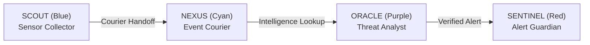

# Milestone 8 — Digital Agent Universe Operational Acceptance

**Project:** HoneyShield X Unified Cybersecurity Operations Platform  
**Target Release Candidate:** `v1.0.0-rc5`  
**Evaluation Date:** 2026-11-06  

---

## 1. Robotic Digital Agents

The Digital Agent Universe visualizes SOC data flows through four distinct robotic characters:

- **SCOUT (Electric Blue, `#3B82F6`):** Deployed at the Sensor Grid. Collects incoming telemetry packets and initiates courier transfers.
- **NEXUS (Vibrant Cyan, `#06B6D4`):** Central courier agent. Travels along cubic Bézier curved pathways carrying data packets to processing hubs.
- **ORACLE (Royal Purple, `#8B5CF6`):** Threat Intelligence Citadel analyst. Correlates attack indicators and calculates multi-vector risk scores.
- **SENTINEL (Crimson Red, `#EF4444`):** Containment Vault guardian. Receives confirmed alerts and stages response workflows.

---

## 2. Character Mechanics & Motion Verification

- **Node Coordinates & Waypoints:** Calculated from layout nodes across four territories (Sensor Grid, Processing Core, Threat Intel Citadel, Containment Vault).
- **Packet Lock Mechanics:** Carried data packets remain locked to robot coordinates (`(agent.x + 12, agent.y - 12)`) throughout movement animations.
- **Confirmation-Gated Delivery:** Transfer transitions (`waiting` → `in_transit` → `completed`) require mutual readiness confirmation between sender and receiver.
- **Failure States:** On network disruption or simulated validation failure, the carried packet displays an amber/red failure aura and logs the specific failure reason.
- **Reduced Motion Support:** Respects `prefers-reduced-motion` media queries, snapping characters directly to destination waypoints without continuous animation loops.

---

## 3. Operational Mode Separation & Replay Features

1. **Demo Mode:**
   - Isolated character gallery and manual waypoint simulation.
   - Four-agent relay test (`SCOUT → NEXUS → ORACLE → SENTINEL`) runs entirely client-side without polluting production databases.
2. **Live Mode:**
   - Connects to real-time WebSocket (`/api/v1/events/ws`) or SSE stream (`/api/v1/events/stream`).
   - Autonomously dispatches robots based on real backend lifecycle events.
3. **Event Journey Replay:**
   - Interactive time-scrubber allowing operators to replay historical security event journeys.
   - Shows step-by-step agent telemetry, transfer duration, and stage logs.
4. **NEXUS Contextual Assistant:**
   - Modal drawer providing grounded explanations of active attacks and recommended containment procedures.
5. **Connection State Indicators:**
   - Displays clear `CONNECTED`, `RECONNECTING`, or `OFFLINE` indicators; does not create fake successful live transfers during server disconnection.

