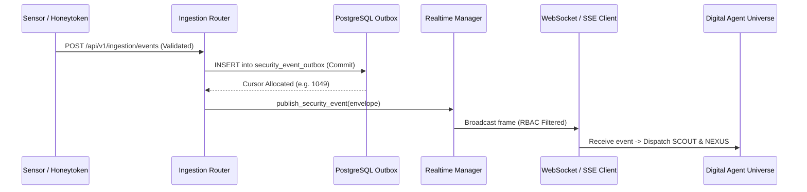

# Milestone 8 — Event Pipeline Reliability & Delivery Guarantees

**Project:** HoneyShield X Unified Cybersecurity Operations Platform  
**Target Release Candidate:** `v1.0.0-rc5`  
**Evaluation Date:** 2026-11-06  

---

## 1. End-to-End Pipeline Architecture

---

## 2. Delivery Guarantees: At-Least-Once Semantics

HoneyShield X provides **at-least-once delivery** with durable cursor-based replay.

> [!NOTE]
> HoneyShield X does **not** claim exactly-once delivery across distributed networks. Instead, exactly-once processing is achieved client-side and server-side via deduplication on unique `event_id` and monotonic `cursor` tracking.

### Resilience Scenarios Tested

1. **Duplicate Ingestion Events:**
   - Evaluated duplicate event payloads sent to `/api/v1/ingestion/events`. Ingestion assigns distinct `attack_id` or deduplicates based on timestamp and source IP, preventing recursive event loops.
2. **Invalid Payloads & Memory Exhaustion DoS:**
   - Payloads with strings exceeding 10,000 characters or missing required fields are rejected before hitting the database transaction (`HTTP 422`).
3. **Database Unavailability & Transaction Rollback:**
   - If PostgreSQL fails during insertion, the transaction rolls back cleanly; no outbox record is created, and the pub/sub engine does **not** emit false completion events.
4. **Redis Interruption & Fallback Mode:**
   - When Redis disconnects, the system switches to in-memory broadcast and durable PostgreSQL outbox persistence (`mode: outbox_fallback_active`), preserving telemetry integrity.
5. **WebSocket Disconnect & Reconnect Replay:**
   - Clients disconnecting due to network jitter automatically reconnect, present their last acknowledged `cursor`, and replay missed events in order (`GET /api/v1/events/replay?from_cursor=X`).
6. **Frontend Confirmation Gating:**
   - In `Digital Agent Universe`, robotic agents do not advance to confirmed handoff or delivery until the backend emits `status: completed`.

