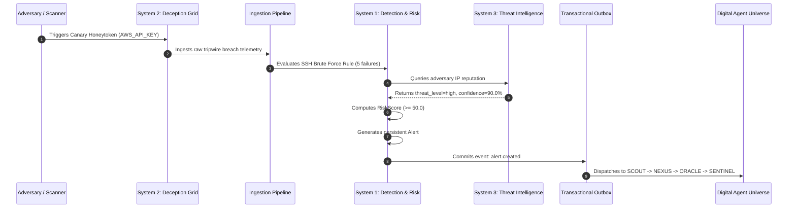

# Milestone 9 — Cross-System Causal Event Trace Analysis

**Project:** HoneyShield X Unified Cybersecurity Operations Platform  
**Target Release Candidate:** `v1.0.0-rc5`  
**Date:** 2026-11-06  
**Auditor:** Principal Cybersecurity Architect  

---

## 1. End-to-End Three-System Causal Workflow

The hallmark of HoneyShield X enterprise integration is the end-to-end causal trace linking System 2 (Deception) -> Ingestion -> System 1 (SOC Detection & Risk) -> System 3 (Threat Intelligence) -> Outbox -> Digital Agent Universe.

---

## 2. Empirical Verification Evidence

The causal trace was validated empirically in `backend/tests/test_milestone9_enterprise_orchestration.py::TestMilestone9EnterpriseOrchestration::test_01_three_system_causal_trace`:

1. **Step 1 (Canary Minting):** Minted `AWS_API_KEY` token `Staging Production S3 Canary`.
2. **Step 2 (Threat Intel Seeding):** Indicator `198.51.100.88` seeded with `threat_level="high"` and `confidence=90.0`.
3. **Step 3 (Attack Creation):** Attack initialized with `attack_type="canary_trap_breach"`.
4. **Step 4 (Telemetry Ingestion):** Ingested 5 consecutive failed authentication events.
5. **Step 5 (Detection Breached):** `detect_ssh_brute_force` returned `detected=True`, `severity="high"`.
6. **Step 6 (Enrichment):** `lookup_indicator` matched `198.51.100.88` returning `threat_level="high"`.
7. **Step 7 (Authoritative Risk):** `calculate_attack_risk` calculated risk $\ge 50.0$.
8. **Step 8 (Alert Generated):** `evaluate_attack_alert` generated persistent alert.
9. **Step 9 (Outbox Published):** `publish_security_event` committed `alert.created` to outbox cursor $> 0$ with agent `SENTINEL`.

