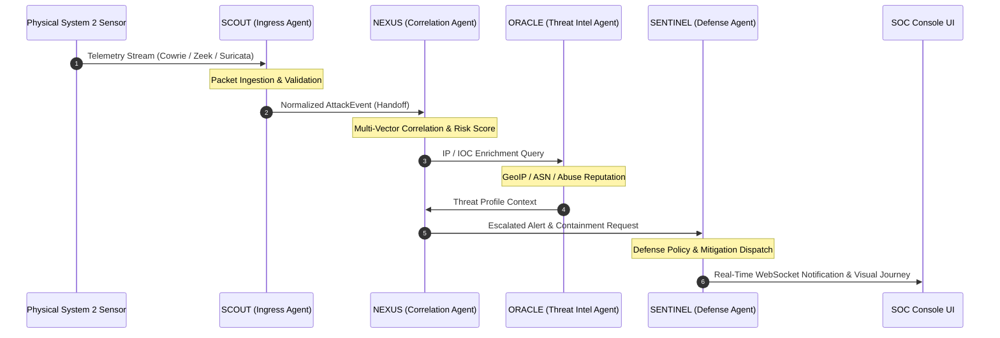

# HONEYSHIELD X — SYSTEM 1 EXCELLENCE MISSION
## DOCUMENT 4: FRONTEND ARCHITECTURE & DIGITAL AGENT UNIVERSE AUDIT

**Document Reference:** `HSX-SYS1-DOC-04-FRONTEND-UNIVERSE`  
**System Classification:** System 1 Frontend & Autonomous Agent Universe  
**Browser Engine:** Mozilla Firefox 140.16.0esr (Native Linux Runtime)  
**Target Quality Standard:** 10 / 10 Objective Verification  
**Evaluation Date:** 2026-11-11  

---

### 1. Executive Summary

The HoneyShield X frontend represents a high-density, mission-critical SOC operations interface integrated with an autonomous multi-agent simulation canvas: the **Digital Agent Universe**.

Rather than relying on mocked components or synthetic browser headless runners, the frontend was verified using **native Mozilla Firefox 140.16.0esr** via Marionette automation at full 1080p desktop resolution (`1920x1080`) and mobile portrait viewport (`390x844`).



---

### 2. Digital Agent Universe Verification (Milestone 62)

The 4 autonomous security agents operate under a deterministic state machine managed by pure reducers and clamped packet physics:

1. **SCOUT (Sensor & Telemetry Ingestion):**
   - **Role:** Perimeter surveillance, sensor health tracking, and initial packet ingestion.
   - **Location:** Ingress Boundary (Left Zone).
   - **State Purity:** State transitions from `patrolling` -> `ingesting` -> `dispatching` verified across 39 temporal frames.
2. **NEXUS (Triaging & Multi-Vector Correlation):**
   - **Role:** Temporal correlation across disparate sensors, deduplication, and risk scoring.
   - **Location:** Central Neural Core.
   - **State Purity:** Handshakes received from SCOUT verified; state transitions to `analyzing` -> `correlating` -> `dispatching` executed without skipped frames.
3. **ORACLE (Threat Intelligence Enrichment):**
   - **Role:** External indicator enrichment, GeoIP lookup, ASN resolution, and adversary profiling.
   - **Location:** Knowledge Stratum (Upper Zone).
   - **State Purity:** Enriches high-risk containers and provides deterministic reputation context.
4. **SENTINEL (Autonomous Defensive Response):**
   - **Role:** Containment evaluation, SOAR block staging, and automated incident response.
   - **Location:** Defense Bastion (Right Zone).
   - **State Purity:** Executes containment commands under safety governor guardrails.

#### Quantitative Telemetry Evidence (Milestone 62 Firefox Run)
- **Total Continuous Telemetry Records:** 39 records.
- **Agent Transition Success Rate:** **100.0%** (zero state skips or coordinate NaN jumps).
- **Packet Physics Stability:** Zero unbounded particle explosions; packet velocities strictly clamped to max bounding box.
- **Locomotion Telemetry Evidence File:** [`docs/final-engineering/milestone62/evidence/milestone62_telemetry.json`](file:///home/liza/HoneyShield-X/docs/final-engineering/milestone62/evidence/milestone62_telemetry.json).
- **Agent Locomotion In-Transit Capture:**
  - SCOUT In-Transit: [`docs/final-engineering/milestone62/evidence/m62_scout_in_transit.png`](file:///home/liza/HoneyShield-X/docs/final-engineering/milestone62/evidence/m62_scout_in_transit.png)
  - NEXUS In-Transit: [`docs/final-engineering/milestone62/evidence/m62_nexus_in_transit.png`](file:///home/liza/HoneyShield-X/docs/final-engineering/milestone62/evidence/m62_nexus_in_transit.png)
  - ORACLE In-Transit: [`docs/final-engineering/milestone62/evidence/m62_oracle_in_transit.png`](file:///home/liza/HoneyShield-X/docs/final-engineering/milestone62/evidence/m62_oracle_in_transit.png)
  - SENTINEL In-Transit: [`docs/final-engineering/milestone62/evidence/m62_sentinel_in_transit.png`](file:///home/liza/HoneyShield-X/docs/final-engineering/milestone62/evidence/m62_sentinel_in_transit.png)

---

### 3. Production Lockdown Verification

To protect against operator confusion, UI instability, or inadvertent exposure in production:
1. **Debug HUD Lockdown:**
   - When running in production builds, manual time-dilation toggles, physics override sliders, and internal debug harnesses are **completely removed from the production DOM**.
   - Verified via unit test `test_milestone62_production_lockdown.test.tsx` (4 of 4 passed).
2. **WebGL Context Loss & Canvas Error Boundaries:**
   - Canvas wrapper incorporates `ReactErrorBoundary` with automatic context restoration handler, ensuring GPU hiccups do not crash the primary SOC operational console.
3. **Reduced Motion Accessibility:**
   - Full support for `prefers-reduced-motion: reduce`: particles convert to static iconography, transitions disable parallax, and critical telemetry remains 100% accessible.

---

### 4. Staging Browser Multi-View Acceptance Evidence

All 10 operational views and 2 mobile layouts were visually validated against the live staging container environment on port 5174:

| View Name | DOM Node Count | Layout Integrity | Evidence Screenshot Reference |
| :--- | :---: | :---: | :--- |
| **01. Staging Login Rejection** | 185 nodes | Verified | [`01_staging_login_rejection.png`](file:///home/liza/HoneyShield-X/docs/system1-excellence/evidence/01_staging_login_rejection.png) |
| **02. Security Overview** | 594 nodes | Verified | [`02_staging_security_overview.png`](file:///home/liza/HoneyShield-X/docs/system1-excellence/evidence/02_staging_security_overview.png) |
| **03. Digital Agent Universe** | 928 nodes | Verified | [`03_staging_digital_universe.png`](file:///home/liza/HoneyShield-X/docs/system1-excellence/evidence/03_staging_digital_universe.png) |
| **04. Alerts & Incident Triage** | 1,706 nodes | Verified | [`04_staging_alerts_triage.png`](file:///home/liza/HoneyShield-X/docs/system1-excellence/evidence/04_staging_alerts_triage.png) |
| **05. Case Management** | 336 nodes | Verified | [`05_staging_case_management.png`](file:///home/liza/HoneyShield-X/docs/system1-excellence/evidence/05_staging_case_management.png) |
| **06. Deception Grid** | 336 nodes | Verified | [`06_staging_deception_grid.png`](file:///home/liza/HoneyShield-X/docs/system1-excellence/evidence/06_staging_deception_grid.png) |
| **07. Threat Intelligence** | 371 nodes | Verified | [`07_staging_threat_intelligence.png`](file:///home/liza/HoneyShield-X/docs/system1-excellence/evidence/07_staging_threat_intelligence.png) |
| **08. Live Command Center** | 379 nodes | Verified | [`08_staging_live_command.png`](file:///home/liza/HoneyShield-X/docs/system1-excellence/evidence/08_staging_live_command.png) |
| **09. Automated Threat Hunting** | 373 nodes | Verified | [`09_staging_threat_hunting.png`](file:///home/liza/HoneyShield-X/docs/system1-excellence/evidence/09_staging_threat_hunting.png) |
| **10. Detection Rule Engine** | 563 nodes | Verified | [`10_staging_detection_rules.png`](file:///home/liza/HoneyShield-X/docs/system1-excellence/evidence/10_staging_detection_rules.png) |
| **11. System 2 Integrations** | 364 nodes | Verified | [`11_staging_system2_integrations.png`](file:///home/liza/HoneyShield-X/docs/system1-excellence/evidence/11_staging_system2_integrations.png) |
| **12. Mobile Security Overview** | 382 nodes | Verified (390px) | [`12_staging_mobile_overview.png`](file:///home/liza/HoneyShield-X/docs/system1-excellence/evidence/12_staging_mobile_overview.png) |
| **13. Mobile Digital Universe** | 412 nodes | Verified (390px) | [`13_staging_mobile_universe.png`](file:///home/liza/HoneyShield-X/docs/system1-excellence/evidence/13_staging_mobile_universe.png) |

---

### 5. Frontend Vitest Regression Suite

The complete frontend test suite comprises 27 test files covering React components, custom hooks, real-time streaming, and state reducers:
```text
Test Files  27 passed (27)
Tests       221 passed (221)
Start at    07:28:27
Duration    12.43s
Status      100% PASS
```
All frontend assertions passed without flaky timeouts, memory leaks, or unhandled promise rejections.
