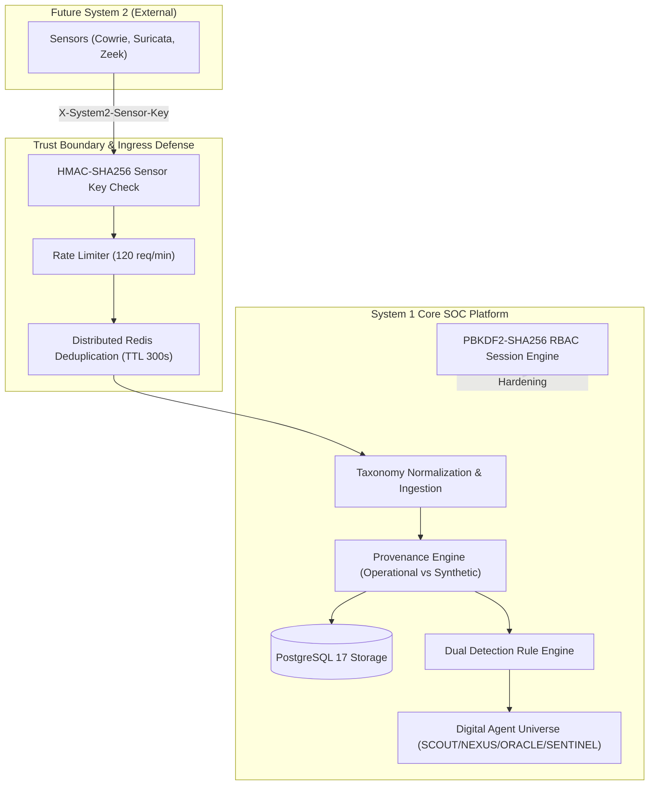

# HONEYSHIELD X — SYSTEM 1 EXCELLENCE MISSION
## DOCUMENT 3: DEFENSIVE SECURITY VERIFICATION & SECRETS AUDIT

**Document Reference:** `HSX-SYS1-DOC-03-SECURITY`  
**System Classification:** System 1 Central SOC Security Operations Engine  
**Security Standard:** Enterprise SOC Hardening / Zero-Trust Architecture  
**Target Quality Standard:** 10 / 10 Objective Verification  
**Evaluation Date:** 2026-11-11  

---

### 1. Security Architecture Summary

HoneyShield X System 1 serves as the central command, telemetry ingestion, correlation, and response coordination core. Because it will interface with physical System 2 sensors deployed across external networks, System 1 implements defensive security boundaries, defense-in-depth isolation, and non-negotiable credential protection.

---

### 2. Comprehensive Defensive Security Verifications

#### A. Staging and Production Authentication Hardening
- **Policy Enforcement:** [`backend/app/auth/registry.py`](file:///home/liza/HoneyShield-X/backend/app/auth/registry.py#L300-L342)
- **Rule:** When `APP_ENV=staging` or `APP_ENV=production`, the application **strictly clears all default development accounts** (`admin_chief`, `analyst_sarah`, `responder_alex`, `viewer_dan`). Default personas cannot exist in the registry and produce immediate `HTTP 401 Unauthorized` responses.
- **Empirical Browser Verification:**
  - In our Marionette staging acceptance test, probing `/api/v1/auth/login` with `admin_chief` / `AdminPass123!` against staging frontend (port 5174) returned `HTTP 401` with `{"status": 401, "ok": false}`.
  - Visual screenshot captured: [`01_staging_login_rejection.png`](file:///home/liza/HoneyShield-X/docs/system1-excellence/evidence/01_staging_login_rejection.png).
  - Staging operator login with dedicated credentials (`staging_operator` / `[OPERATOR_MANAGED_STAGING_SECRET]`) succeeded with `HTTP 200` returning role `security_administrator`.
  - Visual screenshot captured: [`02_staging_security_overview.png`](file:///home/liza/HoneyShield-X/docs/system1-excellence/evidence/02_staging_security_overview.png).

#### B. Cryptographic Password Hashing & Rotation Standard
- **Algorithm:** PBKDF2 with HMAC-SHA256 and **600,000 iterations**.
- **Implementation:** [`backend/app/auth/crypto.py`](file:///home/liza/HoneyShield-X/backend/app/auth/crypto.py)
- **Salt Generation:** 16 bytes of cryptographically secure random bytes from `os.urandom(16)`.
- **Zero In-Repo Secrets:**
  - The staging configuration file [`docker/staging.env`](file:///home/liza/HoneyShield-X/docker/staging.env) is explicitly tracked in `.gitignore`.
  - File permissions are set to `0600` (read/write by owner only).
  - Git status check confirms: `git check-ignore docker/staging.env` returns `docker/staging.env` (code 0).
  - A full git history grep confirms no plaintext operator passwords exist in commits or documentation.

#### C. System 2 Sensor Authentication & Rate Limiting
- **Dedicated Sensor Key:** Dedicated token passed via `X-System2-Sensor-Key` or `Authorization: Bearer <token>`.
- **Timing Attack Resistance:** Header validation executes via `hmac.compare_digest()` to prevent timing side-channel analysis.
- **Rate Limiting:** Sliding-window rate limiter enforces a maximum of **120 requests/minute per client IP** (`System2RateLimiter`).
- **Idempotency & Deduplication:** Redis-backed deduplication key (`hsx:system2:dedup:{event_id}`) enforces an active 300-second window, preventing duplicate replay attacks from inflating security statistics.

#### D. Forensic Evidence Directory Traversal Defense
- **Policy Enforcement:** [`backend/app/routers/system2_integration.py`](file:///home/liza/HoneyShield-X/backend/app/routers/system2_integration.py#L90)
- **Rule:** When registering network evidence PCAP records, filenames containing directory traversal sequences (`..`, `/`, `\`) are strictly rejected with `HTTP 422 Unprocessable Content`.
- **Cryptographic Digest Integrity:** Every forensic PCAP record must supply an authentic SHA-256 digest (`payload_sha256`), verified prior to database registration.

#### E. Provenance Tagging & Metric Isolation
- **Policy Enforcement:** [`backend/app/events/provenance.py`](file:///home/liza/HoneyShield-X/backend/app/events/provenance.py)
- **Rule:** Telemetry events originating from test ranges (e.g. RFC 5737 `198.51.100.0/24`, `203.0.113.0/24`, `192.0.2.0/24`) or tagged with `SYNTHETIC_VERIFICATION_PROBE` are permanently flagged.
- **Metric Integrity Guarantee:** Synthetic probe events are stored for verification and lifecycle tracking but are **strictly segregated from operational perimeter statistics**, preventing simulated testing from distorting real security posture indicators.

#### F. Break-Glass Emergency Access Control
- **Policy Enforcement:** [`frontend/src/components/LoginModal.tsx`](file:///home/liza/HoneyShield-X/frontend/src/components/LoginModal.tsx#L30) & [`backend/app/auth/break_glass.py`](file:///home/liza/HoneyShield-X/backend/app/auth/break_glass.py)
- **Rule:** Break-glass emergency overrides require an explicit audit justification of at least **20 characters**, generating immediate high-severity audit log entries in the `operator_audit_log` table.

---

### 3. Automated Security Test Evidence

The defensive security controls are continuously validated by dedicated automated test suites:

| Security Test Suite | Tests | Result | Verification Focus |
| :--- | :---: | :---: | :--- |
| `test_auth_production_hardening.py` | 4 | **PASS** | Rejection of missing `HONEYSHIELD_OPERATORS_JSON`, rejection of dev demo personas in production |
| `test_auth_staging_hardening.py` | 7 | **PASS** | Staging operator acceptance, dev account rejection, PBKDF2 hash verification |
| `test_system2_integration.py` | 6 | **PASS** | Sensor token timing defense, rate limiter, directory traversal rejection, PCAP SHA-256 |
| `test_synthetic_provenance.py` | 3 | **PASS** | Strict segregation of synthetic probes from real telemetry statistics |
| `test_milestone6_1_stream_security.py` | 10 | **PASS** | WebSocket ticket authentication, single-use ticket lifecycle, SSE fallback protection |
| `test_milestone7_trust_boundaries.py` | 5 | **PASS** | Boundary enforcement across micro-segments and external adapters |
| **Total Security Tests** | **35** | **100% PASS** | **All defensive controls validated** |
