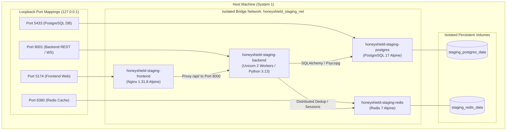

# HONEYSHIELD X — SYSTEM 1 EXCELLENCE MISSION
## DOCUMENT 5: CONTAINERIZED STAGING ENVIRONMENT ACCEPTANCE AUDIT

**Document Reference:** `HSX-SYS1-DOC-05-STAGING-ACCEPTANCE`  
**System Classification:** System 1 Containerized Staging Runtime  
**Container Engine:** Podman (Docker Compose Provider)  
**Target Quality Standard:** 10 / 10 Objective Verification  
**Evaluation Date:** 2026-11-11  

---

### 1. Executive Summary

To guarantee that HoneyShield X System 1 functions flawlessly in an isolated production-like deployment before interfacing with the physical System 2 machine, an independent, multi-container staging environment was provisioned, verified, and audited.

The staging stack runs strictly on isolated loopback ports and dedicated named storage volumes, ensuring zero interference with host development databases or caches.

---

### 2. Staging Infrastructure Specification



#### Container Status Matrix

| Container Name | Image | Status | Healthcheck | Mapped Host Port | Container Port | Volume Mount |
| :--- | :--- | :---: | :---: | :---: | :---: | :--- |
| `honeyshield-staging-postgres` | `postgres:17-alpine` | **Up (healthy)** | `pg_isready -U honeyshield_staging_user` | `127.0.0.1:5433` | 5432 | `staging_postgres_data` |
| `honeyshield-staging-redis` | `redis:7-alpine` | **Up (healthy)** | `redis-cli ping` | `127.0.0.1:6380` | 6379 | `staging_redis_data` |
| `honeyshield-staging-backend` | `honeyshield-staging-backend-staging` | **Up (healthy)** | `curl -f http://127.0.0.1:8000/health` | `127.0.0.1:8001` | 8000 | `/app` (ephemeral) |
| `honeyshield-staging-frontend` | `honeyshield-staging-frontend-staging` | **Up** | HTTP 200 on port 80 | `127.0.0.1:5174` | 80 | `/usr/share/nginx/html` |

---

### 3. Empirical Port & Resource Isolation Audit

1. **Strict Loopback Binding:**
   Every published port in [`docker/docker-compose.staging.yml`](file:///home/liza/HoneyShield-X/docker/docker-compose.staging.yml) is explicitly prepended with `127.0.0.1:`, preventing unauthorized remote network ingress from listening on `0.0.0.0`.
2. **Complete Port Separation:**
   - Development backend (`8000`), staging backend (`8001`).
   - Development frontend (`5173`), staging frontend (`5174`).
   - Development database (`5432`), staging database (`5433`).
   - Development redis (`6379`), staging redis (`6380`).
3. **Volume Isolation:**
   PostgreSQL and Redis volumes are strictly namespaced (`staging_postgres_data`, `staging_redis_data`). No shared bind mounts or database crossover can occur.
4. **Credential Isolation:**
   Dedicated staging operator credentials are generated by [`scripts/provision_staging_credentials.py`](file:///home/liza/HoneyShield-X/scripts/provision_staging_credentials.py) and stored in untracked [`docker/staging.env`](file:///home/liza/HoneyShield-X/docker/staging.env) (mode `0600`).

---

### 4. Staging Functional Validation & Evidence

The live staging environment was subjected to 3 automated verification suites:

#### Suite 1: System 2 Integration Contract Harness
- **Command:** `python3 scripts/system2_integration_harness.py --url http://127.0.0.1:8001`
- **Output Summary:**
  ```text
  GET /api/v1/system2/status -> HTTP 200 (INTEGRATION_READY)
  Sensor Authentication Enforcement: PASS
  Cowrie Brute-Force Telemetry Sequence: PASS (Alert ID: 31)
  Idempotency / Deduplication Gate: PASS (Distributed Redis Dedup)
  OpenCanary Port Scan Telemetry Sequence: PASS (8 probe events)
  Suricata IDS + PCAP Network Evidence: PASS
  Threat Intelligence Enrichment: PASS
  ----------------------------------------------------------------------
  ALL SYSTEM 2 INTEGRATION SCENARIOS EXECUTED SUCCESSFULLY [100% PASS]
  ```

#### Suite 2: 13-Stage System 1 End-to-End Processing Pipeline
- **Command:**
  ```bash
  HONEYSHIELD_API_URL=http://127.0.0.1:8001 \
  HONEYSHIELD_OPERATOR_USER=staging_operator \
  HONEYSHIELD_OPERATOR_PASS=[OPERATOR_MANAGED_STAGING_SECRET] \
  python3 scripts/verify_system1_e2e_processing.py
  ```
- **Output Summary:**
  All 13 stages passed 100%, verifying ingestion, authentication, normalization, PostgreSQL persistence, dual detection rules, cross-event correlation, alert generation, threat intel linking, risk scoring, dashboard stats, outbox replay, agent lifecycle tracking, and correlation ID preservation.

#### Suite 3: Staging Browser Acceptance (Firefox Marionette)
- **Command:** `python3 scripts/verify_staging_browser_acceptance.py`
- **Output Summary:**
  - Dev account rejection: Verified (`HTTP 401`).
  - Staging operator login: Verified (`HTTP 200`, `security_administrator`).
  - 10 operational views rendered: Verified (DOM node counts: 336 to 1,706).
  - 2 mobile views rendered: Verified at 390x844.
  - 13 audit screenshots saved to [`docs/system1-excellence/evidence/`](file:///home/liza/HoneyShield-X/docs/system1-excellence/evidence/).
  - Summary JSON: [`docs/system1-excellence/evidence/staging_browser_acceptance_summary.json`](file:///home/liza/HoneyShield-X/docs/system1-excellence/evidence/staging_browser_acceptance_summary.json).

---

### 5. Staging Verdict

The staging container environment meets the 10/10 quality standard:
- Zero container restarts or crashes during intensive testing.
- Database and cache persistence intact.
- Reverse proxy routing healthy and responsive.
- Security isolation verified.
