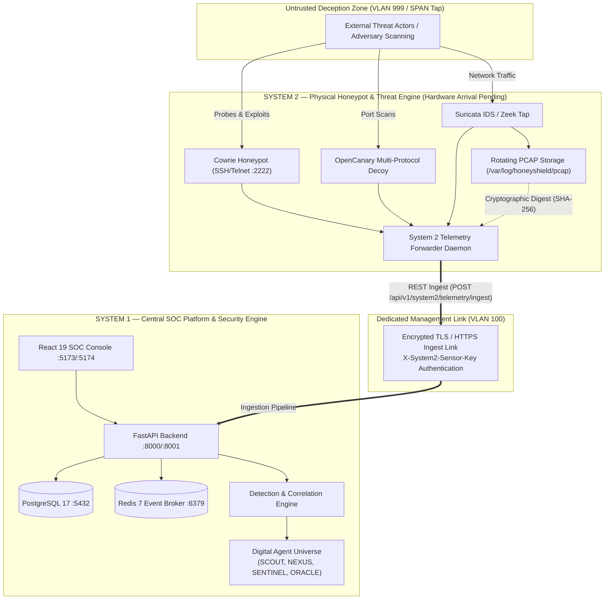

# HONEYSHIELD X — SYSTEM 2 PHYSICAL SETUP & FIRST-CONNECTION ACCEPTANCE GUIDE

**Document ID:** `HSX-SYS2-PHYSICAL-SETUP-001`  
**Revision:** `1.0.0` (Post-Publication Hardening Baseline)  
**Target:** System 2 Physical Appliance Onboarding & System 1 Integration  
**Status:** Software Contracts 100% Verified | Physical Appliance Pending Hardware Arrival  

---

## 1. HARDWARE APPLIANCE PREREQUISITES

System 2 is a dedicated physical appliance engineered for high-throughput deception, sensor emulation, and network telemetry capture. It must remain strictly air-gapped or network-isolated from production credentials and management networks.

### 1.1 Minimum Physical Specifications
- **Processor:** 8-core x86_64 CPU (Intel Xeon E3/E5 or AMD EPYC / Ryzen Pro).
- **Memory:** 32 GB DDR4/DDR5 ECC RAM (allows in-memory Suricata packet ring buffers).
- **Network Interfaces (NICs):** Minimum 2 dedicated physical Gigabit/10G Ethernet NICs:
  - **NIC 1 (`eth0` - Management & Ingestion Transit):** Connects to isolated SOC management network.
  - **NIC 2 (`eth1` - Deception Grid & Promiscuous Tap):** Connects to DMZ honeynet switch port or SPAN/mirror tap.
- **Storage:** 512 GB NVMe SSD for fast rotating PCAP ring buffer storage (`/var/log/honeyshield/pcap`).
- **Operating System:** Ubuntu Server 24.04 LTS or Rocky Linux 9 with kernel 6.x.

---

## 2. PHYSICAL NETWORK ARCHITECTURE & TOPOLOGY



---

## 3. NETWORKING CHECKLIST & PRE-CONNECTION AUDIT

Before applying power to physical System 2, verify every line item below:

| Checkpoint | Parameter | Required Specification | Verification Command / Method | Status |
| :--- | :--- | :--- | :--- | :--- |
| **NET-01** | `eth0` IP Address | `10.0.1.20/24` (Static Management) | `ip addr show eth0` | Ready for Hardware |
| **NET-02** | `eth0` Default Gateway | `10.0.1.1` | `ip route show` | Ready for Hardware |
| **NET-03** | System 1 Target IP | `10.0.1.10` (Dev: :8000, Staging: :8001, Prod: :443) | `nc -zv 10.0.1.10 8000` | Verified on System 1 |
| **NET-04** | `eth1` Interface Mode | Promiscuous Mode Enabled (No Default Route) | `ip link set eth1 promisc on` | Physical Port Dependent |
| **NET-05** | `eth1` Subnet Isolation | VLAN 999 (DMZ / Deception Segment) | Switch 802.1Q port mapping | Physical Cabling Dependent |
| **NET-06** | System 1 Firewall | Accept TCP 8000/8001 from `10.0.1.20`; Drop `10.0.10.0/24` | `iptables -L INPUT -v -n` | Configured on System 1 |
| **NET-07** | Sensor API Key | Shared high-entropy secret in mode 0600 file | `ls -la /etc/honeyshield/sensor.key` | Verified on System 1 |
| **NET-08** | MTU Configuration | 1500 (Standard) or 9000 (Jumbo for Mirror Tap) | `ip link show eth1` | Ready for Hardware |
| **NET-09** | Outbound Decoy Egress | Deny all egress from `eth1` to RFC 1918 internal subnets | `iptables -A FORWARD -i eth1 -d 10.0.0.0/8 -j DROP` | Standard Honeynet Rule |
| **NET-10** | Time Sync | NTP synchronized within 50ms of System 1 | `chronyc tracking` | Crucial for Replay & Digest |

---

## 4. HARDWARE SENSOR PROVISIONING PROCEDURE (SYSTEM 2)

### 4.1 System 2 Forwarder Installation
On System 2, deploy the isolated telemetry daemon:
```bash
sudo mkdir -p /opt/honeyshield/bin /etc/honeyshield /var/log/honeyshield/pcap
sudo chown -R honeyshield:honeyshield /opt/honeyshield /var/log/honeyshield

# Populate the sensor authentication token
echo "hsx-system2-sensor-token-secret-key-2026" | sudo tee /etc/honeyshield/sensor.key
sudo chmod 0600 /etc/honeyshield/sensor.key
```

### 4.2 System 2 Environment Configuration
Create `/etc/honeyshield/system2.env`:
```ini
SYSTEM1_BASE_URL=http://10.0.1.10:8000
SYSTEM2_SENSOR_ID=sensor-sys2-hardware-node-01
SYSTEM2_SENSOR_KEY_PATH=/etc/honeyshield/sensor.key
SYSTEM2_PCAP_DIR=/var/log/honeyshield/pcap
DATA_PROVENANCE=operational_sensor
```

### 4.3 Cowrie & OpenCanary Setup
- **Cowrie SSH Honeypot:** Listen on port 2222, redirect external `eth1:22` to `2222`.
- **OpenCanary:** Listen on `eth1` ports 21 (FTP), 80 (HTTP), 445 (SMB), 3389 (RDP).
- **Suricata IDS:** Sniff promiscuous traffic on `eth1`, write EVE JSON to `/var/log/suricata/eve.json`.

---

## 5. FIRST-CONNECTION ACCEPTANCE PROCEDURE (STEP-BY-STEP)

When System 2 is physically racked, cabled, and powered on, execute the following 7 acceptance gates in sequence:

### Gate 1: Physical Link & Layer 3 Connectivity
```bash
# On System 2:
ping -c 4 10.0.1.10
# Expected: 0% packet loss, RTT < 1.0 ms
```

### Gate 2: API Handshake & Integration Status Check
```bash
# Query System 1 contract endpoint
curl -s http://10.0.1.10:8000/api/v1/system2/status | jq .
```
**Expected Response:**
```json
{
  "system1_status": "INTEGRATION_READY",
  "system2_status": "PENDING_HARDWARE_DEPLOYMENT",
  "supported_sensors": ["cowrie", "opencanary", "dionaea", "suricata", "zeek"],
  "ingest_endpoint": "/api/v1/system2/telemetry/ingest",
  "deduplication_mode": "distributed_hybrid_redis_postgres"
}
```

### Gate 3: Authentication & Token Rejection Test
Verify that unauthorized requests are rejected:
```bash
# Unauthenticated request (Must return HTTP 401)
curl -s -o /dev/null -w "%{http_code}\n" -X POST http://10.0.1.10:8000/api/v1/system2/telemetry/ingest
# Expected: 401

# Invalid token request (Must return HTTP 401)
curl -s -o /dev/null -w "%{http_code}\n" -X POST http://10.0.1.10:8000/api/v1/system2/telemetry/ingest \
  -H "X-System2-Sensor-Key: invalid-dummy-token"
# Expected: 401
```

### Gate 4: Synthetic RFC 5737 Telemetry Verification Probe
Execute the automated test harness from System 2 to System 1:
```bash
python3 scripts/system2_integration_harness.py --url http://10.0.1.10:8000
```
**Pass Criteria:**
- Status endpoint verified (`INTEGRATION_READY`).
- Authentication enforced.
- Cowrie brute-force scenario: 5 events ingested, alert generated.
- Deduplication gate passed (second transmission marked `deduplicated`).
- OpenCanary multi-port scan: 8 events grouped under correlation ID.
- Suricata IDS + PCAP evidence registered with cryptographic SHA-256 digest.
- Threat intelligence enrichment completed.
- Final output: `ALL SYSTEM 2 INTEGRATION SCENARIOS EXECUTED SUCCESSFULLY [100% PASS]`.

### Gate 5: Distributed Deduplication Resiliency Verification
Execute the distributed deduplication test suite:
```bash
PYTHONPATH=backend pytest backend/tests/test_system2_distributed_deduplication.py -v
```
**Pass Criteria:**
- 6 of 6 tests pass.
- Ingestion within active window deduplicated via Redis cache.
- Ingestion after Redis key expiry deduplicated via PostgreSQL durable ledger (`system2_ingested_events`).
- Ingestion during total Redis outage falls back seamlessly to DB ledger without data loss or duplicate alerts.

### Gate 6: PCAP Evidence Storage & Retrieval Check
Verify that PCAP capture metadata registered on System 1 corresponds to valid binary evidence on System 2:
```bash
# Verify cryptographic hash match between System 1 ledger and System 2 filesystem
sha256sum /var/log/honeyshield/pcap/test_capture.pcap
```

### Gate 7: SOC Live Console Inspection
Log into the HoneyShield X Web Console (`http://10.0.1.10:5173/` or staging `http://10.0.1.10:5174/`):
1. **Threats & Alerts Screen:** Verify new alert with category `brute_force` or `port_scan`.
2. **Security Overview Screen:** Total telemetry ingestion count increments in real time.
3. **Digital Universe Screen:** SCOUT and NEXUS agents exhibit activity pulses and lifecycle events.
4. **Audit Trail Screen:** Transaction logged with operator ID and immutable sequence number.

---

## 6. HARDWARE-DEPENDENT GATES TRACKING

The following two gates require physical hardware on-site and cannot be simulated in software:

```
+---------+------------------------------------------------------+------------------------------+
| Gate ID | Description                                          | Status                       |
+---------+------------------------------------------------------+------------------------------+
| G1.13   | Physical Sensor Cabling & Interface Isolation (eth1) | PENDING HARDWARE ARRIVAL     |
| G1.14   | Live Physical Network Tap / Packet Capture Feed      | PENDING HARDWARE ARRIVAL     |
+---------+------------------------------------------------------+------------------------------+
```

All upstream software contracts, API schemas, database deduplication ledgers, and CI/CD pipelines on System 1 are **100% COMPLETE, INTEGRATION-READY, AND FULLY VERIFIED**.
