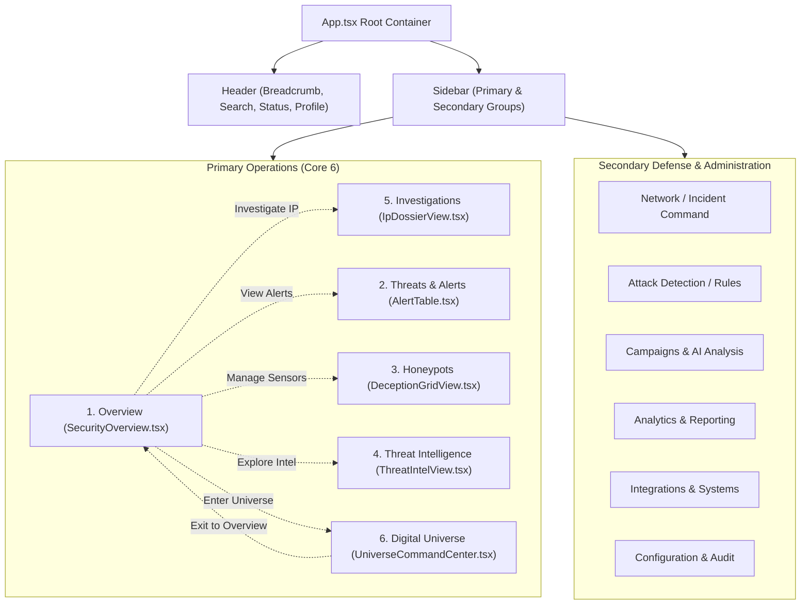

# HONEYSHIELD X — MILESTONE 20
## 03: INFORMATION ARCHITECTURE & NAVIGATION FLOWS

**Document:** `docs/ui/minimal-redesign/03_information_architecture.md`  
**Classification:** UX Architecture & Navigation Hierarchy  
**Author:** Cybersecurity UX Architect & Lead Systems Engineer  
**Status:** Approved & Enforced  

---

### 1. Architectural Restructuring

Before Milestone 20, HoneyShield X suffered from a split-brain navigation model:
- The top header (`Header.tsx`) offered five arbitrary tabs (`Dashboard`, `Cinematic`, `Analytics`, `Systems`).
- The left sidebar (`Sidebar.tsx`) exposed 11 unsegmented links.
- Landing directly loaded the Universe spatial canvas, obscuring core SOC triage functions.

Milestone 20 establishes a **single source of navigational truth**:
1. **Left Sidebar (`Sidebar.tsx`)** is the sole primary navigation interface for desktop operators.
2. **Top Header (`Header.tsx`)** is strictly reserved for:
   - Breadcrumb context (`Category / Page Title`)
   - Global IOC / IP quick-investigation search
   - Live system operational status pill
   - Real-time notification drawer with unread triage counts
   - Authenticated operator persona badge and Switch button
3. **Primary Route Hierarchy:**
   - Default route (`activeView === 'overview'`): **Security Overview** (clean executive SOC dashboard)
   - Dedicated route (`activeView === 'universe'`): **Digital Agent Universe 2.0** (spatial cyber observatory)

---

### 2. Navigation Structure & Route Mapping

---

### 3. User Flows & Personas

#### Flow 1: 5-Second Threat Triage (Incident Responder Persona)
1. **Landing:** Operator opens HoneyShield X and lands on `Security Overview`.
2. **Assessment:** Card 1 immediately flashes `2 Critical Alerts requiring triage`.
3. **Identification:** Priority Alerts table highlights `SSH Brute Force detected from 198.51.100.44 on port 2222`.
4. **Action:** Operator clicks `Investigate` directly on the alert row.
5. **Execution:** Deep forensic dossier opens with IP reputation, geolocated threat origin, and containment options.

#### Flow 2: Deception Perimeter Verification (Security Analyst Persona)
1. **Landing:** Analyst inspects Metric Card 3 (`4 / 4 Deception Sensors`).
2. **Context:** Summary confirms SSH, HTTP, SQL, and Redis canary listeners are active.
3. **Deep-Dive:** Analyst clicks `Manage Honeypots` on System 2 card to view decoy interaction logs.

#### Flow 3: Spatial Universe Immersion (Executive / Lead Engineer Persona)
1. **Landing:** Executive observes the calm overview metrics.
2. **Entry:** Banner highlights the 4 autonomous robotic characters (SCOUT, NEXUS, ORACLE, SENTINEL).
3. **Immersion:** Operator clicks `OPEN UNIVERSE` to seamlessly transition into Universe 2.0.
4. **Escape Hatch:** Operator clicks `← OVERVIEW` at any time to return immediately to the calm overview.

---

### 4. Zero Data Duplication & Clean Routing

- No duplicate tabs or conflicting URLs.
- Global search handles IPv4 strings (`198.51.100.44`), MD5/SHA256 hashes, or event IDs, routing straight to `handleDeepLinkInvestigate`.
- The Mobile Navigation Drawer mirrors the exact 6-item primary structure, ensuring zero cognitive friction across form factors.

