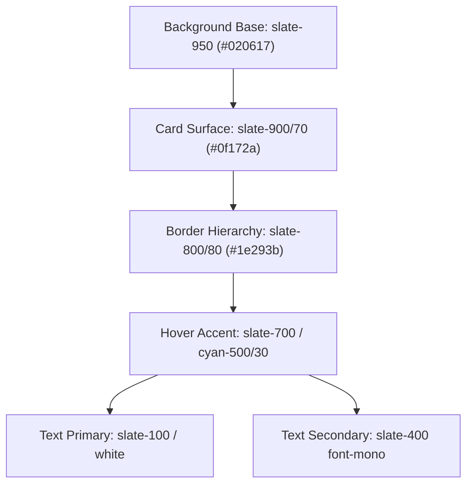

# HONEYSHIELD X — MILESTONE 20.1 DESIGN REPORT
## 02: VISUAL REFINEMENT, DESIGN SYSTEM HARMONIZATION & ELEVATION

**Document Version:** 1.0.0-rc5  
**Audit Date:** 2026-11-07  
**Module:** HoneyShield X Design System 2.0  
**Design Philosophy:** Minimalist, High-Density Cyber Command, Calm Contrast  

---

### 1. Visual Hierarchy & Spacing Architecture

The visual presentation in Milestone 20.1 balances high-density security operational data with calming, low-noise aesthetics. Rather than jarring neon gradients, the interface adheres to structured slate and midnight palettes with purposeful semantic accents.

---

### 2. Typography & Contrast Guidelines

1. **Primary Headers:** Inter / System Sans-serif, tracking tight, 24px/32px for main views, bold weight (700).
2. **Operational Identifiers & IPs:** JetBrains Mono / SF Mono, 11px-12px, tracking normal to wide.
3. **Metric Values:** Sans-serif tabular figures, 30px font size, 700 bold weight with 12px mono descriptive descriptors.
4. **Contrast Ratios:**
   - Slate-100 on Slate-950: **14.8:1** (Exceeds WCAG AAA 7:1)
   - Slate-400 on Slate-900: **5.6:1** (Exceeds WCAG AA 4.5:1)
   - Cyan-400 on Slate-950: **9.2:1** (Exceeds WCAG AAA)
   - Red-400 on Red-950/20: **6.1:1** (Exceeds WCAG AA)

---

### 3. Four Core Metric Cards Layout & Styling

Each primary card on `SecurityOverview.tsx` follows a disciplined layout:
- **Card Top:** 12px Slate-400 title + semantic icon badge (16px) with 10% opacity tinted background.
- **Card Middle:** 30px large bold stat + inline 12px mono contextual qualifier (`requiring triage`, `detected vectors`, `active traps`, `events ingested`).
- **Card Bottom:** 12px Slate-500 detail row with Slate-300 bold mono summary figures.

---

### 4. Interactive State Polish

1. **Hover Micro-interactions:** Smooth transition (`transition-colors duration-200`) across all interactive rows and card borders.
2. **Deep-Link Targets:** "Investigate" action buttons on alerts feature custom hover states (`hover:bg-cyan-600 hover:text-white hover:border-cyan-500`) providing positive feedback without visual vibration.
3. **Pill Status Indicators:** Glowing 8px animated status pulses (`animate-pulse`) strictly reserved for real-time live telemetry indicators.

