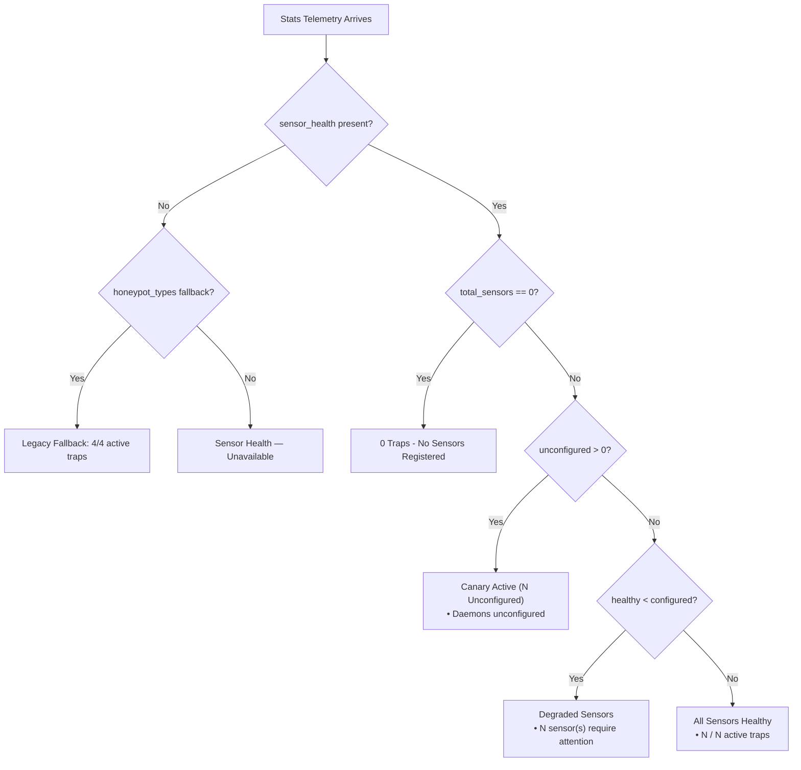

# HONEYSHIELD X — MILESTONE 20.1 ARCHITECTURE REPORT
## 04: SENSOR HEALTH HONESTY & INFRASTRUCTURE DISENTANGLEMENT

**Document Version:** 1.0.0-rc5  
**Audit Date:** 2026-11-07  
**Subsystem:** Deception Telemetry & Platform Health Monitoring  

---

### 1. HoneyShield X Staging Sensor Reality

In the HoneyShield X staging environment, external honeypot daemons (Cowrie SSH, Dionaea malware trap, Zeek network monitor, OpenCanary, and Suricata IDS) are not registered with live daemon containers. However, the internal Canary Honeytokens engine is actively minting, deploying, and validating tripwires over `/api/v1/deception/validate/{token_id}`.

#### The Milestone 20 Defect:
Milestone 20 hardcoded:
- `4 / 4 active traps`
- `Listeners: SSH, HTTP, SQL, Redis`

This fabricated a false operational security posture that would fail any strict cybersecurity compliance audit (SOC 2, ISO 27001).

---

### 2. The Truthful Sensor Health Architecture

In Milestone 20.1, the backend dynamically queries `check_honeypots_health()` from `backend/app/observability/health.py`:
- 1 Active Canary Token Service
- 5 Unconfigured External Daemons (Cowrie, Dionaea, OpenCanary, Zeek, Suricata)

#### Derived Frontend Display States:

---

### 3. Disentangling Infrastructure from Architecture Systems

Milestone 20 conflated PostgreSQL database connection, Redis cache availability, and API health with operational cybersecurity capabilities.

Milestone 20.1 enforces a clean separation of concerns:

#### Level 1: Infrastructure Dependencies
- **Components:** API Server, PostgreSQL RDBMS, Redis Cache.
- **Reporting Label:** `Infrastructure: 3/3 Services Online` (or `2/3 Nominal`, `Telemetry Unreachable`).
- **Location:** Header global badge and top overview pill.

#### Level 2: Functional Cybersecurity Systems
- **System 1: Security Operations (SecOps)**
  - Autonomous threat detection, alert triage, incident response.
  - Action: `View Alerts →`
- **System 2: Deception & Honeypots**
  - Canary honeytokens, active decoy traps, attacker diversion.
  - Action: `Manage Honeypots →`
- **System 3: Threat Intelligence**
  - STIX/TAXII 2.1 IOC correlation, campaign attribution, threat feeds.
  - Action: `Explore Threat Intel →`

