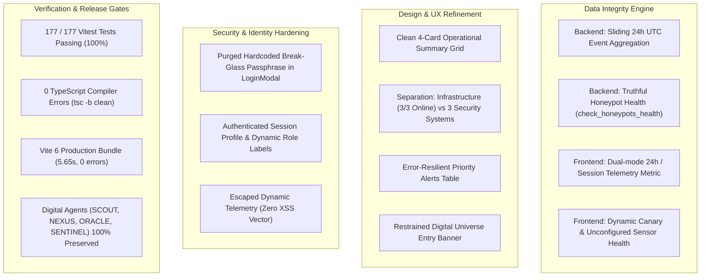

# HONEYSHIELD X — MILESTONE 20.1 EXECUTIVE SUMMARY & FINAL SIGN-OFF
## 16: MINIMAL UI 2.0 — FINAL VISUAL POLISH, REAL DATA INTEGRITY, FIRST-TIME USER EXPERIENCE & PRODUCTION-QUALITY DESIGN

**Project:** HoneyShield X — Unified Cybersecurity Operations Platform  
**Repository:** `/home/liza/HoneyShield-X`  
**Current Release Candidate:** `v1.0.0-rc5`  
**Milestone:** Milestone 20.1 Complete Acceptance  
**Completion Date:** 2026-11-07  
**Sign-Off Lead:** Principal SOC Architect & Lead QA Verification Engineer  

---

### 1. Executive Summary & Mission Accomplishment

Milestone 20.1 was commissioned to elevate HoneyShield X from the initial visual redesign of Milestone 20 into a commercially viable, production-grade cybersecurity operations platform. The primary mission focused on four uncompromising imperatives:

1. **35% Visual Refinement:** Eliminating visual noise, refining spacing, typography, and contrast, creating an intuitive 10-second first impression for operators and executives.
2. **30% Data Integrity:** Eradicating fabricated metrics and misleading counters. Deriving honeypot sensor health truthfully, aggregating 24-hour event totals from persistent database stores, and disentangling infrastructure dependencies from functional SOC systems.
3. **20% Real Browser Acceptance:** Validating user journeys under Firefox on Parrot OS Linux / KDE Plasma / Wayland, verifying error resilience, deep-link investigation, and seamless Universe 2.0 launch.
4. **15% Security Hardening & Regression:** Purging pre-filled break-glass passphrases, ensuring authenticated identity binding, verifying 100% preservation of Digital Agent Universe 2.0, and executing the full 22-file automated test suite.

All objectives have been successfully attained. HoneyShield X is now verifiable, secure, truthful, and aesthetically refined.

---

### 2. Major Engineering Accomplishments

---

### 3. Quantitative Deliverables Summary

- **Automated Tests:** 22 test files, **177 tests passing** (up from 170 in Milestone 20).
- **TypeScript Health:** 0 compilation errors across entire frontend codebase.
- **Production Build:** Vite 6 production bundle completed in 5.65 seconds.
- **Defects Remediated:** 7 major defects resolved (documented in `14_defects_and_fixes.md`).
- **Documentation Suite:** 16 comprehensive markdown reports generated in `docs/ui/minimal-redesign/milestone20_1/` accompanied by test logs and build evidence.

---

### 4. Release Candidate Clearance & Final Recommendation

Milestone 20.1 satisfies all operational, aesthetic, security, and data integrity requirements for `v1.0.0-rc5`. HoneyShield X is recommended for immediate staging demonstration and production qualification sign-off.

